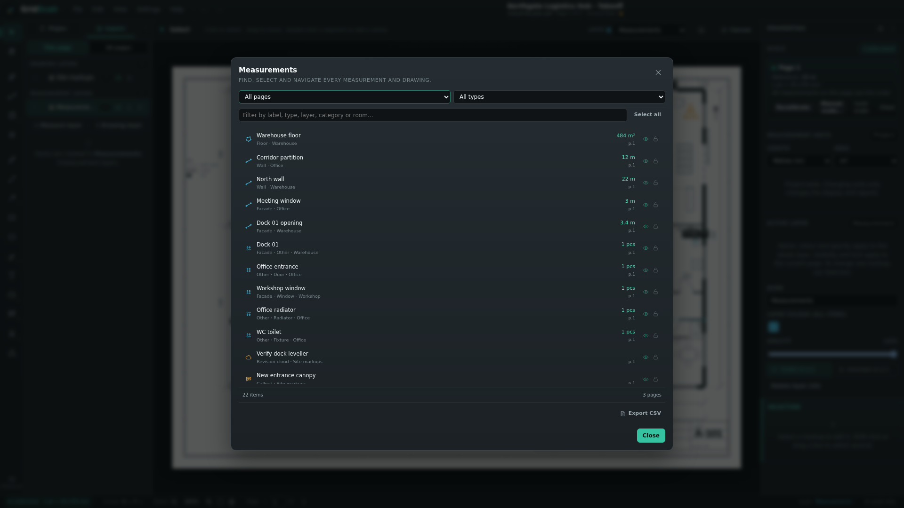
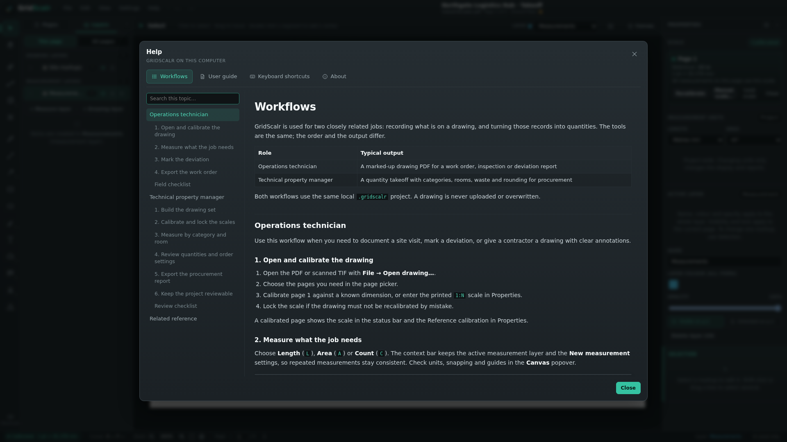

# GridScalr

GridScalr is a local-first desktop app for opening PDF drawings, calibrating their scale, measuring lengths and areas, and organising markups into separate measurement and drawing layers.


The interface is drawing-first: a compact top menu, a vertical tool rail, a Pages/Layers sidebar, the canvas, and a properties panel. GridScalr is built with Tauri, Rust, TypeScript, PDF.js, and HTML5 Canvas.

GridScalr is pre-1.0. Project files are versioned and migrated automatically, and source drawings are never modified.

See the [user guide](docs/user-guide.md) for the full workflow, the [role-based workflows](docs/workflows.md) for day-to-day use, and [shortcuts.md](docs/shortcuts.md) for the keyboard reference. The same content is available in **Help** inside the app.

## Screenshots

| Measure and annotate | Review quantities |
| --- | --- |
|  |  |
| **Drawing and measurement layers.** Tools stay on the matching layer type, with categories, rooms and deductions. | **Live procurement quantities.** Review gross, deduction, net, waste and order quantities before export. |

| Markups and layers | Drawing export |
| --- | --- |
|  |  |
| **Field annotations.** Revision clouds, callouts, stamps and text notes live on drawing layers. | **Controlled PDF output.** Choose pages, crop, visible layers, labels and an optional legend. |

| Measurements list | Workflows in the app |
| --- | --- |
|  |  |
| **Find every item.** Search, select and navigate measurements and drawings across all pages. | **Task-oriented help.** The Workflows tab explains the same tools for site work and procurement. |

## Highlights

- Open PDF plans locally with PDF.js, or scanned TIF drawings with lossless CCITT G3/G4 import.
- Keep several sheets in one project. Each PDF or TIF you open while a project is active is added after the existing pages, so a set of drawings shares one quantity take-off.
- Name pages and duplicate a sheet for a separate takeoff, for example one copy for windows and another for doors, without changing the source drawing.
- Calibrate each page against a known dimension, enter a printed 1:N scale, apply a scale to all pages, and lock a page scale against changes.
- Measure multi-segment lengths, polygon areas, and quick rectangle/ellipse areas with live unit conversion, and count doors, windows, radiators, fixtures, and other objects as pieces.
- Snap to endpoints, segment midpoints, and intersections between visible markup segments, with an adjustable screen-pixel threshold.
- Draw pen strokes, lines, arrows, rectangles, ellipses, highlights, revision clouds, callouts, stamps, revision deltas, and text notes.
- Edit text directly on the plan with multi-line input and a floating font-size, colour, and rotation strip.
- Drag measurement labels to place them manually when labels are tight, and choose **Solid** or **Dashed** line styles for length measurements.
- Switch project length and area units between mm, cm, m, in, ft and yd from Properties, Canvas, or Settings. **Smart length labels** show cm below 1 m and metres above, while quantity reports keep the selected project unit.
- Resize selected text, arrows, and shapes with selection handles, and rotate them with 15° Shift snapping.
- Rename markups in Properties (or press `F2` after selecting one) and rename the project from the top bar.
- Keep **measurement layers** and **drawing layers** separate, with visibility, locking, colour, opacity, ordering, and layer-to-layer item moves. Visibility and lock can be scoped to the active page. Expand a layer to list every item in it, then click an item to jump to its page and select it.
- Use a compact top menu for File, Edit, View, Settings, and Help. The Pages/Layers sidebar and Properties panel can be collapsed to give the drawing the full window. Long-press or right-click the Area, Cloud, Highlight, Callout, Stamp, and Arrow tools, or choose **Variants** in the context bar, for additional shapes, modes, colours, and presets.
- Choose the active target layer from the context bar, with a warning when that layer is hidden or locked.
- Hide or lock individual markups without changing their layer. Hidden items are excluded from rendering, hit-testing, and every export; locked items stay visible and exportable but cannot be moved, edited, or deleted.
- Select several markups with `Shift`/`Ctrl`/`Cmd`-click or a marquee, move them together, and edit their layer, colour, visibility, or lock state in one bulk action. Measurement selections can also share a category, room, area mode, or count type.
- Copy, cut, paste, and duplicate markups with an internal clipboard. Cross-page pastes keep their exact PDF coordinates, while same-page pastes offset by 12 pt.
- Insert PNG or JPEG images from a file or directly from the clipboard. Images are embedded, compressed, and can be background underlays or annotations.
- Use revision clouds with editable vertices, auto-sized scallops, optional translucent fill, and draggable anchored text with a leader arrow, callouts with leaders, status-coloured inspection stamps, and revision deltas.
- Use right-click context menus on the canvas, Measurements dialog, and layers for the same actions.
- Search, navigate, select, and show or hide items from the on-demand **Measurements** dialog without keeping a permanent list in the sidebar.
- Organise measurements with project-wide categories that can be renamed, reordered, and deleted; the default category is used for new measurements.
- Tag measurements with a category and a free-text room. The **New measurement** popover keeps the last category, room, count type, and area mode for the next measurement, and room names autocomplete from rooms already used in the project.
- Mark areas as additions or deductions. Deductions stay the same colour but are labelled **Deduction** on the plan and in the Measurements dialog.
- Review live quantities by category, room, and measurement type in the on-demand **Quantities** dialog, with subtotals, filters, project units including yd², waste, rounding, and order quantities.
- Save portable `.gridscalr` project files that reference the PDF rather than embedding it. Inserted images are embedded and compressed inside the project.
- Export a drawing PDF with the original pages and visible markups, a markups CSV, a project JSON, the current view as PNG, or a quantity report as CSV or print-friendly PDF.
- Undo/redo, autosave, the ten most recent files, and a bundled Markdown user guide and shortcut reference under **Help**.
- No account, cloud service, or network access required.

## Requirements

### All platforms

- Node.js 22.12 or newer (tested with Node 24)
- npm 10 or newer
- Rust 1.77.2 or newer
- Tauri 2 platform prerequisites for your operating system

### Linux (Debian/Ubuntu)

The Tauri 2 webview and build tooling need system packages. On Debian or Ubuntu:

```bash
sudo apt update
sudo apt install -y \
  build-essential curl wget file pkg-config \
  libwebkit2gtk-4.1-dev libgtk-3-dev \
  libjavascriptcoregtk-4.1-dev libsoup-3.0-dev \
  libayatana-appindicator3-dev librsvg2-dev patchelf
```

See the [Tauri prerequisites](https://v2.tauri.app/start/prerequisites/) for Windows, macOS, and other Linux distributions.

## Install and run

```bash
npm install
```

Run the desktop app:

```bash
npm run tauri dev
```

Run the frontend in a browser for UI work:

```bash
npm run dev
```

The browser build is a development fallback. It reads files through the file picker and downloads files instead of using native paths. The desktop build is the intended product.

Production builds:

```bash
npm run build            # type-check and build the Vite frontend into dist/
npm run tauri build      # compile the desktop app and platform bundles
npm run tauri build -- --no-bundle   # compile the desktop binary without installers
```

## Try the sample drawing

A reproducible three-sheet industrial drawing is included for testing:

```bash
npm run fixture
```

Then open `fixtures/industrial-plan.pdf` in GridScalr. It contains three A3 landscape sheets: a ground-floor warehouse and office plan at 1:100, a mezzanine plan at 1:50, and a site plan at 1:400. Page 1 includes a 10.00 m known dimension for calibration. The PDF is generated by `scripts/make-industrial-fixture.mjs` using `pdf-lib`.

The repository also includes `fixtures/demo-project.gridscalr`, a calibrated three-page industrial takeoff with categories, rooms, deductions and drawing annotations. It is the project used by the screenshots in this README and in the in-app workflows. Open it in the desktop app to explore every panel with realistic sample data. The older A4 sample is still available with `npm run fixture:legacy`.

## Interface

GridScalr uses a compact drawing-first layout:

- **Menu bar** – File, Edit, View, Settings, and Help.
- **Top bar** – project name, drawing and page identity, undo/redo, and the unsaved-changes dot.
- **Tool rail** – Select, pan, calibrate, measurement, and drawing tools.
- **Context bar** – the active tool, target layer, tool-specific controls, a **New measurement** popover for category and room, and a **Canvas** popover for units, smart length labels, snapping, and guides.
- **Left panel** – Pages and Layers only. It opens on Pages, and choosing a measurement or drawing tool switches it to Layers so the target layer is visible. Select and Pan leave the current tab alone. Collapse it with the chevron in the panel header, `Ctrl/Cmd+\`, or **View → Sidebar**.
- **Canvas** – the drawing, markups, selection handles, and inline editors.
- **Properties** – the page scale, measurement units, active layer, and selected item. When something is selected, **Selection** moves above the layer-wide settings and gets a distinct accent so a single markup is not confused with its layer. Quantity defaults and stamp presets are under **Settings → Project settings**.
- **Status bar** – calibration, cursor coordinates, zoom and page controls, active layer, and the local-only indicator.

The Pages/Layers sidebar and Properties panel remember their width and collapsed state between sessions. There are no permanent measurement tables: **View → Measurements…** and **View → Quantities…** open them on demand.

## Workflow

### 1. Open a drawing

Use **File → Open drawing…** (`Ctrl/Cmd+O`), drag a PDF or TIF onto the window, or choose it from the welcome screen. Password-protected PDFs prompt for a password.

**File → New project…** (`Ctrl/Cmd+N`) starts a fresh project from a drawing and asks before discarding unsaved changes. **File → Open recent** lists the ten most recent projects and drawings; the welcome screen shows the same list.

Opening a drawing with no project active creates a new project. To continue previous work, open its `.gridscalr` file instead.

Multi-page PDFs and TIFs open a page picker with a preview of every page. Clear the pages you do not need, or use **Select all** / **Clear all**, then choose **Create project** or **Add pages**. Single-page files skip the picker. The same picker is available from **Pages → right-click → Add pages…**.

With a project already open, the selected pages are **added after the existing pages** instead of replacing them. The picker shows where they will land. New sheets are added at the end. Page numbers only move when you explicitly delete a page, in which case later measurements move down with their sheets. Use the page controls in the status bar to move between sheets; the top bar names the source document and the current page.

#### TIF drawings

Scanned drawings in **TIF/TIFF** are imported as real pages with their own paper size and scale. The format is detected from the file contents, not the extension.

- 1-bit CCITT Group 3 or Group 4 scans are written into the project losslessly, without re-encoding. A 126 megapixel A1 sheet stays a few hundred kilobytes and keeps full resolution when zoomed.
- The page size comes from the scan's DPI tags: 12128 × 8072 pixels at 345 DPI becomes 893 × 594 mm. DPI gives the **paper** size, not the drawing scale, so calibrate the page against a known dimension as usual. If a scan has no resolution tags, 300 DPI is assumed and a warning is shown.
- Multi-page TIFFs become several pages. Reduced-resolution preview images inside the file are skipped. Orientation tags 1, 3, 6, and 8 are honoured.
- The converted PDF is embedded in the `.gridscalr` file, so a TIF project keeps working even if the original scan is moved. The original file path and SHA-256 are still stored for provenance.
- Limits: 400 megapixels per page and 200 MB per file. Other compressions (LZW, Deflate, JPEG-in-TIFF), tiled TIFFs, and colour or greyscale scans are rejected with a clear message.

#### Page thumbnails

The **Pages** tab shows a preview of each sheet along with its page size, calibration badge, and item count. Previews follow the sheet's aspect ratio, trim obvious white page margins, and show the source drawing rather than your markups. They are rendered lazily: only cards near the visible area of the list are rasterised, one at a time, and cached for the session. A 400-page project therefore does not render every page up front, though a very large scanned TIF can still take a moment the first time its preview is built.

Right-click an empty spot below the page cards and choose **Add pages…** to import more sheets. Page cards have their own menu with **Go to page**, **Rename page…**, **Duplicate page…**, and **Delete page…**.

Double-click a page name to rename it inline. A named page appears as its title in the card and in the top bar; unnamed pages keep the automatic **Page N** label. Page names are undoable project data.

#### Duplicate a page

Right-click a page card and choose **Duplicate page…**. The dialog can copy the page scale, the page name, and, when wanted, every markup and drawing on the source page.

The copy is appended after the last page and references the same source sheet, so the original PDF or TIF is never modified. Page-scale copies keep the calibration and lock. Page-scoped layer visibility and lock overrides follow the copy so the new sheet looks the same. Duplicating is structural and cannot be undone. Use it when the same drawing needs a separate takeoff, for example one sheet for windows and another for doors.

#### Delete a page

Right-click a page card in the **Pages** tab and choose **Delete page…**. The page's measurements, images, and page scale are deleted; measurements and page state on later pages move down one page number; earlier pages keep their numbers. Removing the last remaining page of a document drops that document reference, but never modifies the source PDF or TIF. Page deletion is structural and cannot be undone. A project always keeps at least one page.

### 2. Set the page scale

Use **Calibrate** for a reference dimension:

1. Press **K** or choose **Calibrate**.
2. Click the two ends of a dimension with a known real-world length.
3. Enter the length and choose its unit (mm, cm, m, in, ft, or yd).
4. Optionally apply the scale to every page and update existing measurements.

Alternatively, choose **Manual scale…** in Properties and enter the printed drawing ratio as `1:N`. Presets for 1:50, 1:100, 1:200, and 1:400 are provided, along with a free ratio field. Manual scale assumes the PDF page is at its physical paper size: 1 mm on paper equals N mm in the real world. It replaces a reference calibration on the affected pages and draws no reference line or calibration label.

The scale is stored per page. Recalibrating a page or setting a manual scale can either preserve existing measurement scale snapshots or update them. **Apply to all pages** copies the scale but not the lock, and skips locked pages.

Once a page has a scale, **Lock scale** prevents changing the scale through calibration, manual scale, editing, or clearing. The lock is stored in the project, is undoable, and does not affect existing measurements, exports, zoom, or page navigation. Use **Unlock scale** before changing the scale again.

Clearing a page scale does not delete the measurements. Measurements created while a page is calibrated capture a scale snapshot. If a page is later recalibrated with **Update existing measurements** disabled, those items keep their original values. Measurements with no scale are shown in PDF points (`pt` / `pt²`).

### 3. Measure

- **Length (L):** click each vertex. Press **Enter** or double-click to finish. Hold **Shift** to constrain the angle. Choose **Solid** or **Dashed** under **Line style** in Properties. Drag the value label on the plan to place it manually; right-click it to **Reset label position** or **Choose connection point…** so the leader attaches exactly where you want. Labels connect to the nearest point on the actual line or outline, including multi-segment lengths.
- **Area (A):** choose **Polygon**, **Rectangle**, or **Ellipse** in the **New measurement** popover. Polygon works click-by-click: click around the perimeter, then click the first vertex or press **Enter** to close it. Rectangle and Ellipse are quick areas drawn by dragging from one corner to the opposite corner. Hold **Shift** while dragging a quick area to make a square or circle. Areas use the unit selected in the Canvas popover. Choose **Add** or **Deduct** in the context bar before drawing, in the **New measurement** popover, or from the Area tool flyout. You can also change an existing area in Properties.
- **Count (C):** choose an object type, then click the plan. Every count is exactly `1 pcs` and carries a built-in vector symbol for a door, window, radiator, fixture, or other object.

Length and area units are project-wide. Choose mm, cm, m, in, ft, yd, or the matching area unit in **Properties → Measurement units**, **Canvas → Units**, or **Settings → Project settings**. Changing units only changes how values are displayed and reported. **Smart length labels** show metric lengths under 1 m in the selected unit and longer values in metres; quantity reports keep the selected project unit.

Measurements are added to the active measurement layer. The value shown on the plan updates as the zoom changes, while the geometry stays in PDF coordinates. New measurements use a 0.75 pt paper-space line weight and new drawing items use 1.5 pt; both can be changed from 0.25 to 8 pt in Properties, and drawing tools also expose the weight in the context bar.

When **Snap to geometry** is enabled, point placement can lock to visible markup endpoints and corners, segment midpoints, and intersections between straight markup segments. The marker names the target type (`Endpoint`, `Midpoint`, or `Intersection`). Snap applies to calibration, length, polygon and quick areas, lines, and arrows. Hidden items and hidden layers never provide snap targets; locked but visible items do. Toggle snapping in the **Canvas** popover and set the snap distance in **Settings → Project settings** from 2 to 24 screen pixels. Shift still provides the existing 45° constraint for segment tools and makes quick areas square or circular.

While the Length, Area, or Count tool is active, the context bar shows a **New measurement** button with the current category and room. The Area tool also shows an **Add / Deduct** switch directly in the context bar. Open the **New measurement** popover to change the category, room, object type, area shape, and add/deduct mode. These stay selected for the next measurement until you change them or open another project; the category starts on the project default and the room list suggests names already used in the project. The Measurements dialog shows the category, count type, deduction marker, and room, and all of them can be changed later in Properties. An empty room is allowed and is not stored.

### 4. Draw and annotate

Use the pen, line, arrow, rectangle, ellipse, highlight, revision cloud, callout, stamp, revision delta, and text tools. Drawing items are added to the active drawing layer. Drawings render below measurement layers, so measurement labels stay easy to read.

Hold **Shift** while drawing lines, arrows, rectangles, or ellipses to constrain angles or proportions.

### Revision cloud, callout, stamp, and revision delta

- **Revision cloud (`D`)** – click the corners and close on the first point or with `Enter`. Long-press or right-click the tool, or choose **Variants** in the context bar, for **Cloud / Cloud + text** and the **No fill / Blue / Orange / Green / Red** fill presets. Cloud vertices can be reshaped. Each cloud has a text box with a leader arrow; drag the round label handle or the box itself to move it independently, while moving the cloud keeps the text's relative position. Double-click the box to edit it inline with font size, colour, bold, underline, alignment, Cancel, and Done; drag the lower-right handle in the editor to resize the box.
- **Callout (`N`)** – click the object to point at, then place the text box. The inline editor opens immediately with size, colour, bold, underline, alignment, Cancel, and Done; the leader ends in a filled arrow at the target. Drag the lower-right handle in the editor to resize the text box. Right-click the tool or choose **Variants** in the context bar for leader-colour presets.
- **Stamp (`S`)** – choose a preset in the tool flyout, **Variants** popover or context bar, or use **Custom…**, then click to place. Status presets carry their status colour. Double-click or right-click a placed stamp to edit only that stamp; the preset list is unchanged.
- **Arrow (`U`)** – right-click the tool or choose **Variants** in the context bar for single/double arrowheads and colour presets; the same options are in Properties.
- **Revision delta (`Y`)** – enter the revision in the context bar and click to place the triangle. An optional date can be set as its label in Properties.

Stamp presets are stored per project under **Settings → Project settings → Stamps**. App defaults for new projects are stored locally and can be edited in the same dialog.

### Highlight modes

The Highlight tool has **Pen**, **Rectangle**, and **Polygon** modes in its tool flyout and context bar. Rectangle and Polygon create translucent area highlights; Pen keeps the original freehand highlighter. Existing freehand highlights are unchanged.

### Text notes

To add a text note, choose the Text tool and click the plan. The inline editor accepts multiple lines:

- `Enter` commits the text.
- `Shift+Enter` inserts a line break.
- `Esc` cancels the edit.
- Clicking outside the editor also commits.

The floating strip beside the editor sets font size (0.5–300 pt), colour, rotation, bold, underline, and left/center/right alignment without leaving the canvas. The canvas and PDF export use the same regular or bold weight. Double-click an existing text note with the Select or Text tool to reopen it.

Measurement labels are single-line editable. Double-click a measurement label, type a name, and press `Enter`; the computed length, perimeter, area, or calibration value remains read-only beside it. Double-clicking the calibration label reopens the calibration dialog with its current value instead of opening the label editor.

Labels use compact paper-space sizes. On the canvas their on-screen size is capped at high zoom so they do not cover the room you are drawing; PDF export keeps the true paper-space size. Large rooms keep the full label centered inside the area. Smaller rooms shrink the label down to a minimum readable paper size. If it still does not fit, the label moves outside the area and a thin leader line connects it to the room. The same paper-space placement is used by canvas rendering, label hit-testing, inline editing, and PDF export.

Renaming in Properties changes the list/export label without changing the drawing text: select one item and edit **Label**, or press `F2` to focus the field. Renaming a text item changes its list/export label, not its text body. The project name in the top bar also supports double-click rename.

### 5. Add images

Use **File → Import image…** (or the context bar) to choose a PNG or JPEG, or press `Ctrl/Cmd+V` when the clipboard contains an image. Clipboard images take precedence over pasted markups; when the clipboard has no image, `Ctrl/Cmd+V` pastes markups as before.

Images are embedded in the project, so the `.gridscalr` file stays portable. Each image is limited to 20 MB and 4000 px on its longest side. Images larger than 4000 px are proportionally downscaled; an image that is still larger than 20 MB after encoding is rejected. PNG transparency is preserved; JPEG files are re-encoded at quality 0.85 when they need resizing or exceed the size limit.

A new image is placed on the current page and on a visible, unlocked drawing layer. If the image would be larger than the page it is scaled proportionally to fit inside the page, so the page width limits wide images; otherwise it keeps its natural size at 96 DPI (1 px = 0.75 pt). Both cases centre the image on the page.

The default mode is **Background**: the image sits above the PDF drawing and below every markup and measurement. Switch to **Annotation** in Properties to draw the image in normal layer order. Properties also expose opacity, rotation, layer, visibility, lock state, duplicate, and delete. Drag a corner handle to resize proportionally, or a side handle to change one dimension.

Images follow the same visibility and locking rules as other items: hidden images and layers never render, hit-test, or export, and locked images stay visible and exportable but cannot be edited. Images are only allowed on drawing layers.

### 6. Resize and rotate

Select a text note, arrow, rectangle, ellipse, or other drawing item to reveal its handles:

- Drag a corner or edge handle to resize. Text corner handles scale the font size.
- Drag the round handle above the selection to rotate. Hold **Shift** to snap to 15° increments.
- Line, arrow, pen, and highlight rotation is baked into their points; text, rectangles, and ellipses store a rotation angle.
- Measurement geometry stays vertex-editable from its points rather than being box-scaled, so its computed values remain trustworthy. Rectangle and ellipse quick areas expose their two opposite defining points and have no rotation handle.

Each drag or inline edit is one undo step.

### 7. Organise layers

Open the **Layers** tab in the left panel. The **This page / All pages** switch controls the scope.

- **This page** lists layers created on the current page or used by at least one item on it.
- **All pages** lists every layer and edits the project-wide defaults.
- Show or hide a layer. In **This page** scope this applies only to the active page; in **All pages** it changes the default and clears page overrides.
- Lock a layer. In **This page** scope this blocks editing only on the active page; in **All pages** it changes the default and clears page overrides.
- Change layer colour and opacity.
- Double-click anywhere on a layer row to rename it inline.
- Drag layers within their group to reorder them.
- Expand a layer with its chevron to list the items on the current page, or every item in **All pages** scope, newest first.
- Click an item to jump to its page and select it, or `Shift`/`Ctrl`/`Cmd`-click to add it to the current selection.
- Right-click a layer or an item for the layer and item menus. The panel never shows the WebView's browser menu.
- Add new measurement or drawing layers on the current page.
- Move the selected item to another layer from Properties or the right-click menu.

A page with no layers shows **No layers on Page N yet** and the create-layer buttons. Layers keep their name, colour and order across pages; only visibility, lock and the item list are page-scoped. Page-scoped visibility is used by hit-testing, snapping, quantities, Markups CSV and all PDF exports. Use **File → Export → Drawing PDF…** to see the same rule applied per exported page.

The **Layer** picker in the context bar shows which layer will receive new items. If the active layer is hidden or locked on the current page, the picker shows a warning. Picking a drawing or measurement tool automatically switches to a visible, unlocked layer of the matching kind; if none exists, GridScalr creates one on the current page instead of silently drawing into a layer you cannot see or edit.

Locking a layer leaves the layer's own settings editable, but prevents changing its markup content on that page. Measurements and drawings always live in their matching layer type.

### 8. Select, bulk edit, and reuse

Use the Select tool to click one markup, `Shift`/`Ctrl`/`Cmd`-click to add or remove markups, or drag on empty canvas to marquee-select everything inside the box. Selected items move together as a group. Group resize and rotation are intentionally not supported.

Open **View → Measurements…** (`Ctrl/Cmd+Shift+M`) to search and navigate items. `Shift`/`Ctrl`/`Cmd`-click rows to build a selection, use **Select all** for the current filter, and use each row's eye and lock buttons for per-item visibility and locking. Right-click a row for copy, cut, duplicate, hide/show, lock/unlock, move to layer, and delete. Click a row to jump to its page and select it.

With more than one item selected, Properties offers bulk actions for:

- Moving all selected items of one kind to another layer.
- Setting a common colour.
- Hiding or showing the selection.
- Locking or unlocking the selection.
- Duplicating or deleting the selection.

When every selected item is a measurement, Properties also offers:

- Setting one category or one room for the selection. Leave the room field empty and choose **Apply** to clear the rooms.
- Setting `Add` or `Deduct` when every selected measurement is an area.
- Setting one object type when every selected measurement is a count.

Category and room are not offered for selections that mix measurements and drawings. `areaMode` and `countType` are only offered when the whole selection has that measurement kind. Locked measurements are skipped by bulk edits and reported in a toast. Every bulk action is a single undo step, even across layers. Mixed measurement-and-drawing selections can share colour, visibility, lock, duplicate, and delete actions, but cannot be moved to one layer because layers are type-specific.

The internal clipboard is in-memory only and is not shared with the operating system. `Ctrl/Cmd+C`, `X`, and `V` copy, cut, and paste markups. Pasting on another page keeps the original PDF coordinates; pasting on the same page offsets the copy by 12 pt. Duplicate uses the same 12 pt offset.

Locked items remain visible and exportable, but group moves, nudges, deletes, resize/rotate, and property edits skip them. Hidden items are not rendered, cannot be hit-tested on the canvas, and are excluded from PDF, PNG, and CSV exports. Both states are stored per item, while layer visibility and locking still take precedence.

### 9. Quantities and procurement reports

Open **View → Quantities…** (`Ctrl/Cmd+Alt+Q`) to summarise the measurements that are currently included by the filters. Each row covers one category, room, and measurement type, and shows gross, deduction, net, waste, order quantity, and the number of items. Category and room headers provide subtotals, and a total row summarises each measurement type.

- Filter by current or all pages, one category, a room substring, or any combination of measurement layers.
- Hidden items and hidden layers are excluded by default and reported in a note. Locked items are included. Enable **Include hidden items and layers** to allow counting them in the live dialog.
- Area deductions are subtracted inside the same category and room only. If a deduction exceeds its gross area, the net is clamped to zero and the row shows a warning. Length and count rows are never reduced by area deductions.
- Length and area values use the project units, including yd², and counts always use pcs.
- Measurements without a scale are excluded and counted in a note. Calibrate their page to include them.
- Quantities are derived from the current items every time the data changes and are never stored in the project file.

Waste and rounding turn net quantities into order quantities:

- Set project defaults under **Settings → Project settings → Quantities**. Waste is a percentage of net, from 0 to 100. A rounding step of 0 means no rounding.
- A category can override either value in **Settings → Manage categories…**. Leave a field empty to inherit the project default. Both settings are stored in the project file and changes are undoable.
- Rounding always goes up. Counts always round to whole pcs even when the project uses a different step. Order quantity is never lower than net.
- The row shows net, waste quantity, and order quantity separately. The waste percentage is part of the waste label.

The **CSV** and **PDF** buttons in the Quantities dialog, and **File → Export → Quantities to CSV / Quantity report (PDF)**, create the procurement report. Reports cover every page and every category, excluding hidden items and hidden layers, and include locked items. The dialog filters only affect the on-screen summary, not the exported report. Reports are generated on demand and never stored in the project file.

The CSV report uses UTF-8 with BOM, comma delimiters, CRLF line endings, point decimals, three decimals for length and area, and whole numbers for count quantities. It contains one row per category, room, and quantity type, followed by two blank lines and project metadata. `hidden_excluded` is `true` only when at least one hidden measurement was actually left out. The PDF report is A4 portrait with 48 pt margins, category sections, subtotals, totals, repeated table headers, page numbers, a hidden-item notice, and a warning for clamped deductions.

### 10. Save and export

- **Save project** (`Ctrl/Cmd+S`) writes a `.gridscalr` JSON file.
- **Save as** (`Ctrl/Cmd+Shift+S`) writes to a new path.
- **File → Export → Drawing PDF…** opens an export dialog. Choose whole page(s) or a selected area, current page / all pages / a page range, which visible layers to include, labels, the calibration line, and an optional legend. Background images are drawn above the source page and below markups; annotation images follow layer order. The export writes `<project>-markups.pdf`; the source PDF is never modified, and the save flow refuses to overwrite it.
  - **Selected area** enters a one-off crop mode on the canvas. Drag a rectangle, adjust it with the handles, then press `Enter` or **Use area**; `Esc` cancels. The crop is stored relative to the page and applied to every selected page, so pages with different sizes or rotation stay aligned. It clips PDF content, markups, labels, and the calibration line.
  - A layer hidden on every page is listed but disabled. A layer hidden on one page is skipped there and still exported on pages where it is visible. Hidden items are always excluded and locked items are exported.
  - **Legend** adds a separate A4 page at the end of the export. It is never drawn over the drawing and is not affected by the crop.
- **File → Export → Markups to CSV** exports page, type, layer, label, computed value, unit, details, and PDF-coordinate vertices.
- **File → Export → Quantities to CSV** writes `<project>-quantities.csv` for spreadsheets and procurement tools.
- **File → Export → Quantity report (PDF)** writes `<project>-quantities.pdf`, a print-friendly procurement report separate from the flattened drawing export.
- **File → Export → Project to JSON** exports the project payload without requiring a `.gridscalr` extension.
- **File → Export → View as PNG** exports the rendered page and markup layers at the current view.

Closing the window with the title-bar X, **File → Quit** (`Ctrl/Cmd+Q`), or Alt+F4 asks before discarding unsaved changes. Discarding also removes the recovery snapshot.

All export formats exclude hidden items and hidden layers. Locked items are still exported. Selection handles, hover states, and vertex markers are never exported. Every save and export refuses a destination that matches any source document in the project, including a second PDF or TIF in a multi-document project, so the source files are never overwritten. Quantity reports always cover all pages and all categories; their rows use the same visibility and locking rules as the canvas. The drawing PDF export uses the source file's page sizes, rotation, and crop information, so markups and images stay aligned on rotated or cropped pages. Measurement and calibration labels are drawn at a compact paper-space size so they annotate rather than cover the source drawing. Text is embedded with a bundled Liberation Sans font. Images are embedded as PNG or JPEG objects with their opacity and rotation. Encrypted source PDFs cannot be flattened without their owner password and produce a clear warning. The PNG export excludes selection handles, hover states, vertex markers, and other interaction overlays.

## Help

The **Help** menu opens a bundled help dialog:

- **Workflows** gives task-oriented guides for operations technicians and technical property managers.
- **User guide** (`F1`) renders [`docs/user-guide.md`](docs/user-guide.md).
- **Keyboard shortcuts** (`?`) renders [`docs/shortcuts.md`](docs/shortcuts.md).
- **About GridScalr** shows the installed version from `package.json` and the current project schema.

The Markdown is bundled by Vite at build time, so help works offline and does not read files at runtime. The app applies a safe Markdown subset, escapes raw HTML, and resolves help screenshots from `docs/screenshots/` through Vite asset URLs. Help includes a topic search and a table of contents, and screenshots can be opened at full size.

## Project files

A `.gridscalr` file is UTF-8 JSON. It contains one or more document references, per-page calibrations, settings, layers, markup items, and embedded images. Referenced PDFs are **not** embedded; a TIF's converted PDF is, because the scan cannot be read directly at render time.

Schema version 2 added optional per-item `visible` and `locked` flags. Schema version 3 added project categories, category/room fields on measurements, area add/subtract, count items, and quantity settings. Schema version 4 added quick-area shapes, manual 1:N scales, per-page scale locks, and the snap distance setting. Schema version 5 added embedded image assets and image items. Schema version 6 replaces the single `document` reference with a `documents` array and adds embedded PDFs for TIF documents.

Version 1–5 projects load normally and are migrated to schema 11: the old `document` entry becomes the first element of `documents`, and page keys keep their numbers. Version 6 projects keep each document's pages in order. Schema 7 adds optional removed-page lists (`excludedPages`) so individual pages can be deleted without rewriting the source files. Schema 8 adds project stamp presets, cloud scallop/box sizing, and the cloud, callout, stamp, revision-delta, and area-highlight markup kinds. Schema 9 adds optional manual measurement-label offsets, label connection points, and dashed length measurements. Schema 10 adds the optional `smartLengthUnits` setting; missing values default to on. Schema 11 adds page names, page-scoped layer visibility and lock overrides, layer home pages, and copied-page document references. Text, callout, and cloud items also store optional `textBold`, `textUnderline`, and `textAlign` fields; missing values mean regular weight, no underline, and the kind's default alignment. Page state beyond the last included page is dropped. Measurements are assigned to the `Other` category when needed, areas default to `add` and `polygon`, and missing quantity and snap settings get safe defaults. Reference calibrations without `source` become `reference`; invalid manual scales and locks without a scale are dropped. Quick rectangle/ellipse data with extra points is trimmed to the two defining points, and unknown shapes fall back to polygon. A category may omit `wastePercent` and `roundingStep` to inherit the project defaults. Image items without a valid embedded asset or a valid two-corner geometry are dropped; old projects start with an empty `assets` map.

```json
{
  "schemaVersion": 11,
  "name": "Level 01",
  "documents": [
    {
      "id": "doc_8f21c3",
      "kind": "pdf",
      "name": "Level 01.pdf",
      "path": "/home/ana/drawings/Level 01.pdf",
      "relativePath": "../drawings/Level 01.pdf",
      "sha256": "7ef5cc05...",
      "pageCount": 12,
      "sizeBytes": 4839201
    },
    {
      "id": "doc_tif_4b77de",
      "kind": "tiff",
      "name": "Site plan.tif",
      "path": "/home/ana/drawings/Site plan.tif",
      "relativePath": "../drawings/Site plan.tif",
      "sha256": "1c9ad40e...",
      "pageCount": 1,
      "sizeBytes": 708779,
      "embeddedPdf": "JVBERi0xLjQK...",
      "source": { "format": "tiff", "dpi": [400, 400], "originalName": "Site plan.tif" }
    }
  ],
  "settings": {
    "lengthUnit": "mm",
    "areaUnit": "m2",
    "smartLengthUnits": true,
    "showGrid": false,
    "showCalibration": true,
    "snapToGeometry": true,
    "snapTolerancePx": 8,
    "stampPresets": ["APPROVED", "NOT APPROVED", "FOR INFORMATION"],
    "quantity": {
      "defaultCategoryId": "cat_...",
      "wastePercent": 0,
      "roundingStep": 0
    }
  },
  "categories": [
    { "id": "cat_...", "name": "Floor", "wastePercent": 10, "roundingStep": 0.5 },
    { "id": "cat_...", "name": "Other" }
  ],
  "assets": {
    "img_...": {
      "id": "img_...",
      "name": "Site photo.jpg",
      "mime": "image/jpeg",
      "width": 1600,
      "height": 900,
      "byteSize": 184320,
      "data": "data:image/jpeg;base64,/9j/4AAQSk..."
    }
  },
  "pages": {
    "1": {
      "name": "Ground floor",
      "calibration": {
        "id": "cal_...",
        "source": "reference",
        "p1": { "x": 120, "y": 460 },
        "p2": { "x": 420, "y": 460 },
        "knownLength": 10,
        "unit": "m",
        "pointsPerMeter": 30,
        "createdAt": "2026-10-20T18:41:05.215Z"
      },
      "scaleLocked": true
    },
    "2": {
      "calibration": {
        "id": "cal_...",
        "source": "manual",
        "ratio": 100,
        "pointsPerMeter": 28.34645669,
        "createdAt": "2026-10-20T18:42:11.031Z"
      }
    }
  },
  "layers": [
    {
      "id": "layer_...",
      "name": "Measurements",
      "kind": "measure",
      "visible": true,
      "locked": false,
      "opacity": 1,
      "color": "#4cc9f0",
      "homePage": 1,
      "pageState": {
        "2": { "visible": false }
      },
      "items": []
    }
  ],
  "activeLayerId": "layer_..."
}
```

On desktop, GridScalr tries each referenced PDF's stored absolute path first, then a path relative to the project file. If a PDF is missing, it asks you to locate it. If the file exists but its SHA-256 differs from the stored checksum, GridScalr warns before continuing. TIF documents need no external file: their converted PDF is embedded, and the stored path and checksum only record where the original scan came from. The project file is designed to stay useful when a project folder is moved without the drawings it references.

Layer IDs, item IDs, document IDs, calibration data, quick-area shapes, scale locks, timestamps, style values, text styling, category IDs, per-item visibility/lock flags, snap settings, stamp presets, annotation text and layouts, and embedded image assets are preserved in the file. Reading validates the schema, normalizes older projects, repairs category references, drops page state beyond the last included page, and drops items that do not match their layer kind or reference a missing image.

## Keyboard shortcuts

| Action | Shortcut |
| --- | --- |
| Select / Pan | `V` / `H` |
| Calibrate | `K` |
| Length / Area / Count | `L` / `A` / `C` |
| Pen / Line / Arrow | `P` / `I` / `U` |
| Rectangle / Ellipse | `R` / `O` |
| Highlight / Text note | `G` / `T` |
| Revision cloud / Callout | `D` / `N` |
| Stamp / Revision delta | `S` / `Y` |
| Finish current shape | `Enter` or double-click |
| Cancel draft / clear selection / return to Select | `Esc` |
| Delete selection or remove last area/length point | `Delete` or `Backspace` |
| Add/remove markups from selection | `Shift`/`Ctrl`/`Cmd` + click, or marquee drag |
| Copy / cut / paste markups | `Ctrl/Cmd+C` / `Ctrl/Cmd+X` / `Ctrl/Cmd+V` |
| Duplicate selection | `Ctrl/Cmd+D` |
| Paste an image from the clipboard | `Ctrl/Cmd+V` when the clipboard contains an image |
| Rename selected markup label | `F2` |
| Edit selected text or measurement label | Double-click with Select or Text tool |
| Rename project | Double-click the project name in the top bar |
| Nudge selected item | Arrow keys |
| Nudge by 10 screen pixels | `Shift` + Arrow keys |
| Pan temporarily | Hold `Space` and drag |
| Zoom | `Ctrl/Cmd` + mouse wheel, `Ctrl/Cmd` + `+` / `-` |
| Fit page / Actual size | `Ctrl/Cmd+0` / `Ctrl/Cmd+1` |
| Previous / next page | `PageUp` / `PageDown` |
| Toggle sidebar / Properties | `Ctrl/Cmd+\` / `Ctrl/Cmd+Shift+\` |
| Measurements / Quantities | `Ctrl/Cmd+Shift+M` / `Ctrl/Cmd+Alt+Q` |
| Undo / Redo | `Ctrl/Cmd+Z` / `Ctrl/Cmd+Shift+Z` or `Ctrl/Cmd+Y` |
| New project | `Ctrl/Cmd+N` |
| Save / Save as | `Ctrl/Cmd+S` / `Ctrl/Cmd+Shift+S` |
| Open drawing / Open project | `Ctrl/Cmd+O` / `Ctrl/Cmd+Shift+O` |
| Export menu | `Ctrl/Cmd+E` |
| Project settings | `Ctrl/Cmd+,` |
| Quit | `Ctrl/Cmd+Q` |
| User guide / Shortcut reference | `F1` / `?` |

## Architecture

```text
src/
  app/App.ts             application wiring, file flows, shortcuts
  app/exportFlows.ts     CSV, PDF, PNG and JSON export orchestration
  canvas/CanvasView.ts   canvas rendering, hit testing, inline editing, resize/rotate, PNG compositing
  canvas/geometry.ts     crop, handle, rotation and colour helpers
  canvas/selectionHandles.ts selection and rotation handles
  canvas/annotationDraw.ts callout, stamp, cloud-label and endpoint drawing
  canvas/crop.ts         export crop mode, overlay and toolbar
  canvas/editors.ts      inline text and measurement-label editors
  model/                 project types, geometry, quick-area shapes, snap, text layout, labels, units, calibration, layers, metrics, quantities, selection, clipboard, revision-cloud geometry, annotation layouts, stamp presets
  model/commands.ts      shared item visibility, locking, deletion, movement and style commands
  state/store.ts         immutable project snapshots, undo/redo, multi-selection UI state, autosave
  state/autosave.ts      IndexedDB recovery store with legacy localStorage fallback
  pdf/pdfRenderer.ts     PDF.js document lifecycle and progressive crop rendering
  pdf/thumbnails.ts      lazily rendered, cached page previews for the Pages panel
  pdf/pdfExport.ts       flattened vector PDF export with embedded text fonts
  pdf/reportPdf.ts       print-friendly A4 quantity report built with pdf-lib
  report/reportModel.ts  pure quantity report model shared by CSV and PDF
  report/csv.ts          quantity CSV serialization with BOM and metadata
  report/markupCsv.ts    visible markup CSV serialization
  ui/                    top menu, sidebar, page/layer lists, context bar, inspector, dialogs, status bar
  styles/help.css        help dialog, search, TOC and image lightbox
  styles/popovers.css    tool flyouts, Canvas options and measurement options
  ui/canvasOptions.ts    units, snapping, grid and scale-line popover
  ui/contextBar.ts       tool-specific context bar and target layer controls
  ui/inspector.ts        Properties scale and active-layer sections
  ui/measureOptions.ts   category, room, count type and area options popover
  ui/selectionInspector.ts single and multi-selection Properties
  ui/selectionMenu.ts    shared item context menu for canvas, layers and Measurements
  ui/itemIcon.ts         icon lookup shared by Layers and Measurements
  ui/shortcuts.json      single source for tool and application shortcuts
  ui/shortcuts.ts        typed shortcut maps and platform formatting
  ui/statusBar.ts        calibration, cursor and layer status
  ui/welcome.ts          empty-project welcome screen and recent files
  ui/pageImportDialog.ts page picker with previews for PDF/TIF import
  ui/topMenu.ts          File/Edit/View/Settings/Help menu model and keyboard navigation
  ui/helpDialog.ts       bundled Markdown help, search, table of contents and image lightbox
  ui/settingsDialog.ts   project-wide units, snapping, quantity defaults
  model/cloud.ts         revision-cloud bezier geometry
  model/annotations.ts   callout, stamp, delta, and cloud-label layout
  model/stamps.ts        stamp preset normalization and defaults
  io/stampDefaults.ts    global stamp presets for new projects
  help/markdown.ts       safe Markdown renderer for bundled help
  help/content.ts        Vite raw imports of the user guide, workflows and shortcuts
  help/images.ts         Vite asset URLs for bundled help screenshots
  io/projectFile.ts      project schema normalization, serialization, relative paths, source-path protection
  io/platform.ts         Tauri/browser file I/O, dialogs, recents, SHA-256 entry point
  io/writeGuard.ts       conservative source-path matching for every save and export
  io/sha256.ts           dependency-free SHA-256 fallback
src-tauri/
  src/commands.rs        atomic text/binary writes, reads, and path checks
  src/lib.rs             Tauri command registration
  capabilities/          desktop permissions
docs/user-guide.md       in-app user guide and workflow reference
docs/workflows.md        role-based guides for operations and property management
docs/shortcuts.md        in-app keyboard reference
docs/screenshots/        versioned screenshots and capture manifest
tests/                   geometry, quick areas, snap, text layout, calibration, layers, quantities, selection/clipboard, hit-testing, project files, PDF export, page thumbnails, SHA-256, Markdown, help images, demo project, canvas geometry and autosave
scripts/plan-geometry.mjs shared geometry for the industrial sample set
scripts/make-industrial-fixture.mjs reproducible three-sheet industrial PDF generator
scripts/make-fixture.mjs legacy A4 sample generator
scripts/make-demo-project.mjs deterministic documentation project
scripts/ui-harness.mjs shared Playwright server and demo-project helpers
scripts/smoke-ui.mjs Playwright smoke test for open, measure, help and save
scripts/canvas-regression.mjs pointer-level canvas gesture regressions
scripts/benchmark-history.mjs synthetic undo/history benchmark with 2,000+ items
scripts/capture-docs.mjs Playwright screenshot capture for the documentation
scripts/check-docs.mjs link, image, anchor and schema checks
scripts/docs-fingerprint.mjs UI fingerprint for screenshot staleness checks
```

Key design choices:

- **Local first.** PDF bytes are read only when needed. Project data autosaves to a local IndexedDB recovery store; no data leaves the machine. A localStorage fallback is used only when the browser disables IndexedDB.
- **Markup layers are app-level.** They are not PDF optional-content groups, and GridScalr never rewrites the source PDF when saving a project. The drawing PDF export writes a new file and leaves the original untouched.
- **Coordinate stability.** Markup points are stored in PDF points, not screen pixels. Zooming, panning, and window resizing do not change measurements; export maps them through PDF.js viewports so page rotation and crop boxes are respected.
- **Progressive rendering.** Only the visible crop of a page is rendered at device resolution. A new render cancels the previous incomplete one.
- **On-demand page thumbnails.** The Pages panel rasterises only the cards near the viewport, one page at a time, at a capped pixel size, and caches the result. Thumbnail work yields while the main canvas renders, so page previews never block drawing.
- **Snapshot history.** Store mutations clone the project before applying changes, giving undo/redo without mutable shared state.
- **Native I/O, portable format.** Rust commands perform atomic writes; the project file records both an absolute and relative PDF path plus a SHA-256 checksum.
- **Tauri prototype freezing stays off.** `@pdf-lib/fontkit` assigns to a prototype property inherited from `Object.prototype`; Tauri's `freezePrototype` makes that assignment throw and prevents the window from starting. GridScalr does not execute untrusted JavaScript, so this hardening is left disabled.

## Development

```bash
npm test          # Vitest model and project-format tests
npm run build     # tsc --noEmit + Vite production build
npm run format:check # Prettier check for TypeScript, CSS and test scripts
npm run check:docs  # links, images, anchors, tools, schema and screenshot freshness
# GRIDSCALR_DOCS_STRICT=1 makes stale screenshots fail instead of warn
npx playwright install chromium  # one-time browser install for test:ui and docs:capture
npm run test:ui     # Playwright smoke: open, measure, help and save
npm run test:canvas # Playwright canvas gestures: draw, resize, rotate, text, crop
npm run bench:history # synthetic undo/history benchmark (2,000 items by default)
npm run docs:capture # regenerate docs/screenshots from the demo project
cargo check       # inside src-tauri, or: cargo check --manifest-path src-tauri/Cargo.toml
```

The frontend uses TypeScript with no UI framework. PDF.js is bundled with its worker. Icons are inline SVG. The CSS implements the dark theme, responsive panel layout, focus states, and reduced-motion handling. Help content is imported from `docs/*.md` with Vite `?raw` and rendered by a small safe Markdown parser. Help screenshots are bundled with Vite `?url` assets, so the help dialog stays offline.

The documentation pipeline is reproducible:

- `fixtures/demo-project.gridscalr` is generated by `npm run docs:demo` or `scripts/make-demo-project.mjs`.
- `npm run docs:capture` starts Vite, restores the demo project in the browser fallback, and writes `docs/screenshots/` plus `manifest.json` with Playwright.
- `npm run check:docs` fails when a documented link, anchor or image is missing, when a tool is not described in the user guide, when the schema reference is stale, or when a screenshot is not listed and referenced.

When a visible screen or workflow changes, recapture the affected screenshots. Do not publish screenshots that show a previous interface.

When adding a project field, update `src/model/types.ts`, the parser in `src/io/projectFile.ts`, and serialization tests. When adding a layer or item operation, put lock and visibility semantics in `src/model/commands.ts` and keep the App, canvas and dialog call sites aligned. Every GUI or feature change must also update `docs/user-guide.md`, and shortcut changes must update `docs/shortcuts.md` and the table above.

## Browser fallback notes

Running `npm run dev` without Tauri is useful for layout and interaction testing, but it cannot use native file paths. In that mode:

- Opening and saving use the hidden file input and browser downloads.
- Recent files are desktop-only.
- Reopening a project asks for the PDF again because browsers do not expose persistent local paths.
- File-system checksum verification still works.

## Known limitations

- Markup layers are stored in the project, not written into the PDF's own annotation or optional-content structures. The drawing PDF export bakes visible markups into page content as vectors.
- Text notes do not wrap inside a fixed text box; use `Shift+Enter` for an explicit line break.
- There is no cloud sync, collaboration, or automatic update service.
- Form fields and embedded PDF annotations are not editable.
- Measurements use the active page's scale; a manual scale or reference calibration can be applied to all pages with the same drawing scale.
- Snapping targets markup endpoints, midpoints, and intersections only. Snapping directly to the PDF drawing's vector geometry is a separate future feature.
- Rectangle and ellipse quick areas can be moved and reshaped from their two opposite points but cannot be rotated.
- Images support PNG and JPEG only. They are embedded in the project and count toward its file size; there is no external `assets/` folder. Image cropping, filters, and colour correction are not available.
- TIF import supports 1-bit CCITT G3/G4 scans only. Colour, greyscale, LZW/Deflate-compressed, tiled, and JPEG-in-TIFF files are rejected with a message. TIF pages can be deleted like any other page but cannot be rearranged, and closing a TIF drawing's original file has no effect because the converted PDF is embedded.
- New sheets are always added after the existing pages. A page can be deleted explicitly: its measurements and page scale are removed, later measurements move down one page number, and the operation is not undoable. Pages cannot be inserted or reordered.
- Count types are fixed to door, window, radiator, fixture, and other. Custom count types and count quantities greater than one piece per object are not supported yet.
- XLSX is not supported; quantity reports are available as CSV and PDF. CSV uses comma separators because that is the documented interchange format, so Excel on a locale with another list separator may need an import step.
