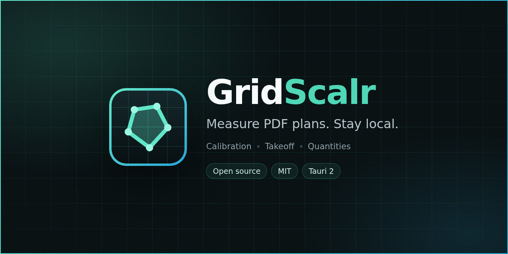

# GridScalr

GridScalr is a local-first desktop app for opening PDF and TIF drawings,
calibrating their scale, measuring lengths and areas, and turning the result into
procurement quantities. Everything stays on your machine: no account, no cloud,
no telemetry.

**Website:** [majorjohndoe.github.io/gridscalr](https://majorjohndoe.github.io/gridscalr/) —
a bilingual landing page and feature tour with screenshots, requirements and
download links. The download button points to the current public release.

[](https://github.com/MajorJohnDoe/gridscalr/actions/workflows/ci.yml)
[](https://github.com/MajorJohnDoe/gridscalr/releases/latest)
[](LICENSE)
[](#requirements)


## Download

Grab the newest build from [Releases](https://github.com/MajorJohnDoe/gridscalr/releases/latest):

| File | Use |
| --- | --- |
| `GridScalr_<version>_x64-setup.exe` | NSIS installer, recommended on Windows |
| `GridScalr_<version>_x64_en-US.msi` | MSI for managed Windows machines |
| `gridscalr.exe` | Portable executable, no installation |
| `GridScalr_<version>_universal.dmg` | macOS disk image, Intel and Apple Silicon |
| `GridScalr_<version>_universal.app.zip` | Portable macOS app bundle |
| `GridScalr_<version>_amd64.AppImage` | Portable Linux x86_64 build |
| `GridScalr_<version>_amd64.deb` | Debian and Ubuntu package |
| `gridscalr_<version>_amd64.tar.gz` | Linux x86_64 binary archive |
| `SHA256SUMS.txt` | Checksums for every downloaded file |

The builds are not code-signed or notarized. Read [Windows SmartScreen](#windows-smartscreen)
and [macOS Gatekeeper](#macos-gatekeeper) before the first launch.

## What it does

- Open PDF plans locally with PDF.js, or scanned TIF drawings with lossless
  CCITT G3/G4 import.
- Open a project by double-clicking `.gridscalr` in Explorer or Finder in the
  installed builds, hand a drawing to an already running window, and keep the
  window size, position and maximised state between sessions.
- Keep several sheets in one project. Every new drawing appends pages after the
  existing ones, so a set of plans shares one takeoff. Import pages from another
  project with a thumbnail picker, a preflight report and page-scoped layers,
  keep optional source revision provenance, and undo the whole import as one
  step.
- Validate every project before saving and after opening. A damaged file opens
  with a load report and a **Project doctor** that lists issues by severity and
  entity, offers read-only open, explicit duplicate-ID, dangling-reference and
  stale-OCR repairs, saves a repaired copy and exports path-free diagnostics.
- Calibrate each page against a known dimension, enter a printed 1:N scale, apply
  it to all pages, and lock a page scale against changes.
- Measure multi-segment lengths, radius, diameter, three-point arcs, angles,
  slopes, polygon volumes from area and depth, polygon areas, quick rectangles
  and ellipses, and count doors, windows, radiators, fixtures and custom object
  types as pieces, with a separate quantity row per type.
- Snap to endpoints, midpoints and intersections between visible markup
  segments, with an adjustable screen-pixel threshold.
- Draw pen strokes, lines, arrows, rectangles, ellipses, highlights, revision
  clouds, callouts, stamps, revision deltas and text notes.
- Place searchable facility symbols from a built-in library of 52 original
  classic sign plates, rotate them, resize them by dragging a corner and give
  them an inspection status.
- Draw operation cards with 156 original stroke-only schematic symbols for
  instruments, valves, pumps, heat exchangers, ventilation, heating, district
  heating, cooling, domestic water, control and general notation. Add a free-text
  tag that follows the symbol, and filter the library between **Signs**,
  **Schematic** and **Special**.
- Format a selected word inside a text box with bold, italic, underline, size and
  colour while the rest of the box keeps its own style. Manage project line types
  and fit an overflowing schematic drawing back inside the sheet area.
- Organise everything in separate measurement and drawing layers with per-item
  visibility and locks, multi-select, bulk edits and a docked Markups table with
  saved views, filters and grouping.
- Review gross, deduction, net, waste and order quantities per category,
  room and page, then export a CSV, an Excel workbook or a print-friendly PDF
  report. Add optional facility, client, project number, revision, author and
  notes plus a report logo in Project settings.
- Switch between English and Swedish in Preferences. The interface, reports,
  XLSX/CSV headings and number formatting follow the selected language, and the
  Swedish help includes a Swedish quick start.
- Choose the default medium gray theme, Light, Dark Gray, Dark Jade or Navy, or
  follow the operating system light/dark preference. Themes change interface
  chrome and the canvas surround only; drawing content and PDF exports keep
  their colours.
- Open a synchronized reference pane showing the same page, a saved revision or
  a raw PDF drawing beside the primary canvas. Pan, zoom and page changes stay in
  step.
- Compare a saved revision in side-by-side or overlay mode, review changed,
  added and removed markups, hide the comparison panel while you work, and
  export a comparison PDF without touching either source drawing. A PDF drawing
  reference supports the same visuals and export without a markup diff.
- Search every page, run local English/Swedish OCR on scanned sheets, jump to a
  highlighted result, and keep the PDF and OCR indexes on your machine.
- Export the drawing as a flattened PDF with page ranges, crops, visible layers,
  labels and a legend, plus markups CSV, project JSON and PNG. For review in
  other PDF readers, optionally write visible layers as PDF optional-content
  groups or add review-only standard annotations; both are off by default and
  never replace the flattened drawing.
- Keep a drawing as a normal reference or copy it into the project, either per
  drawing or with **Consolidate drawings…**. A managed copy protects a shared or
  cloud-synced source from being changed or moved underneath the takeoff, and a
  source-changed banner offers explicit Reload, Use current, Relink and Copy
  into project actions.
- Share a project and its drawings as one portable `.gridscalr.zip` with a
  versioned manifest, relative links and SHA-256 checksums, then open the package
  on another machine without relinking. Managed drawings are included once and
  sender paths are cleared. Reports and original TIF scans are opt-in.
- Pan and zoom with the mouse, wheel, touchpad pinch or two-finger touch; one finger keeps drawing and selecting on a touchscreen.
- Undo/redo, conditional saves that preserve both versions on a conflict,
  automatic rolling backups and **Save a copy** exports, autosave recovery,
  recent files, and the user guide bundled under **Help**. A save conflict can
  show a read-only difference summary against the disk version without merging
  either file. The status bar shows saved/unsaved state and source-file warnings,
  and Project settings reports the project size, image and OCR contribution, and
  source-drawing status.

Hidden items never render, hit-test or export. Locked items stay visible and
exportable but cannot be moved, edited or deleted. Derived quantities are always
calculated from item data.

## Screenshots

| Measure and annotate | Review quantities |
| --- | --- |
| 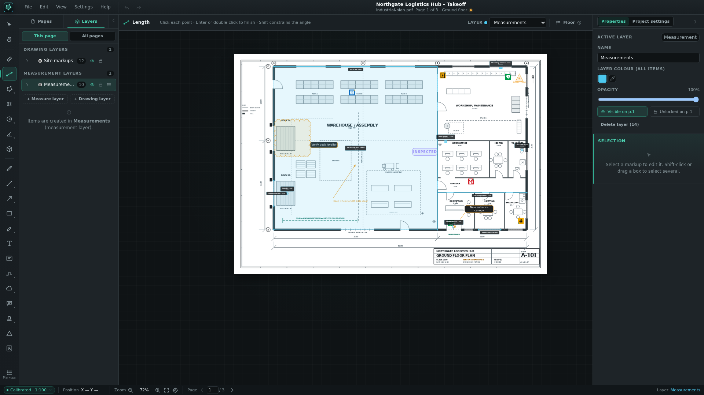 | 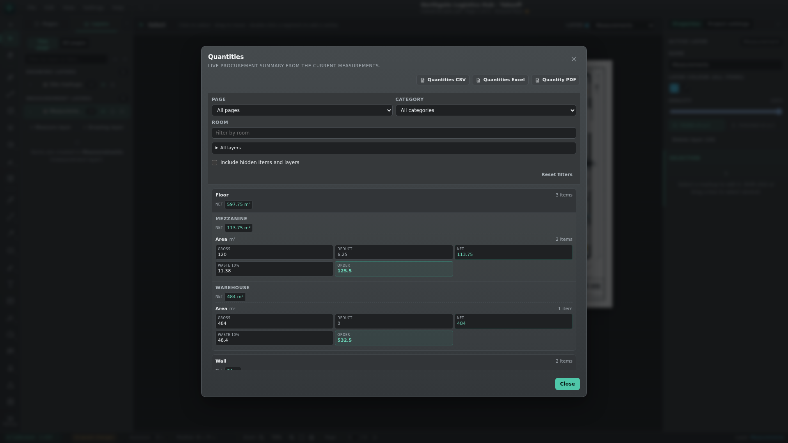 |
| **Drawing and measurement layers.** Tools stay on the matching layer type, with categories, rooms and deductions. | **Live procurement quantities.** Review gross, deduction, net, waste and order quantities before export. |

| Markups and layers | Drawing export |
| --- | --- |
| 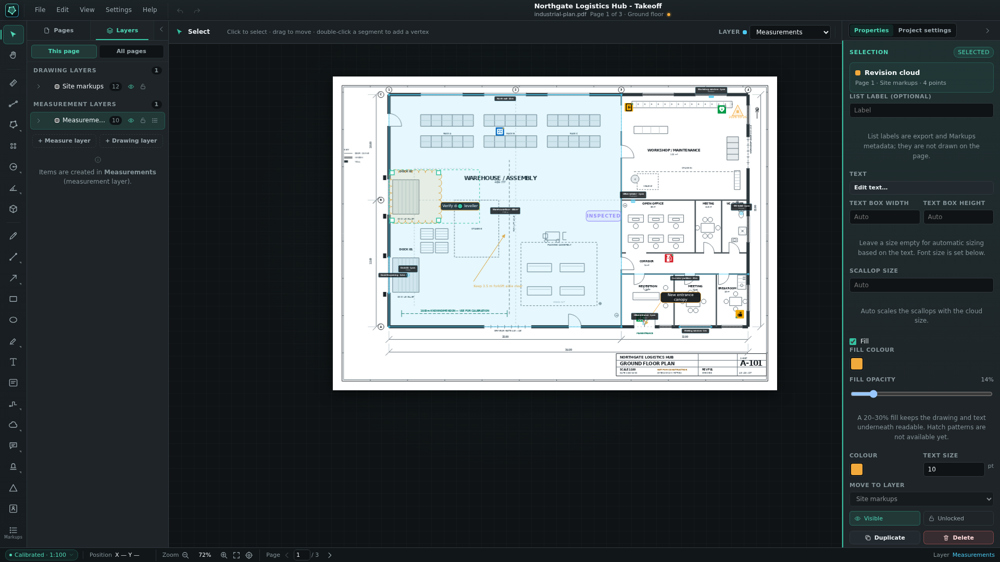 | 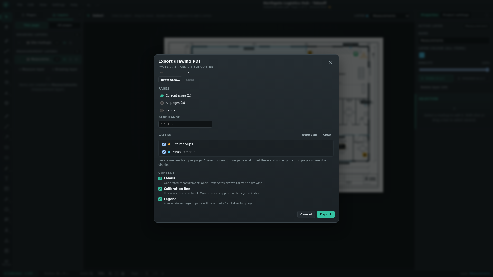 |
| **Field annotations.** Revision clouds, callouts, stamps and text notes live on drawing layers. | **Controlled PDF output.** Choose pages, crop, visible layers, labels and an optional legend. |

| Markups list | Workflows in the app |
| --- | --- |
| 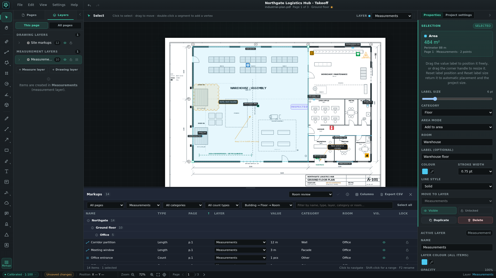 | 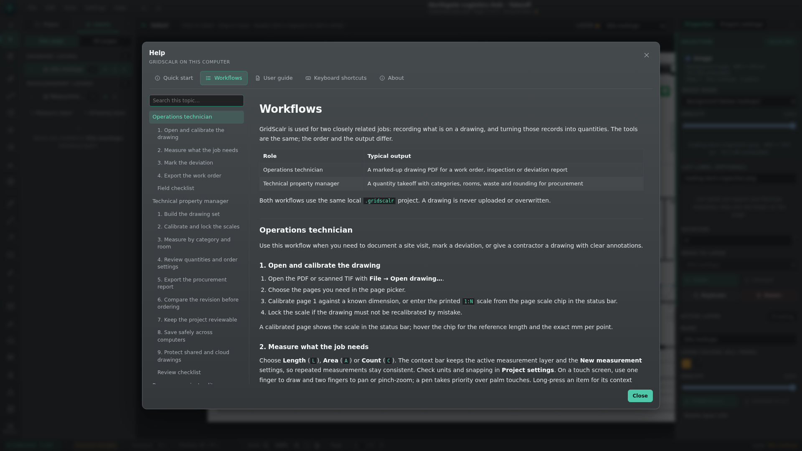 |
| **Find every item.** Search, select and navigate measurements and drawings across all pages. | **Task-oriented help.** The same guides ship inside the app under **Help**. |

| Reference pane | Excel handoff |
| --- | --- |
| 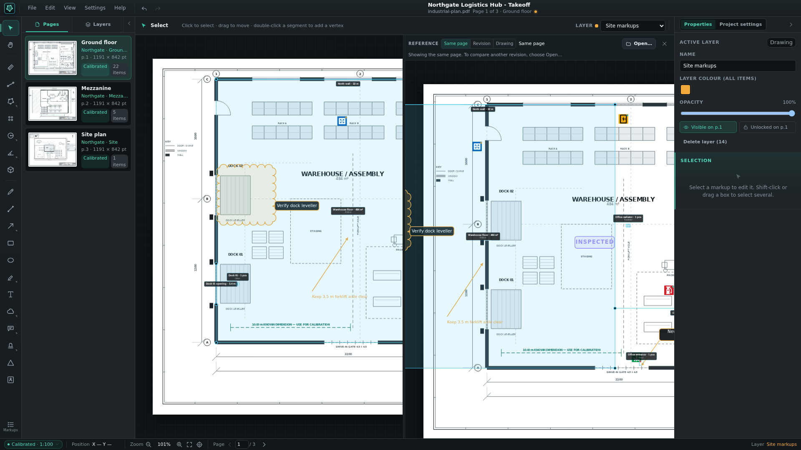 | **Procurement workbook.** Export summary, category, room, page, markup and source-notes sheets from the same takeoff data. |
| **Compare while you work.** Choose the same page, a revision or a PDF drawing; the reference follows every pan, zoom and page change and never edits the project. | **No second source of truth.** The XLSX workbook is generated on demand from the measurements. |

| Revision or drawing comparison | Full-text search |
| --- | --- |
| 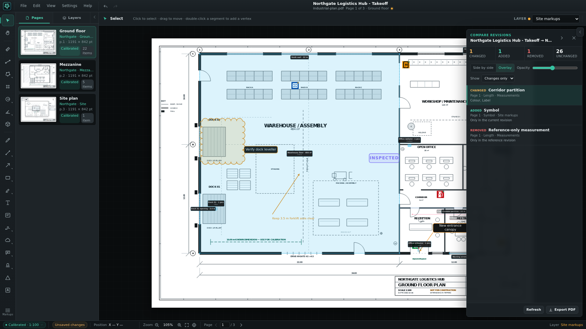 | 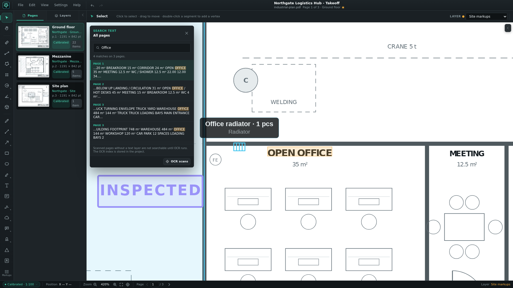 |
| **Review before you act.** Switch between side-by-side and overlay, follow warnings, and jump to every changed item. A PDF drawing reference compares the visuals only. | **Find text fast.** Search PDF text layers or run local OCR on scans, then highlight the exact result on the plan. |
| **No merge, no source changes.** The reference stays session-only and both drawings remain read-only. | **Local index.** PDF text is indexed in memory; OCR words are stored in the project for reuse. |

More screens, including the Markups table, the symbol library, revision
comparison, full-text search and the in-app workflows, are captured in
[docs/screenshots](docs/screenshots).

## Themes

GridScalr ships with five interface themes. Medium Gray is the default; the
others are one click away in **Settings → Preferences → General**.

| Default (medium gray) | Light | Dark Gray |
| --- | --- | --- |
| 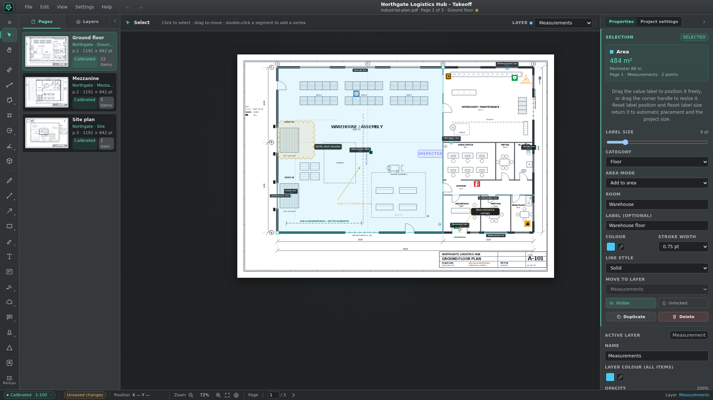 | 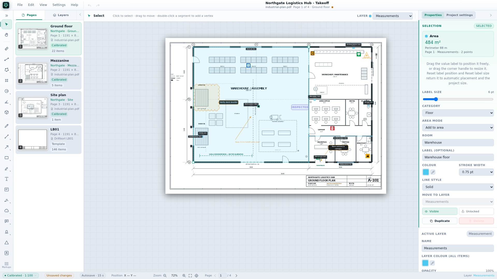 | 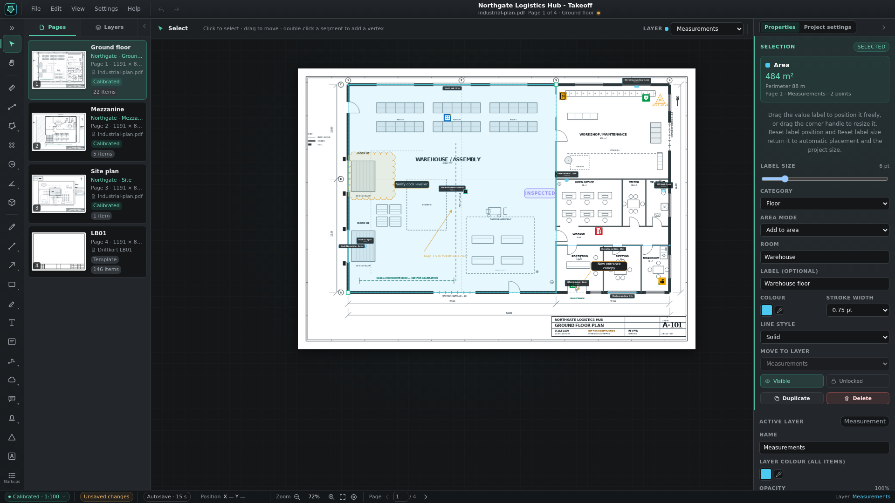 |
| **Dark Jade** | **Navy** | |
| 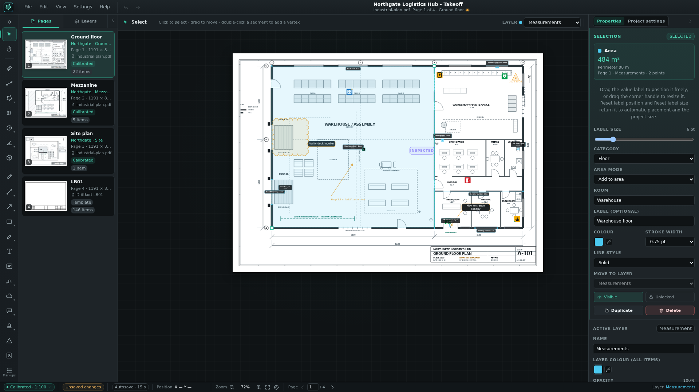 | 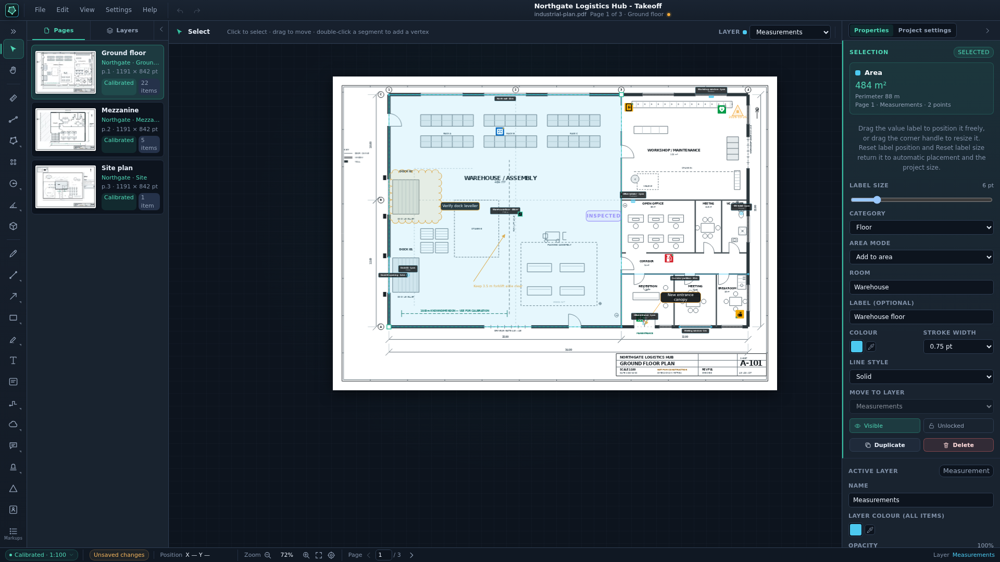 | |

The theme images are regenerated with `npm run docs:capture` as part of the
release documentation pass, so they always show the current interface.

## Requirements

- Node.js 22.12 or newer (tested with Node 24)
- npm 10 or newer
- Rust 1.77.2 or newer
- [Tauri 2 platform prerequisites](https://v2.tauri.app/start/prerequisites/)

On Debian or Ubuntu:

```bash
sudo apt update
sudo apt install -y \
  build-essential curl wget file pkg-config \
  libwebkit2gtk-4.1-dev libgtk-3-dev \
  libjavascriptcoregtk-4.1-dev libsoup-3.0-dev \
  libayatana-appindicator3-dev librsvg2-dev patchelf
```

## Install and run

```bash
npm ci
npm run tauri dev
```

Browser-only UI work:

```bash
npm run dev
```

The browser fallback reads files through the picker and downloads exports. It
cannot use native paths, recent files or autosave recovery; the desktop build is
the product.

Production builds:

```bash
npm run build                        # type-check and build the Vite frontend
GRIDSCALR_SOURCEMAPS=1 npm run build # frontend build with source maps
npm run tauri build                  # desktop app and platform bundles
npm run tauri build -- --no-bundle   # desktop binary only
```

## Try the sample drawing

`fixtures/industrial-plan.pdf` is a reproducible three-sheet A3 sample: a
ground-floor warehouse and office plan at 1:100, a mezzanine at 1:50 and a site
plan at 1:400, with a 10.00 m calibration dimension on page 1.

`fixtures/demo-project.gridscalr` is a calibrated takeoff with categories, rooms,
deductions and drawing annotations. Open it in the desktop app to explore every
panel with realistic sample data. Regenerate the sample set with:

```bash
npm run fixture     # fixtures/industrial-plan.pdf
npm run docs:demo   # fixtures/demo-project.gridscalr
```

## Documentation

| Document | Contents |
| --- | --- |
| [Quick start](docs/quick-start.md) | The short workflow for a new project. Swedish version: [Snabbstart](docs/quick-start.sv.md). |
| [User guide](docs/user-guide.md) | The full workflow, panel by panel. Same content as **Help** in the app. |
| [Workflows](docs/workflows.md) | Task-oriented guides for site work and technical property management. |
| [Shortcuts](docs/shortcuts.md) | Every keyboard shortcut. |
| [Architecture](docs/architecture.md) | Source map, design choices, tests and fixtures. |
| [Testing](docs/testing.md) | Test layers, fuzzing, visual regression and manual visual review. |
| [Architecture decisions](docs/adr/README.md) | Accepted ADRs for modules, packaging, localization, release and performance. |
| [Glossary](docs/glossary.md) | Canonical English and Swedish product terms. |
| [Project files](docs/project-file.md) | The `.gridscalr` format, schema history and migration rules. |
| [Multi-issue workflow](docs/plan/conductor-prompt.md) | Conductor and worker prompts for multi-phase, multi-issue work. |
| [Known limitations](docs/limitations.md) | What the app deliberately does not do yet. |
| [Releasing](docs/releasing.md) | The manual release checklist. |
| [Roadmap](docs/roadmap.md) | Shipped milestones, foundation workstreams, the 1.0 quality gate and open decisions. |

The same reference material ships inside the app: **Help → User guide**,
**Help → Workflows**, **Help → Keyboard shortcuts** and **Help → About**, which
reports the running version and the project-file schema read from the code.

## Privacy and security

GridScalr reads drawings from disk and writes only where you ask it to. There is
no network access, no account, no telemetry and no automatic update service. The
source PDF or TIF is never modified; every save and export resolves real paths,
including symlinks and junctions, and refuses to overwrite any document that
belongs to the project. Project files are replaced atomically, so a failed save
keeps the previous file. Project data autosaves to a local IndexedDB recovery
store, scoped by project and app instance with the base file hash and pruned to a
64 MiB per-project and 256 MiB total byte budget, so a large project cannot
exhaust browser storage. Autosave can
be turned off, given a 15, 30 or 60 second interval, or paused for the session in
**Preferences → Data**. In the desktop
shell, `src-tauri/src/project_write.rs` owns conditional writes and file stamps,
`src-tauri/src/project_lease.rs` owns the advisory sidecar lease, and
`src-tauri/src/project_backup.rs` owns app-data backups. The
`src/features/sessionRecovery/` module owns recovery records, the recovery center,
read-only open and the external-change watcher. The
`src/features/projectIntegrity/` module owns the shared pre-save/load validator
surface, explicit repairs, the project doctor, load-report presentation and
path-free diagnostics; `src/model/integrity.ts` holds the pure rules.
`src/pdf/export/ocg.ts` writes optional-content groups, `src/pdf/export/annotations.ts`
writes review-only annotation dictionaries, and `src/features/saveIntegrity/compare.ts`
builds the read-only conflict comparison. None of them writes project data or a
source drawing. The `tests/robustness/` gate exercises seeded page and save
sequences, competing writers, the committed `fixtures/legacy/` schema 1–25
corpus and source storage; run it alone with `npm run test:robustness`.

The desktop shell enforces one production Content Security Policy as an HTML
response header, with no development origin: see
[`security/policy.json`](security/policy.json) and
[`docs/security-policy.md`](docs/security-policy.md). Every Tauri capability has
a documented call site, and the PDF.js and Tesseract workers inherit the page
policy through blob shims. `npm run check:security` fails when a directive or
permission changes without that record; `npm run test:csp` verifies the policy in
a browser. `npm run check:dependencies` audits the npm and Rust lock files on
every pull request and before a release build, and fails on a new advisory at or
above moderate unless it is accepted in a reviewed allowlist with a reason and
an expiry date.

See [SECURITY.md](SECURITY.md) for the threat model and the private reporting
channel.

## Windows SmartScreen

The installers are not code-signed. Code-signing certificates for Windows cost
several hundred euros per year, which is not justified for a pre-1.0 project
funded out of pocket. As a result Windows may show **"Windows protected your PC"**
or a browser warning the first time you run the installer.

To proceed: choose **More info → Run anyway**. To verify that the file is the one
published here, compare its SHA-256 hash with `SHA256SUMS.txt` on the release
page:

```powershell
Get-FileHash .\GridScalr_<version>_x64-setup.exe -Algorithm SHA256
```

Unsigned builds also trigger more false positives in some antivirus engines. If a
hash does not match, do not run the file and report it through
[SECURITY.md](SECURITY.md).

## macOS Gatekeeper

macOS builds are not notarized either. On first launch macOS may say that
GridScalr cannot be opened because the developer cannot be verified. Open
**System Settings → Privacy & Security**, choose **Open Anyway**, and confirm.
The DMG is universal, so the same download runs on Intel and Apple Silicon.
Verify the `.dmg` or `.app.zip` against `SHA256SUMS.txt` with
`shasum -a 256` before opening it.

## Project status

GridScalr is pre-1.0 and uses schema 25 for project files. Schema changes are
migrated automatically when an older project is opened. Interfaces can still
change between minor versions. The
[roadmap](docs/roadmap.md) lists what is done and what is
deliberately deferred.

1.0 is a quality gate, not a schedule. It covers Windows, macOS and Linux
artifacts, English and Swedish UI, portable `.gridscalr.zip` project packages,
tested large-project performance, and production-ready save, recovery and source
handling. Architecture decisions are recorded in [docs/adr](docs/adr/README.md).

## Contributing

Contributions are welcome. Read [CONTRIBUTING.md](CONTRIBUTING.md) for the setup,
the checks CI runs, the commit style and the documentation policy. The short
version:

```bash
npm test -- --run
npm run test:robustness
npm run lint
npm run build
npm run check:docs
cargo check --manifest-path src-tauri/Cargo.toml
```

`npm run test:robustness` is the focused gate for page identity, competing
saves, the schema 1–25 migration corpus and source storage; the normal test
suite includes the same files. See [docs/testing.md](docs/testing.md).

Never attach real customer drawings to an issue or a pull request.

## License

[MIT](LICENSE) © 2026 MajorJohnDoe. Third-party components are listed in
[THIRD_PARTY_NOTICES.md](THIRD_PARTY_NOTICES.md).

## Acknowledgements

Built with [Tauri](https://tauri.app), [PDF.js](https://mozilla.github.io/pdf.js/),
[pdf-lib](https://pdf-lib.js.org) and TypeScript. The facility symbols are
original vector illustrations drawn for this project; they are not certified
SS-EN ISO 7010 reproductions and not reproductions of SS-EN ISO 14617 or
IEC 60617.
