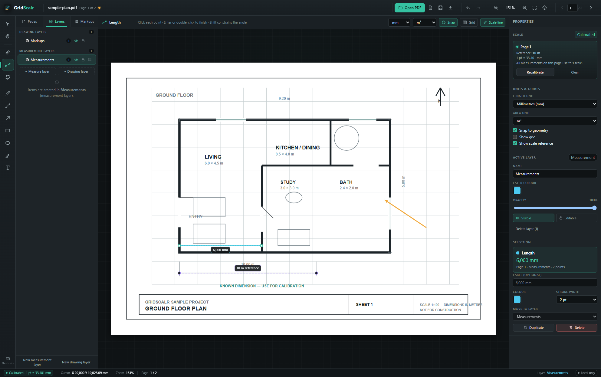

# GridScalr

GridScalr is a local-first desktop app for opening PDF drawings, calibrating their scale, measuring lengths and areas, and organising markups into separate measurement and drawing layers.

It uses a **Graphite & Jade** interface: a dark graphite workspace, jade accents, a vertical tool rail, and dedicated layers, properties, and markups panels. The workflow is inspired by professional PDF takeoff tools, but GridScalr is an independent implementation built with Tauri, Rust, TypeScript, and HTML5 Canvas.



## Highlights

- Open PDF plans locally with PDF.js, or scanned TIF drawings with lossless CCITT G3/G4 import.
- Keep several sheets in one project. Each PDF or TIF you open while a project is active is added after the existing pages, so a set of drawings shares one quantity take-off.
- Calibrate each page against a known dimension, enter a printed 1:N scale, apply a scale to all pages, and lock a page scale against changes.
- Measure multi-segment lengths, polygon areas, and quick rectangle/ellipse areas with live unit conversion, and count doors, windows, radiators, fixtures, and other objects as pieces.
- Snap to endpoints, segment midpoints, and intersections between visible markup segments, with an adjustable screen-pixel threshold.
- Draw pen strokes, lines, arrows, rectangles, ellipses, highlights, and text notes.
- Edit text directly on the plan with multi-line input and a floating font-size, colour, and rotation strip.
- Resize selected text, arrows, and shapes with selection handles, and rotate them with 15° Shift snapping.
- Rename markups from the Markups list (double-click or `F2`) and rename the project from the top bar.
- Keep **measurement layers** and **drawing layers** separate, with visibility, locking, colour, opacity, ordering, and layer-to-layer item moves.
- Choose the active target layer from the context bar, with a warning when that layer is hidden or locked.
- Hide or lock individual markups without changing their layer. Hidden items are excluded from rendering, hit-testing, and every export; locked items stay visible and exportable but cannot be moved, edited, or deleted.
- Select several markups with `Shift`/`Ctrl`/`Cmd`-click or a marquee, move them together, and edit their layer, colour, visibility, or lock state in one bulk action. Measurement selections can also share a category, room, area mode, or count type.
- Copy, cut, paste, and duplicate markups with an internal clipboard. Cross-page pastes keep their exact PDF coordinates, while same-page pastes offset by 12 pt.
- Insert PNG or JPEG images from a file or directly from the clipboard. Images are embedded, compressed, and can be background underlays or annotations.
- Use right-click context menus on the canvas, Markups list, and layers for the same actions.
- Organise measurements with project-wide categories that can be renamed, reordered, and deleted; the default category is used for new measurements.
- Tag measurements with a category and a free-text room. The context bar keeps the last category, room, count type, and area mode for the next measurement, and room names autocomplete from rooms already used in the project.
- Mark areas as additions or deductions. Deductions stay the same colour but are labelled **Deduction** on the plan and in the Markups list.
- Review live quantities by category, room, and measurement type in the Quantities panel, with subtotals, filters, project units including yd², waste, rounding, and order quantities.
- Save portable `.gridscalr` project files that reference the PDF rather than embedding it. Inserted images are embedded and compressed inside the project.
- Export a drawing PDF with the original pages and visible markups, a markups CSV, a project JSON, the current view as PNG, or a quantity report as CSV or print-friendly PDF.
- Undo/redo, autosave, recent files, and a shortcut reference.
- No account, cloud service, or network access required.

## Requirements

### All platforms

- Node.js 22.12 or newer (tested with Node 24)
- npm 10 or newer
- Rust 1.77.2 or newer
- Tauri 2 platform prerequisites for your operating system

### Linux (Debian/Ubuntu)

The Tauri 2 webview and build tooling need system packages. On Debian or Ubuntu:

```bash
sudo apt update
sudo apt install -y \
  build-essential curl wget file pkg-config \
  libwebkit2gtk-4.1-dev libgtk-3-dev \
  libjavascriptcoregtk-4.1-dev libsoup-3.0-dev \
  libayatana-appindicator3-dev librsvg2-dev patchelf
```

See the [Tauri prerequisites](https://v2.tauri.app/start/prerequisites/) for Windows, macOS, and other Linux distributions.

## Install and run

```bash
npm install
```

Run the desktop app:

```bash
npm run tauri dev
```

Run the frontend in a browser for UI work:

```bash
npm run dev
```

The browser build is a development fallback. It reads files through the file picker and downloads files instead of using native paths. The desktop build is the intended product.

Production builds:

```bash
npm run build            # type-check and build the Vite frontend into dist/
npm run tauri build      # compile the desktop app and platform bundles
npm run tauri build -- --no-bundle   # compile the desktop binary without installers
```

## Try the sample drawing

A small reproducible PDF is included for testing:

```bash
npm run fixture
```

Then open `fixtures/sample-plan.pdf` in GridScalr. It contains two A4 landscape plan pages; page 1 includes a 10.00 m known dimension along the bottom for calibration. The PDF is generated by `scripts/make-fixture.mjs` using `pdf-lib`.

## Workflow

### 1. Open a drawing

Use **Open drawing**, drag a PDF or TIF onto the window, or choose it from the welcome screen. Password-protected PDFs prompt for a password.

Opening a drawing with no project active creates a new project. To continue previous work, open its `.gridscalr` file instead.

With a project already open, the drawing is **added after the existing pages** instead of replacing them. GridScalr asks for confirmation and shows how many pages will be added. Page numbers are append-only: new sheets never shift existing pages, so measurements stay on the sheet they were drawn on. Use the page controls to move between sheets; the status bar names the source document and its local page number.

#### TIF drawings

Scanned drawings in **TIF/TIFF** are imported as real pages with their own paper size and scale. The format is detected from the file contents, not the extension.

- 1-bit CCITT Group 3 or Group 4 scans are written into the project losslessly, without re-encoding. A 126 megapixel A1 sheet stays a few hundred kilobytes and keeps full resolution when zoomed.
- The page size comes from the scan's DPI tags: 12128 × 8072 pixels at 345 DPI becomes 893 × 594 mm. DPI gives the **paper** size, not the drawing scale, so calibrate the page against a known dimension as usual. If a scan has no resolution tags, 300 DPI is assumed and a warning is shown.
- Multi-page TIFFs become several pages. Reduced-resolution preview images inside the file are skipped. Orientation tags 1, 3, 6, and 8 are honoured.
- The converted PDF is embedded in the `.gridscalr` file, so a TIF project keeps working even if the original scan is moved. The original file path and SHA-256 are still stored for provenance.
- Limits: 400 megapixels per page and 200 MB per file. Other compressions (LZW, Deflate, JPEG-in-TIFF), tiled TIFFs, and colour or greyscale scans are rejected with a clear message.

### 2. Set the page scale

Use **Calibrate** for a reference dimension:

1. Press **K** or choose **Calibrate**.
2. Click the two ends of a dimension with a known real-world length.
3. Enter the length and choose its unit (mm, cm, m, in, ft, or yd).
4. Optionally apply the scale to every page and update existing measurements.

Alternatively, choose **Manual scale…** in Properties and enter the printed drawing ratio as `1:N`. Presets for 1:50, 1:100, 1:200, and 1:400 are provided, along with a free ratio field. Manual scale assumes the PDF page is at its physical paper size: 1 mm on paper equals N mm in the real world. It replaces a reference calibration on the affected pages and draws no reference line or calibration label.

The scale is stored per page. Recalibrating a page or setting a manual scale can either preserve existing measurement scale snapshots or update them. **Apply to all pages** copies the scale but not the lock, and skips locked pages.

Once a page has a scale, **Lock scale** prevents changing the scale through calibration, manual scale, editing, or clearing. The lock is stored in the project, is undoable, and does not affect existing measurements, exports, zoom, or page navigation. Use **Unlock scale** before changing the scale again.

Clearing a page scale does not delete the measurements. Measurements created while a page is calibrated capture a scale snapshot. If a page is later recalibrated with **Update existing measurements** disabled, those items keep their original values. Measurements with no scale are shown in PDF points (`pt` / `pt²`).

### 3. Measure

- **Length (L):** click each vertex. Press **Enter** or double-click to finish. Hold **Shift** to constrain the angle.
- **Area (A):** choose **Polygon**, **Rectangle**, or **Ellipse** in the context bar. Polygon works click-by-click: click around the perimeter, then click the first vertex or press **Enter** to close it. Rectangle and Ellipse are quick areas drawn by dragging from one corner to the opposite corner. Hold **Shift** while dragging a quick area to make a square or circle. Areas use the unit selected in Properties. Choose **Add** or **Deduct** in the context bar before drawing, or change an existing area in Properties.
- **Count (C):** choose an object type, then click the plan. Every count is exactly `1 pcs` and carries a built-in vector symbol for a door, window, radiator, fixture, or other object.

Measurements are added to the active measurement layer. The value shown on the plan updates as the zoom changes, while the geometry stays in PDF coordinates.

When **Snap to geometry** is enabled, point placement can lock to visible markup endpoints and corners, segment midpoints, and intersections between straight markup segments. The marker names the target type (`Endpoint`, `Midpoint`, or `Intersection`). Snap applies to calibration, length, polygon and quick areas, lines, and arrows. Hidden items and hidden layers never provide snap targets; locked but visible items do. Set the snap distance in **Properties → Units** from 2 to 24 screen pixels. Shift still provides the existing 45° constraint for segment tools and makes quick areas square or circular.

While the Length, Area, or Count tool is active, the context bar shows the category and room for new measurements. The Count tool also shows the object type, and the Area tool shows the add/deduct mode. These stay selected for the next measurement together with the category and room until you change them or open another project; the category starts on the project default and the room list suggests names already used in the project. The Markups list shows the category, count type, deduction marker, and room, and all of them can be changed later in Properties. An empty room is allowed and is not stored.

### 4. Draw and annotate

Use the pen, line, arrow, rectangle, ellipse, highlight, and text tools. Drawing items are added to the active drawing layer. Drawings render below measurement layers, so measurement labels stay easy to read.

Hold **Shift** while drawing lines, arrows, rectangles, or ellipses to constrain angles or proportions.

To add a text note, choose the Text tool and click the plan. The inline editor accepts multiple lines:

- `Enter` commits the text.
- `Shift+Enter` inserts a line break.
- `Esc` cancels the edit.
- Clicking outside the editor also commits.

The floating strip beside the editor sets font size (0.5–300 pt), colour, and rotation without leaving the canvas. Double-click an existing text note with the Select or Text tool to reopen it.

Measurement labels are single-line editable. Double-click a measurement label, type a name, and press `Enter`; the computed length, perimeter, area, or calibration value remains read-only beside it. Double-clicking the calibration label reopens the calibration dialog with its current value instead of opening the label editor.

Labels use compact paper-space sizes. On the canvas their on-screen size is capped at high zoom so they do not cover the room you are drawing; PDF export keeps the true paper-space size. Large rooms keep the full label centered inside the area. Smaller rooms shrink the label down to a minimum readable paper size. If it still does not fit, the label moves outside the area and a thin leader line connects it to the room. The same paper-space placement is used by canvas rendering, label hit-testing, inline editing, and PDF export.

The Markups list supports renaming without changing the drawing text: double-click a row label or select a row and press `F2`. Renaming a text item changes its list/export label, not its text body. The project name in the top bar also supports double-click rename.

### 5. Add images

Use **Import image** in the top bar (or in the context bar) to choose a PNG or JPEG, or press `Ctrl/Cmd+V` when the clipboard contains an image. Clipboard images take precedence over pasted markups; when the clipboard has no image, `Ctrl/Cmd+V` pastes markups as before.

Images are embedded in the project, so the `.gridscalr` file stays portable. Each image is limited to 20 MB and 4000 px on its longest side. Images larger than 4000 px are proportionally downscaled; an image that is still larger than 20 MB after encoding is rejected. PNG transparency is preserved; JPEG files are re-encoded at quality 0.85 when they need resizing or exceed the size limit.

A new image is placed on the current page and on a visible, unlocked drawing layer. If the image would be larger than the page it is scaled proportionally to fit inside the page, so the page width limits wide images; otherwise it keeps its natural size at 96 DPI (1 px = 0.75 pt). Both cases centre the image on the page.

The default mode is **Background**: the image sits above the PDF drawing and below every markup and measurement. Switch to **Annotation** in Properties to draw the image in normal layer order. Properties also expose opacity, rotation, layer, visibility, lock state, duplicate, and delete. Drag a corner handle to resize proportionally, or a side handle to change one dimension.

Images follow the same visibility and locking rules as other items: hidden images and layers never render, hit-test, or export, and locked images stay visible and exportable but cannot be edited. Images are only allowed on drawing layers.

### 6. Resize and rotate

Select a text note, arrow, rectangle, ellipse, or other drawing item to reveal its handles:

- Drag a corner or edge handle to resize. Text corner handles scale the font size.
- Drag the round handle above the selection to rotate. Hold **Shift** to snap to 15° increments.
- Line, arrow, pen, and highlight rotation is baked into their points; text, rectangles, and ellipses store a rotation angle.
- Measurement geometry stays vertex-editable from its points rather than being box-scaled, so its computed values remain trustworthy. Rectangle and ellipse quick areas expose their two opposite defining points and have no rotation handle.

Each drag or inline edit is one undo step.

### 7. Organise layers

Open the **Layers** panel to:

- Show or hide a layer.
- Lock a layer against moving, editing, and deleting its items.
- Change layer colour and opacity.
- Rename the active layer.
- Drag layers within their group to reorder them.
- Add new measurement or drawing layers.
- Move the selected item to another layer from Properties or the right-click menu.

The **Layer** picker in the context bar shows which layer will receive new items. If the active layer is hidden or locked, the picker shows a warning. Picking a drawing or measurement tool automatically switches to a visible, unlocked layer of the matching kind; if none exists, GridScalr creates one instead of silently drawing into a layer you cannot see or edit.

Locking a layer leaves the layer's own settings editable, but prevents changing its markup content. Measurements and drawings always live in their matching layer type.

### 8. Select, bulk edit, and reuse

Use the Select tool to click one markup, `Shift`/`Ctrl`/`Cmd`-click to add or remove markups, or drag on empty canvas to marquee-select everything inside the box. Selected items move together as a group. Group resize and rotation are intentionally not supported.

The **Markups** panel mirrors selection: `Shift`/`Ctrl`/`Cmd`-click rows to build a selection, use **Select all** for the current filter, and use each row's eye and lock buttons for per-item visibility and locking. Right-click a row for copy, cut, duplicate, hide/show, lock/unlock, move to layer, and delete.

With more than one item selected, Properties offers bulk actions for:

- Moving all selected items of one kind to another layer.
- Setting a common colour.
- Hiding or showing the selection.
- Locking or unlocking the selection.
- Duplicating or deleting the selection.

When every selected item is a measurement, Properties also offers:

- Setting one category or one room for the selection. Leave the room field empty and choose **Apply** to clear the rooms.
- Setting `Add` or `Deduct` when every selected measurement is an area.
- Setting one object type when every selected measurement is a count.

Category and room are not offered for selections that mix measurements and drawings. `areaMode` and `countType` are only offered when the whole selection has that measurement kind. Locked measurements are skipped by bulk edits and reported in a toast. Every bulk action is a single undo step, even across layers. Mixed measurement-and-drawing selections can share colour, visibility, lock, duplicate, and delete actions, but cannot be moved to one layer because layers are type-specific.

The internal clipboard is in-memory only and is not shared with the operating system. `Ctrl/Cmd+C`, `X`, and `V` copy, cut, and paste markups. Pasting on another page keeps the original PDF coordinates; pasting on the same page offsets the copy by 12 pt. Duplicate uses the same 12 pt offset.

Locked items remain visible and exportable, but group moves, nudges, deletes, resize/rotate, and property edits skip them. Hidden items are not rendered, cannot be hit-tested on the canvas, and are excluded from PDF, PNG, and CSV exports. Both states are stored per item, while layer visibility and locking still take precedence.

### 9. Quantities and procurement reports

Open the **Quantities** tab to summarise the measurements that are currently visible. Each row covers one category, room, and measurement type, and shows gross, deduction, net, waste, order quantity, and the number of items. Category and room headers provide subtotals, and a total row summarises each measurement type.

- Filter by current or all pages, one category, a room substring, or any combination of measurement layers.
- Hidden items and hidden layers are excluded by default and reported in a note. Locked items are included. Enable **Include hidden items and layers** to allow counting them in the live panel.
- Area deductions are subtracted inside the same category and room only. If a deduction exceeds its gross area, the net is clamped to zero and the row shows a warning. Length and count rows are never reduced by area deductions.
- Length and area values use the project units, including yd², and counts always use pcs.
- Measurements without a scale are excluded and counted in a note. Calibrate their page to include them.
- Quantities are derived from the current items every time the data changes and are never stored in the project file.

Waste and rounding turn net quantities into order quantities:

- Set project defaults under **Properties → Categories → Waste / Round up**. Waste is a percentage of net, from 0 to 100. A rounding step of 0 means no rounding.
- A category can override either value in **Manage categories**. Leave a field empty to inherit the project default. Both settings are stored in the project file and changes are undoable.
- Rounding always goes up. Counts always round to whole pcs even when the project uses a different step. Order quantity is never lower than net.
- The row shows net, waste quantity, and order quantity separately. The waste percentage is part of the waste label.

The **CSV** and **PDF** buttons in the Quantities footer, and **Export → Quantities to CSV / Quantity report (PDF)**, create the procurement report. Reports cover every page and every category, excluding hidden items and hidden layers, and include locked items. The live panel filters only affect the on-screen summary, not the exported report. Reports are generated on demand and never stored in the project file.

The CSV report uses UTF-8 with BOM, comma delimiters, CRLF line endings, point decimals, three decimals for length and area, and whole numbers for count quantities. It contains one row per category, room, and quantity type, followed by two blank lines and project metadata. `hidden_excluded` is `true` only when at least one hidden measurement was actually left out. The PDF report is A4 portrait with 48 pt margins, category sections, subtotals, totals, repeated table headers, page numbers, a hidden-item notice, and a warning for clamped deductions.

### 10. Save and export

- **Save project** (`Ctrl/Cmd+S`) writes a `.gridscalr` JSON file.
- **Save as** (`Ctrl/Cmd+Shift+S`) writes to a new path.
- **Export → Drawing PDF…** opens an export dialog. Choose whole page(s) or a selected area, current page / all pages / a page range, which visible layers to include, labels, the calibration line, and an optional legend. Background images are drawn above the source page and below markups; annotation images follow layer order. The export writes `<project>-markups.pdf`; the source PDF is never modified, and the save flow refuses to overwrite it.
  - **Selected area** enters a one-off crop mode on the canvas. Drag a rectangle, adjust it with the handles, then press `Enter` or **Use area**; `Esc` cancels. The crop is stored relative to the page and applied to every selected page, so pages with different sizes or rotation stay aligned. It clips PDF content, markups, labels, and the calibration line.
  - Hidden layers are listed but disabled. Hidden items are always excluded and locked items are exported.
  - **Legend** adds a separate A4 page at the end of the export. It is never drawn over the drawing and is not affected by the crop.
- **Export → Markups to CSV** exports page, type, layer, label, computed value, unit, details, and PDF-coordinate vertices.
- **Export → Quantities to CSV** writes `<project>-quantities.csv` for spreadsheets and procurement tools.
- **Export → Quantity report (PDF)** writes `<project>-quantities.pdf`, a print-friendly procurement report separate from the flattened drawing export.
- **Export → Project to JSON** exports the project payload without requiring a `.gridscalr` extension.
- **Export → View as PNG** exports the rendered page and markup layers at the current view.

All export formats exclude hidden items and hidden layers. Locked items are still exported. Quantity reports always cover all pages and all categories; their rows use the same visibility and locking rules as the canvas. The drawing PDF export uses the source file's page sizes, rotation, and crop information, so markups and images stay aligned on rotated or cropped pages. Measurement and calibration labels are drawn at a compact paper-space size so they annotate rather than cover the source drawing. Text is embedded with a bundled Liberation Sans font. Images are embedded as PNG or JPEG objects with their opacity and rotation. Encrypted source PDFs cannot be flattened without their owner password and produce a clear warning. The PNG export excludes selection handles, hover states, and other interaction overlays.

## Project files

A `.gridscalr` file is UTF-8 JSON. It contains one or more document references, per-page calibrations, settings, layers, markup items, and embedded images. Referenced PDFs are **not** embedded; a TIF's converted PDF is, because the scan cannot be read directly at render time.

Schema version 2 added optional per-item `visible` and `locked` flags. Schema version 3 added project categories, category/room fields on measurements, area add/subtract, count items, and quantity settings. Schema version 4 added quick-area shapes, manual 1:N scales, per-page scale locks, and the snap distance setting. Schema version 5 added embedded image assets and image items. Schema version 6 replaces the single `document` reference with a `documents` array and adds embedded PDFs for TIF documents.

Version 1–5 projects load normally and are migrated to schema 6: the old `document` entry becomes the first element of `documents`, and page keys keep their numbers. Version 6 projects keep each document's pages in order, and page state beyond the last page is dropped. Measurements are assigned to the `Other` category when needed, areas default to `add` and `polygon`, and missing quantity and snap settings get safe defaults. Reference calibrations without `source` become `reference`; invalid manual scales and locks without a scale are dropped. Quick rectangle/ellipse data with extra points is trimmed to the two defining points, and unknown shapes fall back to polygon. A category may omit `wastePercent` and `roundingStep` to inherit the project defaults. Image items without a valid embedded asset or a valid two-corner geometry are dropped; old projects start with an empty `assets` map.

```json
{
  "schemaVersion": 6,
  "name": "Level 01",
  "documents": [
    {
      "id": "doc_8f21c3",
      "kind": "pdf",
      "name": "Level 01.pdf",
      "path": "/home/ana/drawings/Level 01.pdf",
      "relativePath": "../drawings/Level 01.pdf",
      "sha256": "7ef5cc05...",
      "pageCount": 12,
      "sizeBytes": 4839201
    },
    {
      "id": "doc_tif_4b77de",
      "kind": "tiff",
      "name": "Site plan.tif",
      "path": "/home/ana/drawings/Site plan.tif",
      "relativePath": "../drawings/Site plan.tif",
      "sha256": "1c9ad40e...",
      "pageCount": 1,
      "sizeBytes": 708779,
      "embeddedPdf": "JVBERi0xLjQK...",
      "source": { "format": "tiff", "dpi": [400, 400], "originalName": "Site plan.tif" }
    }
  ],
  "settings": {
    "lengthUnit": "mm",
    "areaUnit": "m2",
    "showGrid": false,
    "showCalibration": true,
    "snapToGeometry": true,
    "snapTolerancePx": 8,
    "quantity": {
      "defaultCategoryId": "cat_...",
      "wastePercent": 0,
      "roundingStep": 0
    }
  },
  "categories": [
    { "id": "cat_...", "name": "Floor", "wastePercent": 10, "roundingStep": 0.5 },
    { "id": "cat_...", "name": "Other" }
  ],
  "assets": {
    "img_...": {
      "id": "img_...",
      "name": "Site photo.jpg",
      "mime": "image/jpeg",
      "width": 1600,
      "height": 900,
      "byteSize": 184320,
      "data": "data:image/jpeg;base64,/9j/4AAQSk..."
    }
  },
  "pages": {
    "1": {
      "calibration": {
        "id": "cal_...",
        "source": "reference",
        "p1": { "x": 120, "y": 460 },
        "p2": { "x": 420, "y": 460 },
        "knownLength": 10,
        "unit": "m",
        "pointsPerMeter": 30,
        "createdAt": "2026-10-20T18:41:05.215Z"
      },
      "scaleLocked": true
    },
    "2": {
      "calibration": {
        "id": "cal_...",
        "source": "manual",
        "ratio": 100,
        "pointsPerMeter": 28.34645669,
        "createdAt": "2026-10-20T18:42:11.031Z"
      }
    }
  },
  "layers": [],
  "activeLayerId": "layer_..."
}
```

On desktop, GridScalr tries each referenced PDF's stored absolute path first, then a path relative to the project file. If a PDF is missing, it asks you to locate it. If the file exists but its SHA-256 differs from the stored checksum, GridScalr warns before continuing. TIF documents need no external file: their converted PDF is embedded, and the stored path and checksum only record where the original scan came from. The project file is designed to stay useful when a project folder is moved without the drawings it references.

Layer IDs, item IDs, document IDs, calibration data, quick-area shapes, scale locks, timestamps, style values, category IDs, per-item visibility/lock flags, snap settings, and embedded image assets are preserved in the file. Reading validates the schema, normalizes version 1–5 projects, repairs category references, drops page state beyond the last page, and drops items that do not match their layer kind or reference a missing image.

## Keyboard shortcuts

| Action | Shortcut |
| --- | --- |
| Select / Pan | `V` / `H` |
| Calibrate | `K` |
| Length / Area / Count | `L` / `A` / `C` |
| Pen / Line / Arrow | `P` / `I` / `U` |
| Rectangle / Ellipse | `R` / `O` |
| Highlight / Text note | `G` / `T` |
| Finish current shape | `Enter` or double-click |
| Cancel draft / clear selection / return to Select | `Esc` |
| Delete selection or remove last area/length point | `Delete` or `Backspace` |
| Add/remove markups from selection | `Shift`/`Ctrl`/`Cmd` + click, or marquee drag |
| Copy / cut / paste markups | `Ctrl/Cmd+C` / `Ctrl/Cmd+X` / `Ctrl/Cmd+V` |
| Paste an image from the clipboard | `Ctrl/Cmd+V` when the clipboard contains an image |
| Rename selected markup label | `F2` |
| Edit selected text or measurement label | Double-click with Select or Text tool |
| Rename project | Double-click the project name in the top bar |
| Nudge selected item | Arrow keys |
| Nudge by 10 screen pixels | `Shift` + Arrow keys |
| Pan temporarily | Hold `Space` and drag |
| Zoom | `Ctrl/Cmd` + mouse wheel, `Ctrl/Cmd` + `+` / `-` |
| Fit page / Actual size | `Ctrl/Cmd+0` / `Ctrl/Cmd+1` |
| Previous / next page | `PageUp` / `PageDown` |
| Undo / Redo | `Ctrl/Cmd+Z` / `Ctrl/Cmd+Shift+Z` or `Ctrl/Cmd+Y` |
| Save / Save as | `Ctrl/Cmd+S` / `Ctrl/Cmd+Shift+S` |
| Open drawing / Open project | `Ctrl/Cmd+O` / `Ctrl/Cmd+Shift+O` |
| Export menu | `Ctrl/Cmd+E` |
| Shortcut reference | `?` |

## Architecture

```text
src/
  app/App.ts             application wiring, file flows, shortcuts, exports
  canvas/CanvasView.ts   canvas rendering, hit testing, inline editing, resize/rotate, PNG compositing
  model/                 project types, geometry, quick-area shapes, snap, text layout, labels, units, calibration, layers, metrics, quantities, selection, clipboard
  state/store.ts         immutable project snapshots, undo/redo, multi-selection UI state, autosave
  pdf/pdfRenderer.ts     PDF.js document lifecycle and progressive crop rendering
  pdf/pdfExport.ts       flattened vector PDF export with embedded text fonts
  pdf/reportPdf.ts       print-friendly A4 quantity report built with pdf-lib
  report/reportModel.ts  pure quantity report model shared by CSV and PDF
  report/csv.ts          quantity CSV serialization with BOM and metadata
  ui/                    shell, tool rail, panels, quantity panel, inspector, dialogs, status bar
  io/projectFile.ts      project schema normalization, serialization, relative paths
  io/platform.ts         Tauri/browser file I/O, dialogs, recents, SHA-256 entry point
  io/sha256.ts           dependency-free SHA-256 fallback
src-tauri/
  src/commands.rs        atomic text/binary writes, reads, and path checks
  src/lib.rs             Tauri command registration
  capabilities/          desktop permissions
tests/                   geometry, quick areas, snap, text layout, calibration, layers, quantities, selection/clipboard, hit-testing, project files, PDF export, SHA-256
scripts/make-fixture.mjs reproducible sample PDF generator
```

Key design choices:

- **Local first.** PDF bytes are read only when needed. Project data autosaves to browser local storage for recovery; no data leaves the machine.
- **Markup layers are app-level.** They are not PDF optional-content groups, and GridScalr never rewrites the source PDF when saving a project. The drawing PDF export writes a new file and leaves the original untouched.
- **Coordinate stability.** Markup points are stored in PDF points, not screen pixels. Zooming, panning, and window resizing do not change measurements; export maps them through PDF.js viewports so page rotation and crop boxes are respected.
- **Progressive rendering.** Only the visible crop of a page is rendered at device resolution. A new render cancels the previous incomplete one.
- **Snapshot history.** Store mutations clone the project before applying changes, giving undo/redo without mutable shared state.
- **Native I/O, portable format.** Rust commands perform atomic writes; the project file records both an absolute and relative PDF path plus a SHA-256 checksum.
- **Tauri prototype freezing stays off.** `@pdf-lib/fontkit` assigns to a prototype property inherited from `Object.prototype`; Tauri's `freezePrototype` makes that assignment throw and prevents the window from starting. GridScalr does not execute untrusted JavaScript, so this hardening is left disabled.

## Development

```bash
npm test          # Vitest model and project-format tests
npm run build     # tsc --noEmit + Vite production build
cargo check       # inside src-tauri, or: cargo check --manifest-path src-tauri/Cargo.toml
```

The frontend uses TypeScript with no UI framework. PDF.js is bundled with its worker. Icons are inline SVG. The CSS defines the Graphite & Jade theme, responsive panel layout, focus states, and reduced-motion handling.

When adding a project field, update `src/model/types.ts`, the parser in `src/io/projectFile.ts`, and serialization tests. When adding a layer or item operation, keep the lock guards in `src/state/store.ts`, `src/canvas/CanvasView.ts`, and the inspector in sync.

## Browser fallback notes

Running `npm run dev` without Tauri is useful for layout and interaction testing, but it cannot use native file paths. In that mode:

- Opening and saving use the hidden file input and browser downloads.
- Recent files are desktop-only.
- Reopening a project asks for the PDF again because browsers do not expose persistent local paths.
- File-system checksum verification still works.

## Known limitations

- Markup layers are stored in the project, not written into the PDF's own annotation or optional-content structures. The drawing PDF export bakes visible markups into page content as vectors.
- Text notes do not wrap inside a fixed text box; use `Shift+Enter` for an explicit line break.
- There is no cloud sync, collaboration, or automatic update service.
- Form fields and embedded PDF annotations are not editable.
- Measurements use the active page's scale; a manual scale or reference calibration can be applied to all pages with the same drawing scale.
- Snapping targets markup endpoints, midpoints, and intersections only. Snapping directly to the PDF drawing's vector geometry is a separate future feature.
- Rectangle and ellipse quick areas can be moved and reshaped from their two opposite points but cannot be rotated.
- Images support PNG and JPEG only. They are embedded in the project and count toward its file size; there is no external `assets/` folder. Image cropping, filters, and colour correction are not available.
- TIF import supports 1-bit CCITT G3/G4 scans only. Colour, greyscale, LZW/Deflate-compressed, tiled, and JPEG-in-TIFF files are rejected with a message. TIF pages cannot be rearranged or removed, and closing a TIF drawing's original file has no effect because the converted PDF is embedded.
- Pages are append-only. A sheet can be added after the existing pages, but pages and documents cannot be reordered, inserted, or deleted.
- Count types are fixed to door, window, radiator, fixture, and other. Custom count types and count quantities greater than one piece per object are not supported yet.
- XLSX is not supported; quantity reports are available as CSV and PDF. CSV uses comma separators because that is the documented interchange format, so Excel on a locale with another list separator may need an import step.
