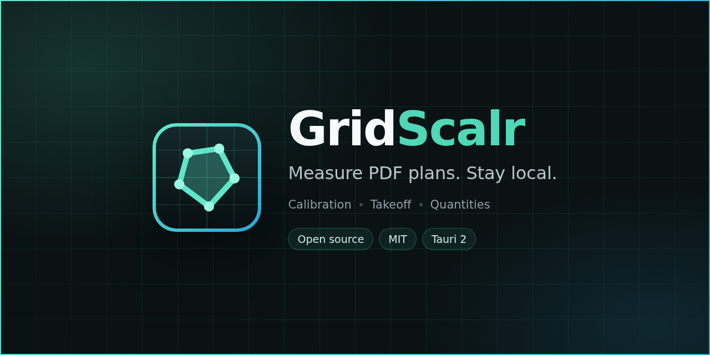
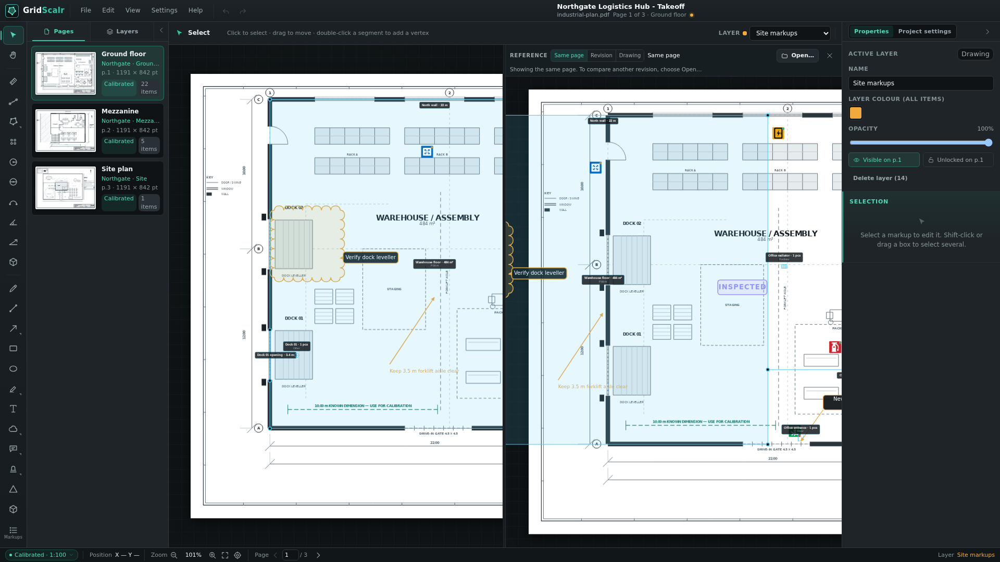
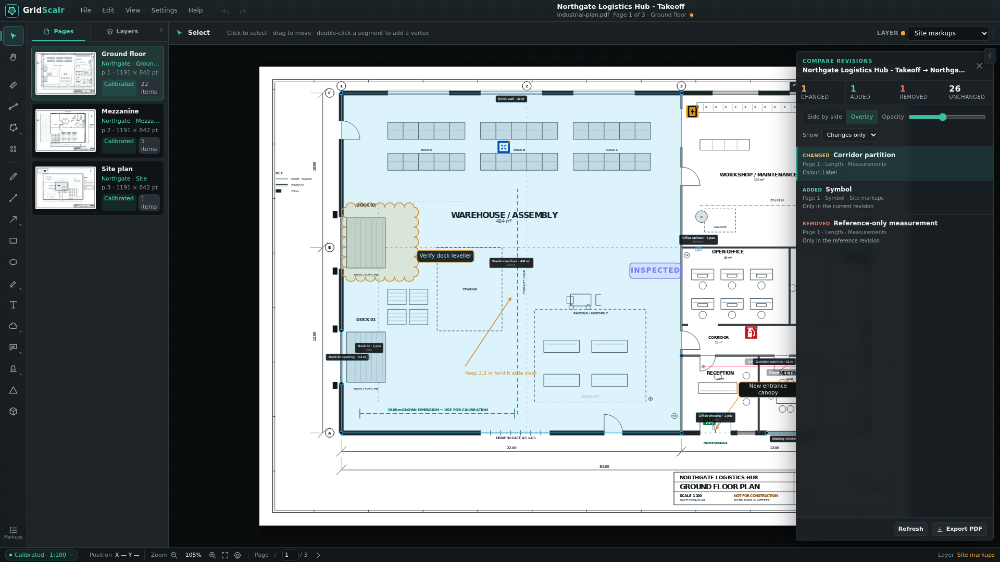
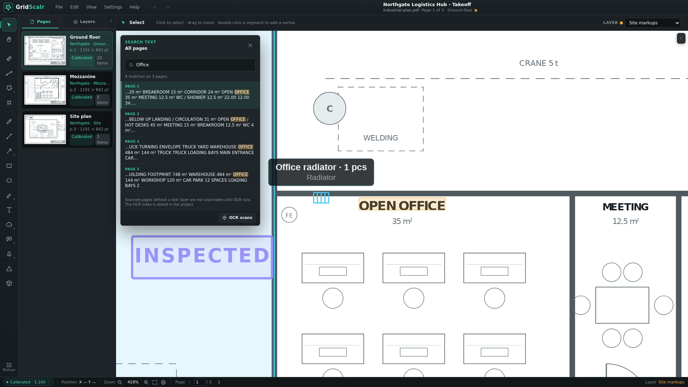

# GridScalr

GridScalr is a local-first desktop app for opening PDF and TIF drawings,
calibrating their scale, measuring lengths and areas, and turning the result into
procurement quantities. Everything stays on your machine: no account, no cloud,
no telemetry.

[](https://github.com/MajorJohnDoe/gridscalr/actions/workflows/ci.yml)
[](https://github.com/MajorJohnDoe/gridscalr/releases/latest)
[](LICENSE)
[](#requirements)


## Download

Grab the newest build from [Releases](https://github.com/MajorJohnDoe/gridscalr/releases/latest):

| File | Use |
| --- | --- |
| `GridScalr_<version>_x64-setup.exe` | NSIS installer, recommended on Windows |
| `GridScalr_<version>_x64_en-US.msi` | MSI for managed Windows machines |
| `gridscalr.exe` | Portable executable, no installation |
| `SHA256SUMS.txt` | Checksums for verifying the download |

The Windows builds are not code-signed. Read [Windows SmartScreen](#windows-smartscreen)
before the first launch. Linux and macOS builds can be produced from source.

## What it does

- Open PDF plans locally with PDF.js, or scanned TIF drawings with lossless
  CCITT G3/G4 import.
- Keep several sheets in one project. Every new drawing appends pages after the
  existing ones, so a set of plans shares one takeoff.
- Calibrate each page against a known dimension, enter a printed 1:N scale, apply
  it to all pages, and lock a page scale against changes.
- Measure multi-segment lengths, radius, diameter, three-point arcs, angles,
  slopes, polygon volumes from area and depth, polygon areas, quick rectangles
  and ellipses, and count doors, windows, radiators and fixtures as pieces.
- Snap to endpoints, midpoints and intersections between visible markup
  segments, with an adjustable screen-pixel threshold.
- Draw pen strokes, lines, arrows, rectangles, ellipses, highlights, revision
  clouds, callouts, stamps, revision deltas and text notes.
- Place searchable facility symbols from a built-in library of 52 original
  classic sign plates, rotate them, resize them by dragging a corner and give
  them an inspection status.
- Organise everything in separate measurement and drawing layers with per-item
  visibility and locks, multi-select, bulk edits and a docked Markups table with
  saved views, filters and grouping.
- Review gross, deduction, net, waste and order quantities per category,
  room and page, then export a CSV, an Excel workbook or a print-friendly PDF
  report.
- Open a synchronized reference pane showing the same page, a saved revision or
  a raw PDF drawing beside the primary canvas. Pan, zoom and page changes stay in
  step.
- Compare a saved revision in side-by-side or overlay mode, review changed,
  added and removed markups, hide the comparison panel while you work, and
  export a comparison PDF without touching either source drawing. A PDF drawing
  reference supports the same visuals and export without a markup diff.
- Search every page, run local English/Swedish OCR on scanned sheets, jump to a
  highlighted result, and keep the PDF and OCR indexes on your machine.
- Export the drawing as a flattened PDF with page ranges, crops, visible layers,
  labels and a legend, plus markups CSV, project JSON and PNG.
- Undo/redo, autosave recovery, recent files, and the user guide bundled under
  **Help**.

Hidden items never render, hit-test or export. Locked items stay visible and
exportable but cannot be moved, edited or deleted. Derived quantities are always
calculated from item data.

## Screenshots

| Measure and annotate | Review quantities |
| --- | --- |
|  |  |
| **Drawing and measurement layers.** Tools stay on the matching layer type, with categories, rooms and deductions. | **Live procurement quantities.** Review gross, deduction, net, waste and order quantities before export. |

| Markups and layers | Drawing export |
| --- | --- |
|  |  |
| **Field annotations.** Revision clouds, callouts, stamps and text notes live on drawing layers. | **Controlled PDF output.** Choose pages, crop, visible layers, labels and an optional legend. |

| Markups list | Workflows in the app |
| --- | --- |
|  |  |
| **Find every item.** Search, select and navigate measurements and drawings across all pages. | **Task-oriented help.** The same guides ship inside the app under **Help**. |

| Reference pane | Excel handoff |
| --- | --- |
|  | **Procurement workbook.** Export summary, category, room, page, markup and source-notes sheets from the same takeoff data. |
| **Compare while you work.** Choose the same page, a revision or a PDF drawing; the reference follows every pan, zoom and page change and never edits the project. | **No second source of truth.** The XLSX workbook is generated on demand from the measurements. |

| Revision or drawing comparison | Full-text search |
| --- | --- |
|  |  |
| **Review before you act.** Switch between side-by-side and overlay, follow warnings, and jump to every changed item. A PDF drawing reference compares the visuals only. | **Find text fast.** Search PDF text layers or run local OCR on scans, then highlight the exact result on the plan. |
| **No merge, no source changes.** The reference stays session-only and both drawings remain read-only. | **Local index.** PDF text is indexed in memory; OCR words are stored in the project for reuse. |

More screens, including the Markups table, the symbol library, revision
comparison, full-text search and the in-app workflows, are captured in
[docs/screenshots](docs/screenshots).

## Requirements

- Node.js 22.12 or newer (tested with Node 24)
- npm 10 or newer
- Rust 1.77.2 or newer
- [Tauri 2 platform prerequisites](https://v2.tauri.app/start/prerequisites/)

On Debian or Ubuntu:

```bash
sudo apt update
sudo apt install -y \
  build-essential curl wget file pkg-config \
  libwebkit2gtk-4.1-dev libgtk-3-dev \
  libjavascriptcoregtk-4.1-dev libsoup-3.0-dev \
  libayatana-appindicator3-dev librsvg2-dev patchelf
```

## Install and run

```bash
npm ci
npm run tauri dev
```

Browser-only UI work:

```bash
npm run dev
```

The browser fallback reads files through the picker and downloads exports. It
cannot use native paths, recent files or autosave recovery; the desktop build is
the product.

Production builds:

```bash
npm run build                        # type-check and build the Vite frontend
npm run tauri build                  # desktop app and platform bundles
npm run tauri build -- --no-bundle   # desktop binary only
```

## Try the sample drawing

`fixtures/industrial-plan.pdf` is a reproducible three-sheet A3 sample: a
ground-floor warehouse and office plan at 1:100, a mezzanine at 1:50 and a site
plan at 1:400, with a 10.00 m calibration dimension on page 1.

`fixtures/demo-project.gridscalr` is a calibrated takeoff with categories, rooms,
deductions and drawing annotations. Open it in the desktop app to explore every
panel with realistic sample data. Regenerate the sample set with:

```bash
npm run fixture     # fixtures/industrial-plan.pdf
npm run docs:demo   # fixtures/demo-project.gridscalr
```

## Documentation

| Document | Contents |
| --- | --- |
| [User guide](docs/user-guide.md) | The full workflow, panel by panel. Same content as **Help** in the app. |
| [Workflows](docs/workflows.md) | Task-oriented guides for site work and technical property management. |
| [Shortcuts](docs/shortcuts.md) | Every keyboard shortcut. |
| [Architecture](docs/architecture.md) | Source map, design choices, tests and fixtures. |
| [Project files](docs/project-file.md) | The `.gridscalr` format, schema history and migration rules. |
| [Known limitations](docs/limitations.md) | What the app deliberately does not do yet. |
| [Releasing](docs/releasing.md) | The manual release checklist. |
| [Roadmap](docs/roadmap.md) | Shipped milestones, deferred work and open decisions. |

The same reference material ships inside the app: **Help → User guide**,
**Help → Workflows**, **Help → Keyboard shortcuts** and **Help → About**, which
reports the running version and the project-file schema read from the code.

## Privacy and security

GridScalr reads drawings from disk and writes only where you ask it to. There is
no network access, no account, no telemetry and no automatic update service. The
source PDF or TIF is never modified; every save and export refuses to overwrite
any document that belongs to the project. Project data autosaves to a local
IndexedDB recovery store.

See [SECURITY.md](SECURITY.md) for the threat model and the private reporting
channel.

## Windows SmartScreen

The installers are not code-signed. Code-signing certificates for Windows cost
several hundred euros per year, which is not justified for a pre-1.0 project
funded out of pocket. As a result Windows may show **"Windows protected your PC"**
or a browser warning the first time you run the installer.

To proceed: choose **More info → Run anyway**. To verify that the file is the one
published here, compare its SHA-256 hash with `SHA256SUMS.txt` on the release
page:

```powershell
Get-FileHash .\GridScalr_0.13.2_x64-setup.exe -Algorithm SHA256
```

Unsigned builds also trigger more false positives in some antivirus engines. If a
hash does not match, do not run the file and report it through
[SECURITY.md](SECURITY.md).

## Project status

GridScalr is pre-1.0 and uses schema 19 for project files. Schema changes are
migrated automatically when an older project is opened. Interfaces can still
change between minor versions. The
[roadmap](docs/roadmap.md) lists what is done and what is
deliberately deferred.

## Contributing

Contributions are welcome. Read [CONTRIBUTING.md](CONTRIBUTING.md) for the setup,
the checks CI runs, the commit style and the documentation policy. The short
version:

```bash
npm test -- --run
npm run build
npm run check:docs
cargo check --manifest-path src-tauri/Cargo.toml
```

Never attach real customer drawings to an issue or a pull request.

## License

[MIT](LICENSE) © 2026 MajorJohnDoe. Third-party components are listed in
[THIRD_PARTY_NOTICES.md](THIRD_PARTY_NOTICES.md).

## Acknowledgements

Built with [Tauri](https://tauri.app), [PDF.js](https://mozilla.github.io/pdf.js/),
[pdf-lib](https://pdf-lib.js.org) and TypeScript. The facility symbols are
original vector illustrations drawn for this project; they are not certified
SS-EN ISO 7010 reproductions.
