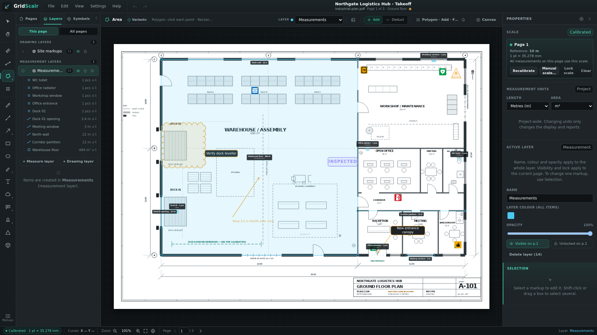

# GridScalr User Guide

GridScalr is a local-first desktop app for measuring PDF and TIF drawings and turning those measurements into procurement quantities. Everything runs on your computer. Drawings are read from disk and are never uploaded.

This guide follows the current interface. For a printable shortcut list, open **Help → Keyboard shortcuts** or read [shortcuts.md](shortcuts.md). For task-oriented walkthroughs, open **Help → Workflows** or read [workflows.md](workflows.md).

## Quick start

1. Choose **File → New project…** or **File → Open drawing…**.
2. Pick a PDF or a scanned TIF drawing.
3. Calibrate the page against a known dimension, or enter the printed scale.
4. Choose a measurement tool and draw on the plan.
5. Review **View → Quantities…**.
6. Save the project with **File → Save**.

The welcome screen also offers **Open drawing**, **Open project**, **Restore last session**, and up to ten recent files.

## The interface

GridScalr uses a compact, drawing-first layout.

- **Menu bar** – File, Edit, View, Settings, and Help.
- **Top bar** – project name, undo/redo, and the unsaved-changes dot.
- **Tool rail** – Select, pan, calibrate, measurement, and drawing tools, plus a **Markups** button at the bottom.
- **Context bar** – the active tool, target layer, tool-specific options, a **New measurement** popover, and a **Canvas** popover for units, smart length labels, snapping, and guides.
- **Left panel** – Pages and Layers only. Page cards can be renamed, given a building/floor location, duplicated and deleted. The Layers tab has a **This page / All pages** scope switch. It opens on Pages, and choosing a measurement or drawing tool switches it to Layers so the target layer is visible. Select and Pan leave the current tab alone. Collapse it with the chevron in the panel header, `Ctrl/Cmd+\`, or **View → Sidebar**.
- **Canvas** – the drawing, markups, selection handles, and inline editors.
- **Markups panel** – optional docked table below the canvas for every measurement and drawing, with configurable columns, saved views, grouping, filters, inline rename, layer changes, visibility, locking, and CSV export. Selecting a row zooms to that markup with 25 % breathing room, but never zooms out further than Fit page.
- **Properties** – the current page scale, measurement units, the active layer, and the selected item. When something is selected, **Selection** moves above the layer-wide settings and is highlighted. Collapse it with **View → Properties**.
- **Status bar** – calibration state, cursor coordinates, zoom controls, page navigation, and the active layer.

Panels remember their width, height and collapsed state between sessions.

## Open drawings and projects

### New project

**File → New project…** starts a fresh project from a drawing. If the current project has unsaved changes, GridScalr asks before discarding them.

### Open a drawing

**File → Open drawing…** (`Ctrl/Cmd+O`) opens a PDF or TIF. With no project open, this creates a new project. You can also right-click an empty spot in the **Pages** panel and choose **Add pages…**.

A PDF or TIF with several sheets opens a page picker with a preview of every page before anything is imported. Clear the pages you do not need, or use **Select all** / **Clear all**, then choose **Create project** or **Add pages**. Single-page files skip the picker.

With a project already open, the selected pages are **added after the existing pages**. The picker shows where they will land. New sheets never change existing page numbers unless you explicitly delete a page.

### Open a project

**File → Open project…** (`Ctrl/Cmd+Shift+O`) opens a `.gridscalr` file. The source PDFs are referenced by path and SHA-256; if a PDF has moved, GridScalr asks you to locate it.

### Recent files

**File → Open recent** lists the ten most recent projects and drawings. The welcome screen shows the same list. Use **Clear recent list** to remove the entries. Recent files require the desktop app; the browser preview cannot reopen local paths.

### TIF drawings

Scanned drawings in **TIF/TIFF** are imported as real pages with their own paper size and scale. The format is detected from the file contents, not the extension.

- 1-bit CCITT Group 3 or Group 4 scans are embedded losslessly, without re-encoding.
- The page size comes from the scan's DPI tags. DPI gives the paper size, not the drawing scale, so calibrate against a known dimension as usual. If the scan has no resolution tags, 300 DPI is assumed and a warning is shown.
- Multi-page TIFFs become several pages. Reduced-resolution preview images are skipped. Orientation tags 1, 3, 6, and 8 are honoured.
- The converted PDF is embedded in the `.gridscalr` file, so the project keeps working even if the original scan is moved.
- Limits: 400 megapixels per page and 200 MB per file. Other compressions (LZW, Deflate, JPEG-in-TIFF), tiled TIFFs, and colour or greyscale scans are rejected with a message.

### Page thumbnails

The **Pages** tab shows a preview of each sheet along with its page size, calibration state, and item count. Previews follow the sheet's aspect ratio, trim obvious white page margins, and show the source drawing, not your markups.

Previews are produced on demand: only the cards near the visible part of the list are rendered, one page at a time, and the result is cached for the session. Opening a project with many pages therefore does not rasterise every sheet up front. A very large scanned TIF can still take a moment the first time its preview is built; the page itself is unaffected. Clearing the project or deleting a page discards the cached previews.

Right-click an empty spot below the page cards to open **Add pages…**. The menu does not appear on a page card, which has its own menu with **Go to page**, **Rename page…**, **Set location…**, **Duplicate page…**, and **Delete page…**.

Double-click a page name to rename it inline. Named pages show their title in the card and in the top bar; unnamed pages keep the automatic **Page N** label. **Set location…** adds an optional building and floor to the sheet. These labels are used by Markups grouping and follow a duplicated page, but they do not affect measurements, quantities or exports.

### Duplicate a page

Right-click a page card and choose **Duplicate page…**. Choose whether to copy:

- **Page name** – the name is editable before duplicating.
- **Page scale** – keeps the calibration and scale lock.
- **Markups and drawings** – copies every item on the source page.

The copy is appended at the end and references the same source sheet. The original PDF or TIF is never modified. Page-specific layer visibility, lock settings, building and floor labels always follow the copy. Duplicating is structural and cannot be undone. It is useful when the same drawing needs a separate takeoff, such as one page for windows and another for doors.

### Delete a page

If you imported the wrong drawing, delete the page from the **Pages** tab:

1. Right-click the page card and choose **Delete page…**.
2. Confirm the warning.

Deleting a page:

- Removes all measurements, highlights, images, and page scale stored on that page.
- Moves measurements and page state on later pages down one page number.
- Keeps every earlier page on its existing number.
- Deletes the source document reference when its last remaining page is removed. The original PDF or TIF file on disk is never modified.
- Cannot be undone.

A project must keep at least one page. New drawings are still always added at the end.

## Set the page scale

A page scale is required for real-world length and area values. The scale is stored per page.

### Calibrate against a known dimension

1. Choose **Calibrate** in the tool rail, or open **Properties → Scale → Calibrate**.
2. Click the two ends of a dimension with a known real-world length.
3. Enter the length and choose its unit (mm, cm, m, in, ft, or yd).
4. Optionally apply the scale to every page and update existing measurements.

### Enter a printed scale

Choose **Properties → Scale → Manual scale…** and enter the printed drawing ratio as `1:N`. Presets for 1:50, 1:100, 1:200, and 1:400 are available.

Manual scale assumes the PDF page is at its physical paper size: 1 mm on paper equals N mm in the real world. It replaces a reference calibration on the affected pages and draws no reference line or calibration label.

### Apply and lock

- **Apply to all pages** copies the scale but not the lock, and skips locked pages.
- **Lock scale** prevents changing the scale through calibration, manual scale, editing, or clearing. The lock is undoable and does not affect measurements, exports, zoom, or page navigation.
- Clearing a page scale does not delete measurements. Measurements created while a page was calibrated keep a scale snapshot and their original values.

Measurements without a scale are shown in PDF points (`pt` / `pt²`) and are excluded from quantity totals.

## Measure

Measurements are added to the active **measurement layer**. Choose the target layer in the context bar or the Layers tab. New measurements use a **0.75 pt** paper-space line weight; change it in **Properties → Stroke width** from 0.25 to 8 pt. The line weight is stored per item and is used by the PDF export.

### Length

Choose **Length** (`L`) and click each vertex. Press `Enter` or double-click to finish. Hold `Shift` to constrain the angle.

Length measurements can use a **Solid** or **Dashed** line style in Properties. With **Smart length labels** enabled, metric lengths below 1 m use the project unit and longer values switch to metres. Drag the value label on the plan to place it manually when labels are tight; a visible leader line connects it to the nearest point on the line or outline. Right-click the label to **Reset label position** or **Choose connection point…** and then click the exact point on the line. The same label dragging works for areas and counts.

### Area

Choose **Area** (`A`) and select **Polygon**, **Rectangle**, or **Ellipse** in the **New measurement** popover.

- **Polygon** works click-by-click. Click around the perimeter, then click the first vertex or press `Enter` to close it.
- **Rectangle** and **Ellipse** are quick areas drawn by dragging from one corner to the opposite corner.
- Hold `Shift` while dragging a quick area to make a square or circle.
- Use the **Add / Deduct** switch in the context bar before drawing. Deductions are subtracted inside the same category and room.
- The same mode is available in the **New measurement** popover and by right-clicking or long-pressing the Area tool.

### Count

Choose **Count** (`C`), pick a door, window, radiator, fixture, or other object type, and click the plan. Every count is exactly `1 pcs` and carries a built-in vector symbol.

### Category and room

While a measurement tool is active, the context bar shows a **New measurement** button with the current category and room. The Area tool also shows a direct **Add / Deduct** switch. Open the **New measurement** popover to change the category, room, object type, area shape, and add/deduct mode. The last choice is kept for the next measurement. Room names autocomplete from rooms already used in the project.

Change a measurement's category, room, area mode, line style, or count type later in **Properties**, or for several selected measurements at once. When a markup is selected, the **Selection** section is shown above **Active layer** so it is clear whether a change applies to one markup or the whole layer.

### Snapping

When **Snap to geometry** is enabled in the **Canvas** popover, point placement can lock to:

- Endpoints and corners of visible markup segments
- Segment midpoints
- Intersections between straight markup segments

The snap marker names the target type. Hidden items and hidden layers never provide snap targets; locked but visible items do. Set the snap distance in Settings from 2 to 24 screen pixels.

## Draw and annotate

Use the pen, line, arrow, rectangle, ellipse, highlight, cloud, callout, stamp, delta, and text tools. Drawing items are added to the active **drawing layer**. Drawing layers render below measurement layers, so measurement labels stay readable.

Hold `Shift` while drawing lines, arrows, rectangles, or ellipses to constrain angles or proportions.

### Revision cloud

Choose **Revision cloud** (`D`) and click each corner. Close the shape on the first point or press `Enter`.

Long-press or right-click the cloud button in the tool rail, or choose **Variants** in the context bar, to pick **Cloud** or **Cloud + text**, and one of the fill presets: **No fill**, **Blue**, **Orange**, **Green**, or **Red**. Form and fill are independent, so Red + Cloud + text and Red + Cloud are both available without separate tools. The default is **Cloud** with no text box and no fill. The context bar also has quick **Text box** and **Fill** controls. The cloud can be reshaped with its vertex handles. Double-click the cloud, use **Edit text…** in Properties, or right-click it to edit its text box.

Every cloud gets an attached text box with a leader arrow to the cloud edge. Select the cloud and drag the round label handle, or drag inside the text box, to move the box independently. When the whole cloud is moved, the box keeps its relative position.

Double-click the text box, use **Edit text…** in Properties, or right-click the cloud to open the inline editor. It edits the cloud text in place with font size, text colour, bold, underline, left/center/right alignment, **Cancel**, and **Done**, just like the Text tool. Drag the square handle at the lower-right corner of the editor to resize the text box; the fixed width and height are then shown in Properties. Empty width/height means automatic sizing.

Clouds use the current drawing colour and line weight. Use **Fill** in Properties to add a translucent background colour, then set **Fill opacity** to roughly 20–30% so the drawing and text underneath stay readable. Hatch patterns are not available yet. Scallop size follows the cloud size automatically; set an exact **Scallop size** in Properties if you want smaller or larger arcs. The text box is optional. Its font size, width, and height can be changed in the context bar and Properties; leave the width or height empty for automatic sizing.

### Callout

Long-press or right-click the Callout button to choose the leader colour: Blue, Orange, Green, Red, Violet, or Graphite. The text colour is changed separately in the inline editor.

Choose **Callout** (`N`). Click the object the callout should point at, then click where the text box should sit. The inline editor opens immediately with size, text colour, bold, underline, alignment, Cancel, and Done. The leader ends in a filled arrow exactly at the target.

Double-click the text box, use **Edit text…** in Properties, or right-click the callout to edit it inline later. Drag the box itself or its vertex handle to move the text independently, or drag the square handle at the lower-right corner of the inline editor to resize the box. Font size and optional text box width/height are available in Properties; empty width/height means automatic sizing. Wrapped lines follow the measured text box width, so resizing the box changes where the lines break.

### Stamp

Long-press or right-click the Stamp button to pick a project status preset, or choose **Custom…**. The preset list uses the status colours. A placed stamp can still get an individual colour override in Properties.

Choose **Stamp** (`S`) and select a preset in the context bar, its **Variants** popover or the tool flyout. Click the plan to place it. **Custom…** lets you type a one-off status, and double-clicking or right-clicking a placed stamp edits only that stamp, not the preset list.

Stamp colours follow common statuses: **APPROVED** is green, **NOT APPROVED** is red, **FOR INFORMATION** is blue, **INSPECTED** is violet, and **REVISED** is orange. The same colours are recognised for **GODKÄND**, **EJ GODKÄND**, **FÖR KÄNNEDOM**, **BESIKTIGAD**, and **REVIDERAD**. Custom statuses keep the current stamp colour. Stamps use a bold, letter-spaced label.

Project stamp presets are managed under **Settings → Project settings → Stamps**. App defaults for new projects are stored locally on the computer; new projects inherit them, while each project keeps its own list.

### Arrow

Long-press or right-click the Arrow button, or choose **Variants** in the context bar, to pick **Single** or **Double** arrowheads and a colour preset. The same head and colour controls are available in the context bar and Properties.

### Revision delta

Choose **Revision delta** (`Y`), enter the revision number or letter in the context bar, and click to place the triangle. Double-click or right-click the delta to edit its revision text. An optional date can be entered as its label in Properties.

### Text notes

Choose **Text** (`T`) and click the plan. The inline editor accepts multiple lines:

- `Enter` commits the text.
- `Shift+Enter` inserts a line break.
- `Esc` cancels the edit.
- Clicking outside the editor also commits.

The floating strip beside the editor sets font size, colour, rotation, bold, underline, and left/center/right alignment. Text notes and annotation boxes are drawn at the same weight on the canvas and in exports; bold text uses the bold export font. Double-click an existing text note with the Select or Text tool to reopen it.

### Resize and rotate

Select a text note, arrow, rectangle, ellipse, or other drawing item to reveal handles.

- Drag a corner or edge handle to resize. Text corner handles scale the font size.
- Drag the round handle above the selection to rotate. Hold `Shift` to snap to 15° increments.
- Line, arrow, pen, and highlight rotation is baked into their points; text, rectangles, and ellipses store a rotation angle.
- Measurement geometry stays vertex-editable from its points. Rectangle and ellipse quick areas expose their two opposite defining points and have no rotation handle.

Each drag or inline edit is one undo step.

## Images

Use **File → Import image…** or the context bar to add a PNG or JPEG. `Ctrl/Cmd+V` also inserts an image when the clipboard contains one; when it does not, the same shortcut pastes markups.

- Images are embedded in the project, so the `.gridscalr` file stays portable.
- Each image is limited to 20 MB and 4000 px on its longest side. Larger images are proportionally downscaled.
- PNG transparency is preserved. JPEG files are re-encoded at quality 0.85 when resizing or size reduction is needed.
- A new image is placed on the current page and on a visible, unlocked drawing layer.
- Choose **Background** mode to place the image above the PDF but below every markup, or **Annotation** mode to use normal layer order.
- Properties exposes opacity, rotation, layer, visibility, lock state, duplicate, and delete. Corner handles resize proportionally; side handles change one dimension.
- Images follow the same visibility and locking rules as other items.

## Layers

Open the **Layers** tab in the left panel. The **This page / All pages** switch controls the scope.

- **This page** lists layers created on the current page or used by at least one item on it.
- **All pages** lists every layer and edits the project-wide defaults.
- **Eye** shows or hides a layer. In **This page** scope this applies only to the active page; in **All pages** it changes the default and clears page overrides.
- **Lock** prevents moving, editing, and deleting its items. In **This page** scope this applies only to the active page; in **All pages** it changes the default and clears page overrides.
- Click the colour swatch to change the layer colour.
- Double-click anywhere on a layer row to rename it inline.
- Drag layers within their group to reorder them.
- Use the chevron to expand a layer and list the items on the current page, or every item in **All pages** scope, newest first.
- Click an item to jump to its page and select it. `Shift`/`Ctrl`/`Cmd`-click adds it to the current selection.
- Right-click a layer for layer actions, or right-click an item for copy, cut, duplicate, visibility, lock, move and delete.
- Use **+ Measure layer** or **+ Drawing layer** to add layers on the current page.
- Move the selected item to another layer from Properties or the right-click menu.

A page with no layers shows **No layers on Page N yet** with the create-layer buttons. Layers keep their name, colour and order across pages; only visibility, lock and the item list are page-scoped. Page-scoped visibility is used by hit-testing, snapping, quantities, Markups CSV and every PDF export.

Measurement layers and drawing layers stay separate. The **Layer** picker in the context bar shows which layer receives new items. If the active layer is hidden or locked on the current page, the picker shows a warning. Choosing a tool automatically switches to a visible, unlocked layer of the matching kind; if none exists, a new layer is created on the current page.

Hidden items do not render, hit-test, or export. Locked items stay visible and exportable but cannot be moved, edited, or deleted.

## Select and edit

Use the Select tool (`V`) to:

- Click one markup.
- `Shift`/`Ctrl`/`Cmd`-click to add or remove markups.
- Drag on empty canvas to marquee-select everything inside the box.
- Move selected items together.

Properties shows the selection and offers bulk actions:

- Move all selected items of one kind to another layer.
- Set a common colour and line weight.
- Hide or show the selection.
- Lock or unlock the selection.
- Duplicate or delete the selection.

When every selected item is a measurement, Properties also offers:

- Setting one category or one room. Leave the room field empty and choose **Apply** to clear rooms.
- Setting **Add** or **Deduct** when every selected measurement is an area.
- Setting one object type when every selected measurement is a count.

Locked measurements are skipped by bulk edits and reported in a toast. Every bulk action is one undo step, even across layers.

### Clipboard

The internal clipboard supports `Ctrl/Cmd+C`, `X`, and `V`, and `Ctrl/Cmd+D` duplicates the selection. Pasting on another page keeps the original PDF coordinates; pasting on the same page offsets the copy by 12 pt. Duplicate uses the same offset. The clipboard is in memory only and is not shared with the operating system.

### Find and navigate measurements

Open **View → Markups list…**, click the **Markups** button at the bottom of the tool rail, or press `Ctrl/Cmd+L` for a docked, searchable table of every measurement and drawing across the project. The table stays open while you navigate the drawing. Clicking a row selects the item and zooms to it with 25 % breathing room; the view never zooms out further than Fit page. Ctrl/Shift/Cmd-click only changes the selection without moving the view.

- Filter by **All pages** or **Current page**, measurement/drawing type, category, or the search field.
- Use **Columns** to show or hide table columns. Name is always visible.
- Use **Group by** to create collapsible groups by category, room, page, layer, or **Building → Floor → Room**. Building and floor come from **Pages → right-click → Set location…**.
- Click a sortable column heading to sort, click again to reverse, and a third time to return to the default page/layer/name order.
- Click a row to go to its page and select the markup.
- Double-click a name or use the rename button to edit the label inline.
- Change the layer from the row picker, and use the eye and lock controls for per-item visibility and locking.
- Right-click a row for copy, cut, duplicate, hide/show, lock/unlock, move to layer, and delete.
- **Select all** selects every row matching the current filter. **Export CSV** writes the Markups CSV for the whole project, not only the visible view.
- Close the panel with its close button, the tool rail button, or `Ctrl/Cmd+L`. The panel remembers its height between sessions.

### Markups views

A view stores the visible columns, page/type/category filters, search text, grouping and sort order. Views belong to the project, so a colleague who opens the same `.gridscalr` file gets the same set-up.

- Start from **All markups**, configure the table, then choose **More view options → Save as new view…**.
- Choose the view from the **Markups view** selector to apply it.
- After changing a saved view, the amber dot marks unsaved changes. Click the check button to update the view.
- **More view options → Manage views…** renames or removes saved views. Removing the active view returns the table to All markups.
- Applying another view while there are unsaved changes asks before discarding them.

## Highlight modes

Long-press or right-click the Cloud, Highlight, Callout, Stamp, and Arrow buttons, or choose **Variants** in the context bar, for additional variants. The small corner triangle shows that alternatives exist. The **Highlight** tool (`G`) also exposes the same three modes in the context bar:

- **Pen** – the original freehand highlighter.
- **Rectangle** – drag a translucent highlight box.
- **Polygon** – click a translucent highlight area and close it with `Enter` or the first point.

Existing projects keep their freehand highlights; new highlights use the selected mode.

## Quantities

Open **View → Quantities…** (`Ctrl/Cmd+Alt+Q`) to summarise the measurements currently included by the filters.

Each row covers one category, room, and measurement type and shows gross, deduction, net, waste, order quantity, and item count. Category and room headers provide subtotals, and a total row summarises each measurement type.

- Filter by current or all pages, one category, a room substring, or any combination of measurement layers.
- Hidden items and hidden layers are excluded by default and reported in a note. Locked items are included.
- **Include hidden items and layers** counts them in the live dialog.
- Area deductions are subtracted inside the same category and room only. If a deduction exceeds its gross area, the net is clamped to zero and the row shows a warning.
- Length and area values use the project units, including yd². Counts always use pcs.
- Measurements without a scale are excluded and counted in a note.

Quantities are derived from the current items every time the data changes and are never stored in the project file.

### Waste and rounding

Set project defaults under **Settings → Project settings → Quantities**:

- **Waste** is a percentage of net, from 0 to 100.
- **Rounding step** controls how order quantities round up. A step of 0 means no rounding.
- A category can override either value in **Settings → Manage categories…**. Leave a field empty to inherit the project default.
- Rounding always goes up. Counts always round to whole pcs even when another step is configured.
- Order quantity is never lower than net.

### Export quantity reports

Use the **CSV** or **PDF** buttons in the Quantities dialog, or **File → Export → Quantities to CSV / Quantity report (PDF)**.

Reports cover every page and every category, exclude hidden items and hidden layers, and include locked items. Dialog filters do not affect the exported report. Reports are generated on demand and never stored in the project file.

- CSV is UTF-8 with BOM, comma delimiters, CRLF line endings, point decimals, three decimals for length and area, and whole numbers for counts.
- The PDF report is A4 portrait with category sections, subtotals, totals, repeated table headers, page numbers, a hidden-item notice, and a warning for clamped deductions.

## Save and export

### Save

- **File → Save** (`Ctrl/Cmd+S`) writes a `.gridscalr` project file.
- **File → Save as…** (`Ctrl/Cmd+Shift+S`) writes to a new path.

The source PDF is never overwritten. Every save and export refuses a destination that matches any source document in the project, including a second PDF or TIF in a multi-document project. Autosave keeps a recovery snapshot in a local IndexedDB database; a localStorage fallback is used only when IndexedDB is unavailable. If neither can be written, GridScalr reports the problem instead of failing silently.

Closing the window with the title-bar X, **File → Quit** (`Ctrl/Cmd+Q`), or Alt+F4 asks before discarding unsaved changes. Discarding also removes the recovery snapshot.

### Export

**File → Export** contains:

- **Drawing PDF…** – opens the drawing export dialog. Choose whole pages or a selected area, current page / all pages / a page range, visible layers, labels, the calibration line, and an optional legend. The export writes `<project>-markups.pdf`.
  **Selected area** enters a one-off crop mode. Drag a rectangle, adjust it with the handles, then press `Enter` or **Use area**. `Esc` cancels. The crop is stored relative to the page and applied to every selected page.

  A layer hidden on every page is listed but disabled. A layer hidden on one page is skipped there and still exported where it is visible. Hidden items are always excluded; locked items are exported.

  **Legend** adds a separate A4 page at the end of the export.
- **View as PNG** – exports the rendered page and markup layers at the current view.
- **Markups to CSV** – exports page, type, layer, label, computed value, unit, details, and PDF-coordinate vertices.
- **Quantities to CSV** – writes `<project>-quantities.csv` for spreadsheets and procurement tools.
- **Quantity report (PDF)** – writes `<project>-quantities.pdf`.
- **Project to JSON** – exports the project payload without requiring a `.gridscalr` extension.

All export formats exclude hidden items and hidden layers. Locked items are still exported. Selection handles, hover states, and vertex markers are editing aids and are never included in an export.

## Settings

Open **Settings → Project settings…** (`Ctrl/Cmd+,`).

- **Page scale** – shows the current page's calibration or manual scale and whether it is locked. Change it in **Properties → Scale**.
- **Units** – length and area units for the project. The same controls are available under **Properties → Measurement units** and in the **Canvas** popover. **Smart length labels** shows metric lengths under 1 m in the selected unit and longer values in metres; quantity reports keep the selected project unit.
- **Display** – show grid, show scale line, snap to geometry, and snap distance. The **Canvas** popover in the context bar provides quick access to the same units and guides.
- **Quantities** – default category, waste percentage, and rounding step.
- **Stamps** – edit the project's stamp presets, edit the app defaults used by new projects, and copy between them.
- **Manage categories…** – rename, reorder, delete, and override waste/rounding per category.
- **Reset panel layout** – restores the default sidebar and Properties widths and expands both panels.

Project settings are stored in the `.gridscalr` file and are undoable while the project is open. Interface preferences such as collapsed panels are stored locally and are not part of the project.

## Help

- **Help → Workflows** opens task-oriented guides for operations technicians and technical property managers.
- **Help → User guide** (`F1`) opens this guide inside the app.
- **Help → Keyboard shortcuts** (`?`) opens the shortcut reference.
- **Help → About GridScalr** shows the installed version and project schema.

The help content is bundled with the application. It does not use the network. Use the search field to filter the current topic, or the table of contents to jump between sections. Screenshots can be clicked to open them at full size.

## Project files

A `.gridscalr` file is UTF-8 JSON. It contains document references, per-page calibrations and locations, settings, categories, saved Markups views, layers, markup items, and embedded images. Referenced PDFs are not embedded; a TIF's converted PDF is embedded because the scan cannot be read directly at render time.

New sheets are always added after the existing pages. Deleting a page is a separate, explicit action: measurements and page scale on that page are removed, later measurements move down one page number, and the operation cannot be undone. Pages cannot be inserted or reordered.

Schema version 12 is the current format. Older projects load normally and are migrated when opened.

## Keyboard and mouse

The full list is in **Help → Keyboard shortcuts** and in [shortcuts.md](shortcuts.md). Common actions:

- `V` select, `H` pan, `K` calibrate, `L` length, `A` area, `C` count.
- `P` pen, `I` line, `U` arrow, `R` rectangle, `O` ellipse, `G` highlight, `T` text.
- `Enter` finishes a shape; `Esc` cancels a draft, clears the selection, or returns to Select.
- `Ctrl/Cmd+Z` undo, `Ctrl/Cmd+Shift+Z` redo.
- `Ctrl/Cmd+0` fit page, `Ctrl/Cmd+1` actual size.
- `Ctrl/Cmd+L` opens or closes the Markups list.
- `PageUp` / `PageDown` change page.
- `Space` + drag pans temporarily.

## Troubleshooting

### The scale looks wrong

Check that the page is calibrated or has the correct manual `1:N` ratio, and that the page scale is not locked. Applying a scale to all pages skips locked pages.

### A measurement is missing from quantities

Hidden items, hidden layers, and measurements without a scale are excluded by default. Check the quantity notice and enable **Include hidden items and layers** only when you deliberately want them counted.

### A PDF cannot be exported

Encrypted source PDFs cannot be flattened without their owner password. GridScalr shows a warning instead of writing a partial file.

### A TIF is rejected

Only 1-bit CCITT Group 3/4 scans are supported. Re-scan colour, greyscale, LZW/Deflate, tiled, or JPEG-in-TIFF images as a supported bilevel TIFF or as a PDF.

### Recent files do not open in the browser

Browser development mode uses the file picker and downloads. Native paths, recent files, and atomic save require the desktop app.

### The window fails to start

Restart the app and make sure Microsoft Edge WebView2 is up to date. On Linux, check the Tauri prerequisites in the README. The boot screen can show technical details for a bug report.
