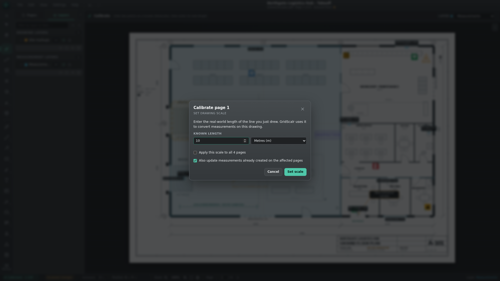
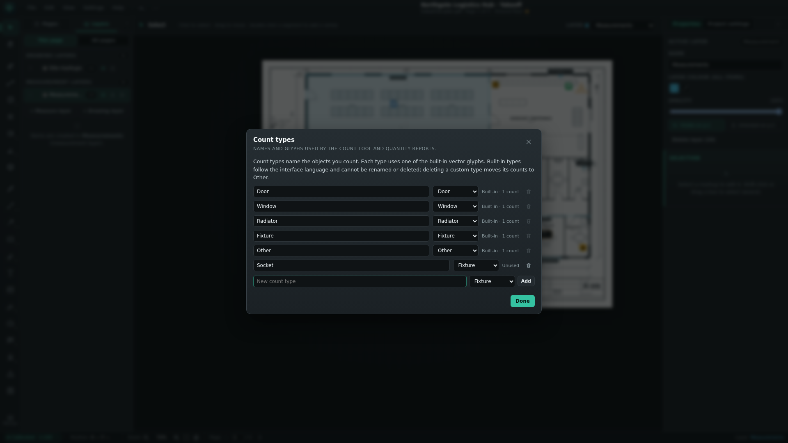
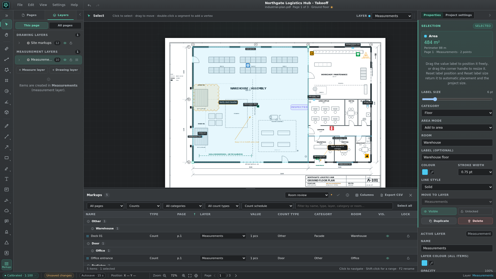
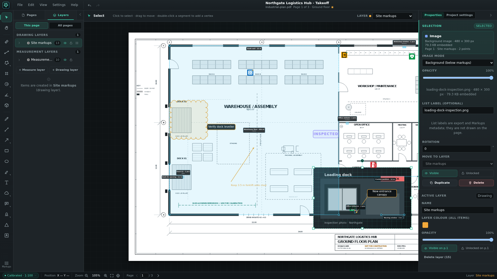
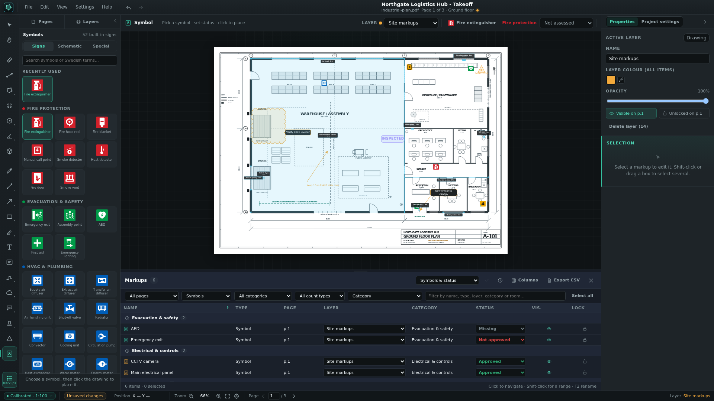
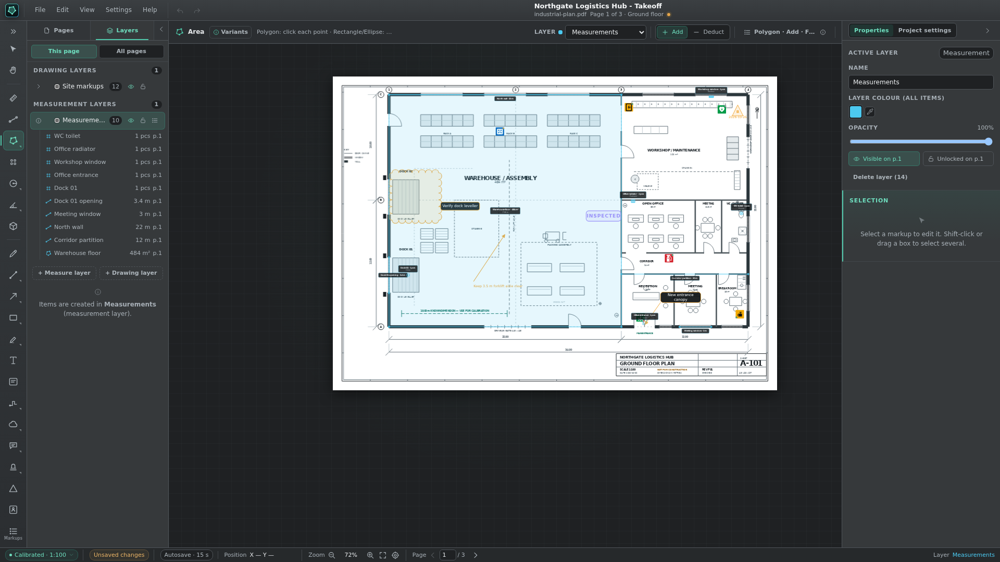
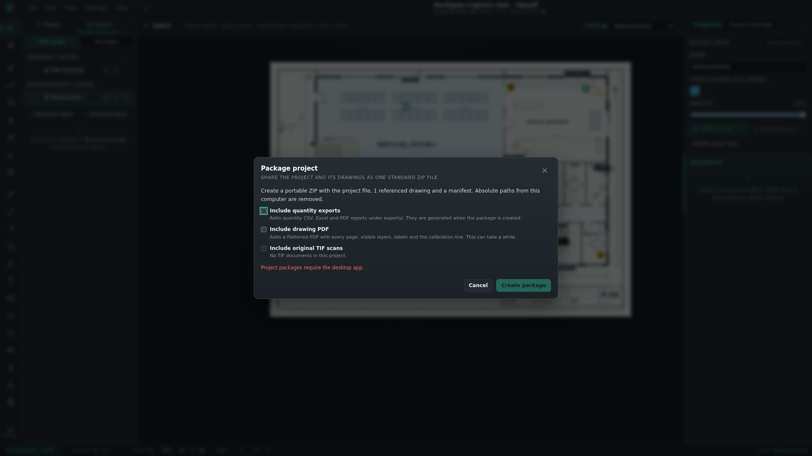

# GridScalr User Guide

GridScalr is a local-first desktop app for measuring PDF and TIF drawings and turning those measurements into procurement quantities. Everything runs on your computer. Drawings are read from disk and are never uploaded.

This guide follows the current interface. For a printable shortcut list, open **Help → Keyboard shortcuts** or read [shortcuts.md](shortcuts.md). For task-oriented walkthroughs, open **Help → Workflows** or read [workflows.md](workflows.md).

## Quick start

1. Choose **File → New project…** or **File → Open drawing…**.
2. Pick a PDF or a scanned TIF drawing, or start from an operation card sheet template.
3. Calibrate the page against a known dimension, or enter the printed scale.
4. Choose a measurement tool and draw on the plan.
5. Review **View → Quantities…**.
6. Save the project with **File → Save**.

The welcome screen also offers **Open drawing**, **Open project**, **Open demo project**, **Restore last session**, and up to ten recent files, plus a three-step quick start: open a drawing or the demo, calibrate the page, then measure and review the quantities.

**Open demo project** loads a bundled sample with one drawing, three sheets and finished measurements. GridScalr copies the demo into its app data folder the first time, so you can edit, calibrate and save it like any project; the bundled files are never changed. Delete the `demo` folder in the app data directory to get a fresh copy.

The demo requires the desktop app. The browser fallback offers open, restore and recent files only.

## The interface

GridScalr uses a compact, drawing-first layout.

- **Title row** – the app mark, the menu bar (File, Edit, View, Settings, Help), undo/redo, the project name with the drawing and page, the unsaved-changes dot, and the window buttons. On macOS the system traffic lights sit at the left of the same row.
- **Tool rail** – Select, pan, calibrate, measurement, drawing and symbol tools, plus a **Markups** button at the bottom.
- **Context bar** – the active tool, target layer, tool-specific options, and a **New measurement** popover. With the Symbol tool it shows the chosen symbol, its category and the next inspection status.
- **Left panel** – Pages and Layers. Page cards can be renamed, given a building/floor location, duplicated and deleted. The Layers tab has a **This page / All pages** scope switch. It opens on Pages, and choosing a measurement or drawing tool switches it to Layers so the target layer is visible. The Symbol tool swaps the panel to the symbol library; selecting Pages or Layers returns to the lists. Select and Pan leave the current tab alone. Collapse it with the chevron in the panel header, `Ctrl/Cmd+\`, or **View → Sidebar**.
- **Canvas** – the drawing, markups, selection handles, and inline editors.
- **Markups panel** – optional docked table below the canvas for every measurement, drawing and symbol, with configurable columns, saved views, grouping, filters, inline rename, layer changes, visibility, locking, symbol status, and CSV export. Selecting a row zooms to that markup, capped at four times Fit page so a small symbol keeps its drawing context.
- **Properties** – the active layer and the selected item, with **Properties** and **Project settings** buttons in the header. Collapse it with the header chevron, `Ctrl/Cmd+Shift+\`, or **View → Properties**; a tab on the right edge reopens it.
- **Status bar** – the clickable page scale, cursor position with its unit, zoom controls, page navigation, and the active layer.

Panels remember their width, height and collapsed state between sessions. The window remembers its size, position and maximised state per user account and restores them when it is on a known monitor.

On a touch screen, one finger draws or selects with the active tool. Use **two fingers** to pan and pinch to zoom around the point between them, over either the primary canvas or the reference pane. When a two-finger gesture starts, an unfinished touch draft is cancelled; lift all fingers before drawing again. While a pen is active, or just after it was used, touch is treated as palm input and does not draw. Long-press an item with the Select tool to open the same context menu as a right-click.

## Reference view

**View → Reference view (same page)** (`Ctrl/Cmd+Shift+2`) opens a second, read-only canvas beside the main one. Its toolbar selects the source:

- **Same page** mirrors the current page. Both panes stay synchronized when you pan, zoom or change pages. The bar shows a short hint explaining that this is not a second drawing.
- **Revision** compares a saved `.gridscalr` project. Choose **File → Compare with revision…**, use **Open…** in the pane, or select **Revision** and pick the file.
- **Drawing** compares a raw PDF drawing. Choose **File → Compare with drawing…**, use **Open…**, or select **Drawing** and pick the PDF.

The bar also names the loaded reference and shows its page count. **Open…** replaces the reference for the current source, and the close button restores the primary canvas. Drag the divider to change how much room each pane gets, and use the mouse wheel over either pane to zoom.

The reference pane is for comparison only: selection, editing, layers and undo belong to the primary canvas. Closing the pane does not change the drawing, the project or the undo history, and the reference state is not stored in the project file.

## Compare a revision or drawing

A revision reference opens a comparison panel beside the canvas:

- **Side by side** shows the current and reference page next to each other with the same pan, zoom and page.
- **Overlay** stacks the reference over the current drawing. Use **Opacity** to make the reference lighter or heavier; white page areas are transparent in this mode.
- **Changed**, **Added** and **Removed** count the differences. The list can be filtered to changes only, one status, or every item, including unchanged items.
- Click a row to jump to that page and item. A reference-only item keeps its position on the reference page even when it no longer exists in the current project.
- Warnings call out different page counts, drawing names and page scales.

The comparison compares measurements, drawings, symbols and their properties. The visual pages show the source drawings; the **Differences** table lists the markup changes. It is not a semantic diff of the PDF's raw vector operators. Edits made while comparing refresh the list after a short pause, and **Refresh** forces it immediately.

A **Drawing** reference is a raw PDF, so it has no markup list. The panel still shows the drawing name and page count, keeps **Side by side**, **Overlay** and **Opacity**, and explains that no markup comparison is available. **Export PDF** writes `<project>-comparison.pdf` with a summary and page-by-page visuals. For a revision it also includes warnings and the difference table. The export refuses to overwrite any source drawing. Close the comparison with **Close comparison**; the reference pane returns to the same-page layout if it was open before.

Use the collapse chevron in the panel header to hide the comparison panel while you work on the drawing. A **Compare** tab at the right edge of the canvas brings it back; closing the reference pane removes the tab.

## Search text

**View → Search text…** (`Ctrl/Cmd+Shift+F`) searches across every page. Digital PDFs use their PDF text layer. For scanned TIF pages and image-only PDF pages, choose **OCR scans** in the search panel to run local OCR with bundled English and Swedish models. Type a room name, equipment tag, sheet number or phrase; results show the page and a snippet. Select a result to jump to the page and highlight the matching text on the drawing. Use `↑` / `↓` and `Enter` to move through results without leaving the panel.

OCR is a deliberate action because it takes time. The resulting words, bounding boxes, engine and source checksum are stored in the project file, so reopening the project does not OCR the same page again. The PDF text index itself is built in memory and discarded when the project closes. Search and OCR run entirely on the machine; nothing is uploaded. OCR quality depends on scan resolution and contrast, and only the bundled English and Swedish models are available.

## Open drawings and projects

### New project

**File → New project…** asks for the source: a PDF/TIF drawing or an operation card sheet. For a sheet, choose a template, paper (A3 or A2) and a project name. The first sheet is added immediately with its title block ready to fill in. If the current project has unsaved changes, GridScalr asks before discarding them.

### Operation card sheets

An operation card sheet is a page created from a built-in template instead of a PDF. It has a title block and revision table on every sheet.

- **Add a sheet:** open the Pages panel menu or the empty area context menu, choose **Add pages**, then **Operation card sheet**, a template, paper and a sheet name. Sheets append at the end, like imported pages.
- **Fill in fields:** double-click a cell, or choose **Edit sheet fields…** from the page card menu. The form edits every field on the sheet. Table cells can also be filled directly on the canvas.
- **Multi-line fields:** project name, logo and the wide system/equipment cell accept up to three lines; title-block values accept two. Press `Enter` for a new line inside a multi-line cell, or `Ctrl/Cmd+Enter` to commit. Long lines wrap inside the cell.
- **Data summary:** choose the **Data summary** template for a sheet with a table. The table has fixed column headers and 9 mm rows; the number of rows depends on the paper (about 23 on A3, more on A2). Fill the cells in the form or double-click them. Need more rows? Create another data-summary sheet and continue there.
- **Page number:** the **Page** field is free text. It is prefilled with the sheet ordinal and never updated automatically.
- **Export:** fields are drawn into the PDF even when every layer is hidden. The exported text is searchable. Hiding layers never hides the title block or table.
- **Not to scale:** template sheets show **Sheet · not to scale** in the status bar and do not need calibration.
- **Paper:** choose A3 or A2 when the sheet is created, or change it under **Edit sheet fields → Paper**. The title block keeps its physical size; the drawing area grows on A2 and the data table gains rows. Field values are kept, including table cells in rows that are currently hidden on a smaller sheet.

### Open a drawing

**File → Open drawing…** (`Ctrl/Cmd+O`) opens a PDF or TIF. With no project open, this creates a new project. You can also right-click an empty spot in the **Pages** panel and choose **Add pages…**.

A PDF or TIF with several sheets opens a page picker with a preview of every page before anything is imported. Clear the pages you do not need, or use **Select all** / **Clear all**, then choose **Create project** or **Add pages**. Single-page files skip the picker.

With a project already open, the selected pages are **added after the existing pages**. The picker shows where they will land. New sheets never change existing page numbers unless you explicitly delete a page.

### Open a project

**File → Open project…** (`Ctrl/Cmd+Shift+O`) opens a `.gridscalr` file. The source PDFs are referenced by path and SHA-256; if a PDF has moved, GridScalr asks you to locate it.

### Open from Explorer or Finder

Installing GridScalr registers `.gridscalr` as a project file type, so double-clicking a project opens it in GridScalr. If GridScalr is already running, the existing window comes to the front and opens the project there instead of starting a second copy.

The same start argument accepts a PDF or TIF drawing: with no project open it starts a new project, and with a project open it opens the page picker and appends the selected pages, exactly like **File → Open drawing…**. GridScalr keeps one project per window, so only the first file in a multi-file launch is opened.

The portable executable and the AppImage do not register file types. Use the installer (`.msi`, NSIS setup, `.deb` or `.dmg`), or open the file from inside GridScalr. GridScalr does not claim `.pdf`, so double-clicking a PDF only opens it here after **Open with…**.

### Recent files

**File → Open recent** lists the ten most recent projects and drawings. The welcome screen shows the same list. Use **Clear recent list** to remove the entries. Recent files require the desktop app; the browser preview cannot reopen local paths.

### TIF drawings

Scanned drawings in **TIF/TIFF** are imported as real pages with their own paper size and scale. The format is detected from the file contents, not the extension.

- 1-bit CCITT Group 3 or Group 4 scans are embedded losslessly, without re-encoding.
- The page size comes from the scan's DPI tags. DPI gives the paper size, not the drawing scale, so calibrate against a known dimension as usual. If the scan has no resolution tags, 300 DPI is assumed and a warning is shown.
- Multi-page TIFFs become several pages. Reduced-resolution preview images are skipped. Orientation tags 1, 3, 6, and 8 are honoured.
- The converted PDF is embedded in the `.gridscalr` file, so the project keeps working even if the original scan is moved.
- Limits: 400 megapixels per page and 200 MB per file. Other compressions (LZW, Deflate, JPEG-in-TIFF), tiled TIFFs, and colour or greyscale scans are rejected with a message.

### Page thumbnails

The **Pages** tab shows a preview of each sheet along with its page size, calibration state, and item count. Previews follow the sheet's aspect ratio, trim obvious white page margins, and show the source drawing, not your markups.

Previews are produced on demand: only the cards near the visible part of the list are rendered, one page at a time, and the result is cached for the session. Opening a project with many pages therefore does not rasterise every sheet up front. A very large scanned TIF can still take a moment the first time its preview is built; the page itself is unaffected. Clearing the project or deleting a page discards the cached previews.

Right-click an empty spot below the page cards to open **Add pages…**. The menu does not appear on a page card, which has its own menu with **Go to page**, **Rename page…**, **Set location…**, **Duplicate page…**, and **Delete page…**.

Double-click a page name to rename it inline. Named pages show their title in the card and in the title row; unnamed pages keep the automatic **Page N** label. **Set location…** adds an optional building and floor to the sheet. These labels are used by Markups grouping and follow a duplicated page, but they do not affect measurements, quantities or exports.

### Duplicate a page

Right-click a page card and choose **Duplicate page…**. Choose whether to copy:

- **Page name** – the name is editable before duplicating.
- **Page scale** – keeps the calibration and scale lock.
- **Markups and drawings** – copies every item on the source page.

The copy is appended at the end and references the same source sheet. The original PDF or TIF is never modified. Page-specific layer visibility, lock settings, building and floor labels always follow the copy. Duplicating is structural and cannot be undone. It is useful when the same drawing needs a separate takeoff, such as one page for windows and another for doors.

### Delete a page

If you imported the wrong drawing, delete the page from the **Pages** tab:

1. Right-click the page card and choose **Delete page…**.
2. Confirm the warning.

Deleting a page:

- Removes all measurements, highlights, images, and page scale stored on that page.
- Moves measurements and page state on later pages down one page number.
- Keeps every earlier page on its existing number.
- Deletes the source document reference when its last remaining page is removed. The original PDF or TIF file on disk is never modified.
- Cannot be undone.

A project must keep at least one page. New drawings are still always added at the end.

## Set the page scale

A page scale is required for real-world length and area values. The scale is stored per page.

### Calibrate against a known dimension

1. Choose **Calibrate** in the tool rail, or open the page scale chip in the status bar and choose **Calibrate…**.
2. Click the two ends of a dimension with a known real-world length.
3. Enter the length and choose its unit (mm, cm, m, in, ft, or yd).
4. Optionally apply the scale to every page and update existing measurements.

### Enter a printed scale

Choose **Manual scale…** from the page scale chip in the status bar and enter the printed drawing ratio as `1:N`. Presets for 1:50, 1:100, 1:200, and 1:400 are available.

Manual scale assumes the PDF page is at its physical paper size: 1 mm on paper equals N mm in the real world. It replaces a reference calibration on the affected pages and draws no reference line or calibration label.

### Apply and lock

- **Apply to all pages** copies the scale but not the lock, and skips locked pages.
- **Lock scale** prevents changing the scale through calibration, manual scale, editing, or clearing. The lock is undoable and does not affect measurements, exports, zoom, or page navigation.
- Clearing a page scale does not delete measurements. Measurements created while a page was calibrated keep a scale snapshot and their original values.

When a measurement keeps an older scale than the page, Markups and Properties show a small warning on that value, for example `Measured at 1:50; the page is now 1:100`. Recalibrating with **Update existing measurements** clears the warning; the value is never changed silently.

Measurements without a scale are shown in PDF points (`pt` / `pt²`) and are excluded from quantity totals.

## Measure

Measurements are added to the active **measurement layer**. Choose the target layer in the context bar or the Layers tab. New measurements use a **0.75 pt** paper-space line weight; change it in **Properties → Stroke width** from 0.25 to 8 pt. The line weight is stored per item and is used by the PDF export. While you draw, the preview uses the target layer's colour, so the finished measurement matches the colour you saw during measuring.

Radius, diameter and arc share one **Circle & arc** button in the tool rail, and angle and slope share an **Angle & slope** button. Click the button to reuse the last variant, or long-press/right-click it to choose another variant. The shortcuts `Q`/`W`/`Z` and `E`/`J` keep working directly.

### Length

Choose **Length** (`L`) and click each vertex. Press `Enter` or double-click to finish. Hold `Shift` to constrain the angle.

Length measurements can use a **Solid** or **Dashed** line style in Properties. With **Smart length labels** enabled, metric lengths below 1 m use the project unit and longer values switch to metres. Drag the value label on the plan to place it manually when labels are tight; a visible leader line connects it to the nearest point on the line or outline. Right-click the label to **Reset label position** or **Choose connection point…** and then click the exact point on the line. The same label dragging and resizing works for areas and counts.

### Radius and diameter

Choose **Radius** (`Q`) or **Diameter** (`W`), click the circle centre and then a point on the circle. Radius shows `R 4.20 m`; diameter shows `Ø 8.40 m`. The circle is drawn on the plan and the value uses the page scale. The centre and edge points stay editable.

### Arc

Choose **Arc** (`Z`), then click the start point, a point on the curve, and the end point. The value is the arc length along the circle through those three points. A collinear three-point arc is invalid and is not created.

Radius, diameter and arc measurements use the same category, room, label, visibility, lock, deduction-free quantity and PDF export paths as lengths. They are grouped as **length** rows in the quantity report.

### Angle

Choose **Angle** (`E`), then click the first ray, the vertex, and the second ray. The label shows the angle in degrees. The two rays and the angle arc are drawn on the plan; the three points stay editable. Angles are dimensionless, so they do not require a calibrated page.

### Slope

Choose **Slope** (`J`) and click the start and end of the run. The value is the drawn grade: rise over run, shown as a percentage, with the corresponding angle as secondary text. This is a geometric slope from the two points, not an elevation input. Slope is dimensionless and does not require a calibrated page.

### Volume

Choose **Volume** (`M`) and draw a polygon like an area, then finish with `Enter` or a double-click. GridScalr opens a **Volume depth** dialog where you enter the height in the project length unit. Double-click the volume or its label later to change the depth, or use **Properties → Depth**; the label's right-click menu also has **Set volume depth…**. The value is polygon area × depth, shown in the matching cubic unit (`m³`, `ft³` and so on). Volume uses the page scale, category, room and waste/rounding settings, and is exported in the drawing PDF. Like an area label, a volume label can be locked inside its measured shape from the label's right-click menu.

### Area

Choose **Area** (`A`) and select **Polygon**, **Rectangle**, or **Ellipse** in the **New measurement** popover.

- **Polygon** works click-by-click. Click around the perimeter, then click the first vertex or press `Enter` to close it.
- **Rectangle** and **Ellipse** are quick areas drawn by dragging from one corner to the opposite corner.
- Hold `Shift` while dragging a quick area to make a square or circle.
- Use the **Add / Deduct** switch in the context bar before drawing. Deductions are subtracted inside the same category and room.
- The same mode is available in the **New measurement** popover and by right-clicking or long-pressing the Area tool.

### Count

Choose **Count** (`C`), pick a project count type, and click the plan. Each count is one piece by default and uses the vector glyph assigned to its type. Set **Pieces per object** in Properties when one symbol represents several identical objects, or apply it to a mixed selection in one undoable action.

The **New measurement** popover also has a **Pieces** field for new counts and a **Preset** selector. Choose a saved preset to restore its count type, category, room and pieces, or use **Save preset** to keep the current combination for later. Delete a preset from the same popover when it is selected.

Manage types in **Settings → Project settings… → Count types**. Built-in types are named by the interface language and cannot be renamed or deleted. Add a custom type, choose one of the five built-in glyphs, and rename it later; deleting a custom type moves its counts to **Other**. Count quantities feed the plan label, the Markups value, the quantity report and the CSV, XLSX and PDF exports. The quantity report keeps one row per count type, so a count schedule for doors, windows and fixtures no longer collapses into one Count row.

In **Markups**, use the **Count type** column, the count-type filter and the **Count schedule** grouping. The drawing PDF legend shows the glyph, type and total for every counted object.

### Measurement labels

Labels are paper-space annotations: the size on the canvas matches the exported PDF at every zoom. Select a measurement and drag the square handle at the label's lower-right corner to resize it, or set **Properties → Label size** from 4 to 16 pt. **Reset label size** in Properties or the label's context menu returns it to the project size. An automatic area label is centred and shrinks down to 4 pt if needed to stay inside the area. Only when even the minimum size does not fit does it move outside with a leader line. Radius, diameter, arc, angle and slope labels are always placed outside their geometry with a leader line, so the value never covers the measured curve, ray or line.

Right-click an area label and choose **Lock inside area**, then **Center**, **Top left**, **Top right**, **Bottom right** or **Bottom left**. The label moves inside the measured area and uses the largest size that fits, up to the project or per-measurement size. This is useful on A4 sheets, where a 6 pt label would otherwise cover most of the room. Drag the label to release the lock and keep the fitted size, choose **Release** in the same menu, or use **Release inside area** in Properties.

The project label size and compact area labels are in **Settings → Project settings… → Measurement labels**. Compact area labels show `P 14.48 m` instead of `Perimeter 14.48 m`; the inspector and CSV keep the full wording. Existing projects keep the full wording until the setting is enabled.

### Category and room

While a measurement tool is active, the context bar shows a **New measurement** button with the current category and room. The Area tool also shows a direct **Add / Deduct** switch. Open the **New measurement** popover to change the category, room, object type, area shape, and add/deduct mode. The last choice is kept for the next measurement. Room names autocomplete from rooms already used in the project.

Change a measurement's category, room, area mode, line style, or count type later in **Properties**, or for several selected measurements at once. When a markup is selected, the **Selection** section is shown above **Active layer** so it is clear whether a change applies to one markup or the whole layer.

### Snapping

When **Snap to geometry** is enabled in **Project settings**, point placement can lock to:

- Endpoints and corners of visible markup segments, including schematic symbol ports
- Segment midpoints
- Intersections between straight markup segments

With a drawing tool active, the marker appears as soon as the pointer is over a target, before the first click. The snap marker names the target type. Hidden items and hidden layers never provide snap targets; locked but visible items do. Set the snap distance in Settings from 2 to 24 screen pixels.

## Draw and annotate

Use the pen, line, arrow, rectangle, ellipse, highlight, cloud, callout, stamp, delta, and text tools. Drawing items are added to the active **drawing layer**. Drawing layers render below measurement layers, so measurement labels stay readable.

Hold `Shift` while drawing lines, arrows, rectangles, or ellipses to constrain angles or proportions. The same angle constraint applies when you drag an endpoint of a line or arrow, or a vertex of a pipe/duct, to reshape it.

**Rectangle** and **Ellipse** share one button in the tool rail. Long-press or right-click it, or choose **Shapes** in the context bar, to pick filled or outline-only, colour, stroke width and solid or dashed. Outline-only is the default for new shapes: it has no fill and is hit only along its outline, so you can click the objects it encloses. Filled shapes keep a clickable interior. Select a rectangle or ellipse to switch fill on or off and change its outline style in Properties.

Every colour swatch has a pipette button. Click it, then click a colour on the drawing to reuse that colour for the selected item, layer, line type or tool. `Esc` cancels the pick.

### Revision cloud

Choose **Revision cloud** (`D`) and click each corner. Close the shape on the first point or press `Enter`.

Long-press or right-click the cloud button in the tool rail, or choose **Variants** in the context bar, to pick **Cloud** or **Cloud + text**, and one of the fill presets: **No fill**, **Blue**, **Orange**, **Green**, or **Red**. Form and fill are independent, so Red + Cloud + text and Red + Cloud are both available without separate tools. The default is **Cloud** with no text box and no fill. The context bar also has quick **Text box** and **Fill** controls. The cloud can be reshaped with its vertex handles. Double-click the cloud, use **Edit text…** in Properties, or right-click it to edit its text box.

Every cloud gets an attached text box with a leader arrow to the cloud edge. Select the cloud and drag the round label handle, or drag inside the text box, to move the box independently. When the whole cloud is moved, the box keeps its relative position.

Double-click the text box, use **Edit text…** in Properties, or right-click the cloud to open the inline editor. It edits the cloud text in place with font size, text colour, bold, underline, left/center/right alignment, **Cancel**, and **Done**, just like the Text tool. Drag the square handle at the lower-right corner of the editor to resize the text box; the fixed width and height are then shown in Properties. Empty width/height means automatic sizing.

Clouds use the current drawing colour and line weight. Use **Fill** in Properties to add a translucent background colour, then set **Fill opacity** to roughly 20–30% so the drawing and text underneath stay readable. Hatch patterns are not available yet. Scallop size follows the cloud size automatically; set an exact **Scallop size** in Properties if you want smaller or larger arcs. The text box is optional. Its font size, width, and height can be changed in the context bar and Properties; leave the width or height empty for automatic sizing.

### Callout

Long-press or right-click the Callout button to choose the leader colour: Blue, Orange, Green, Red, Violet, or Graphite. The text colour is changed separately in the inline editor.

Choose **Callout** (`N`). Click the object the callout should point at, then click where the text box should sit. The inline editor opens immediately with size, text colour, bold, underline, alignment, Cancel, and Done. The leader ends in a filled arrow exactly at the target.

Double-click the text box, use **Edit text…** in Properties, or right-click the callout to edit it inline later. Drag the box itself or its vertex handle to move the text independently, or drag the square handle at the lower-right corner of the inline editor to resize the box. Font size and optional text box width/height are available in Properties; empty width/height means automatic sizing. Wrapped lines follow the measured text box width, so resizing the box changes where the lines break.

### Stamp

Long-press or right-click the Stamp button to pick a project status preset, or choose **Custom…**. The preset list uses the status colours. A placed stamp can still get an individual colour override in Properties.

Choose **Stamp** (`S`) and select a preset in the context bar, its **Variants** popover or the tool flyout. Click the plan to place it. **Custom…** lets you type a one-off status, and double-clicking or right-clicking a placed stamp edits only that stamp, not the preset list.

Stamp colours follow common statuses: **APPROVED** is green, **NOT APPROVED** is red, **FOR INFORMATION** is blue, **INSPECTED** is violet, and **REVISED** is orange. The same colours are recognised for **GODKÄND**, **EJ GODKÄND**, **FÖR KÄNNEDOM**, **BESIKTIGAD**, and **REVIDERAD**. Custom statuses keep the current stamp colour. Stamps use a bold, letter-spaced label.

Project stamp presets are managed under **Settings → Project settings → Stamps**. App defaults for new projects are stored locally on the computer; new projects inherit them, while each project keeps its own list.

### Arrow

Long-press or right-click the Arrow button, or choose **Variants** in the context bar, to pick **Single** or **Double** arrowheads and a colour preset. The same head and colour controls are available in the context bar and Properties.

### Revision delta

Choose **Revision delta** (`Y`), enter the revision number or letter in the context bar, and click to place the triangle. Double-click or right-click the delta to edit its revision text. An optional date can be entered as its label in Properties.

### Text notes

Choose **Text** (`T`) and click the plan. The inline editor accepts multiple lines:

- `Enter` commits the text.
- `Shift+Enter` inserts a line break.
- `Esc` cancels the edit.
- Clicking outside the editor also commits.

The floating strip beside the editor sets font size, colour, rotation, bold, underline, and left/center/right alignment. Text notes and annotation boxes are drawn at the same weight on the canvas and in exports; bold text uses the bold export font. Double-click an existing text note with the Select or Text tool to reopen it.

### Text boxes

Choose **Text box** (`Shift+T`) and drag a rectangle. The text wraps to the box width, so several boxes can form columns without manual line breaks.

- `Enter` inserts a line break. `Ctrl/Cmd+Enter`, the done button, or clicking outside commits the text.
- `Esc` cancels the edit.
- The strip sets font size, colour, bold, italic, underline and left/center/right alignment for the whole box.
- Select a range inside the editor and use the same strip controls to format only that range. The editor shows the formatting live while you type. Bold, italic, underline, size and colour are stored per run, so one word can stand out without changing the rest of the box.
- Click the same control again on the selection to remove the formatting.
- Text boxes are transparent by default. Turn on **White background** in Properties when the text needs to sit on a solid fill; text colour and font size are also editable there.
- Drag the box handles to resize it; the text reflows. If the text becomes taller than the box, a red dashed outline warns you and the text is never silently clipped.
- Double-click an existing text box with the Select tool to reopen it.
- Older text boxes without formatted ranges open exactly as before and are upgraded when you edit them.

Text boxes are useful for function descriptions, notes over drawings and multi-column text on a sheet.

### Pipes, ducts and line types

Choose **Pipe / duct** (`F`) and click the vertices of the run. Segments stay horizontal or vertical unless you hold `Shift` for a free angle, or the segment starts or ends on an explicit snap target such as an endpoint, midpoint, intersection or rail row. The tool otherwise follows the pointer freely and snaps to existing item endpoints, midpoints, rail rows and intersections. `Enter` or a double-click finishes the run; `Esc` cancels it.

The context bar selects the media class: supply air, extract air, exhaust air, outdoor air, heating flow/return, district heating flow/return, domestic water, cooling, control cable and bus. The class sets the colour, width and dash at creation. Open **Line options** in the context bar to choose the line type from a dropdown, pick a colour swatch, set the stroke width, or switch between solid and dashed. The Line tool has the same menu without the line-type selector. A one-off colour, weight or dashed pipe therefore does not need a new media class. Use **Edit line types…** to rename, recolour, reweight, add or remove media classes. Existing runs keep their stored style, so editing or deleting a class never restyles an old drawing.

When visible objects extend past the sheet’s drawing area, the context bar shows **Outside drawing area**. Click it to scale and centre every unlocked, visible item inside the area. The fit is one undoable change; locked items are left where they are.

### I/O rails

Choose **Symbol** (`B`), open the **Special** tab and pick **I/O rail**, then drag horizontally. The rail is created with five rows, `PLC/DI/AI/DU/AU`, and editable legends. Double-click the rail, use **Edit rail…** in Properties, or right-click it to open the rail dialog.

- Load the `PLC/DI/AI/DU/AU` or `M-Bus/DUC/DI/AI/DU/AU` preset.
- Rename rows and edit their legends.
- Add, remove and reorder rows with the arrow buttons.
- Show or hide the left badges and the legend line.

Rail rows are snap targets for pipes and control cables. Connection dots are ordinary small filled ellipses; a cable can cross a row without connecting, so the dots are placed explicitly.

### Resize and rotate

Select a text note, arrow, rectangle, ellipse, or other drawing item to reveal handles.

- Drag a corner or edge handle to resize. Text and stamp corner handles scale the font size; symbol corner handles scale the sign plate.
- Drag the round handle above the selection to rotate. Hold `Shift` to snap to 15° increments.
- With two or more items selected, a group box with corner handles appears. Drag a corner to scale the whole selection uniformly. Text and labels scale with it; line weights, opacity and rotation stay unchanged.
- Line, arrow, pen, and highlight rotation is baked into their points; text, rectangles, and ellipses store a rotation angle.
- Measurement geometry stays vertex-editable from its points. Rectangle and ellipse quick areas expose their two opposite defining points and have no rotation handle.

Each drag or inline edit is one undo step.

## Images

Use **File → Import image…** to add a PNG or JPEG. `Ctrl/Cmd+V` also inserts an image when the clipboard contains one; when it does not, the same shortcut pastes markups.

- Images are embedded in the project, so the `.gridscalr` file stays portable.
- Each image is limited to 20 MB and 4000 px on its longest side. Larger images are proportionally downscaled.
- PNG transparency is preserved. JPEG files are re-encoded at quality 0.85 when resizing or size reduction is needed.
- A new image is placed on the current page and on a visible, unlocked drawing layer.
- Choose **Background** mode to place the image above the PDF but below every markup, or **Annotation** mode to use normal layer order.
- Properties exposes opacity, rotation, layer, visibility, lock state, duplicate, and delete. Corner handles resize proportionally; side handles change one dimension.
- Images follow the same visibility and locking rules as other items.

## Symbols

Press `B` or choose the **Symbol** tool in the tool rail; the left panel switches to the symbol library. The library has three tabs — **Signs**, **Schematic** and **Special** — and searches English and Swedish names, ids and keywords. **Special** holds operation-card tools such as the I/O rail. For example **Fire extinguisher**, **brandsläckare**, **tilluftsdon**, **värmebatteri** or **undercentral**.

**Signs** contains the 52 facility signs:

- Categories: **Fire protection**, **Evacuation & safety**, **HVAC & plumbing**, **Electrical & controls**, **Building elements**, and **Waste & environment**.
- Select a tile, choose the status for the next placement in the context bar, then click the drawing.
- Plate colour is fixed by category: red for fire equipment, green for evacuation and safety, blue for HVAC, yellow with a black pictogram for electrical, violet for building elements, and olive for waste.
- A small corner marker shows the inspection status: Approved, Not approved, Action required, Missing, or no marker for Not assessed.
- Change status in Properties or directly from the **Status** column in the Markups list. The status is included in the Markups CSV.
- Signs are classic plates with filled vector pictograms, placed at 24 pt by default.

**Schematic** contains 127 stroke-only equipment symbols for operation cards:

- Categories: **Instruments**, **Valves**, **Pumps**, **Heat exchangers**, **Ventilation**, **Heating**, **District heating**, **Cooling**, **Domestic water**, **Control & electrical**, and **General**.
- Symbols are flat black line art with a fixed 0.7 pt stroke at every size, placed at 40 pt by default. The thick flow arrow uses a 1.2 pt stroke. They are exported as vectors in the drawing PDF.
- Each symbol has a suggested tag prefix such as `FF`, `VVX` or `GT`. Enter any free text in **Tag** in Properties; the tag follows the symbol and its offset can be adjusted. Nothing is numbered automatically.
- Ports mark pipe, duct and cable connection points for snapping and review. Schematic symbols do not draw their own pipe or duct connection stubs; draw the pipe or duct line yourself and snap it to a port on the symbol body.
- Connection dots, arrows, references and tag holders live in **General**. **Flow arrow** is a small chevron you can place and rotate on a pipe to show flow direction; **Flow arrow, thick** is the same chevron with a heavier stroke. They are symbols, so they follow the drawing layer and the same visibility and export rules as other symbols.
- District heating includes the inline **District heating energy meter** and the standalone **District heating meter, panel** with a bezelled display and two indicator dots. The panel has no pipe ports and is placed freely.
- Valves include **Valve with motor actuator** (M) and **Valve with hydraulic actuator** (H), with the actuator type drawn in the box above the valve body. The simpler **Motorized valve** remains available.
- The expansion vessel is a domed cylinder with a bottom connection. It is available as the standard **Expansion vessel**, **Expansion vessel, large** and **Expansion vessel, small**, placing at 40, 56 and 26 pt by default. All three can still be resized.
- Heating also includes **Tank 2** (closed pitched top), **Tank 3** (open top with a bottom step), **Tank 4** (closed with a top neck and bottom step) and **Open tank** (open with a flat bottom). Each has a bottom connection port.

- Symbols are drawing objects. They do not appear in quantity totals.
- Select a symbol and use its rotation handle; hold `Shift` to snap to 15°. Rotation is also available in Properties.
- The symbol name appears as the Markups label. You can still give an item a custom label.
- The status marker is a small white-ringed badge in the corner; it is visible on both the dark canvas and white paper.

Built-in symbols are original vector interpretations inspired by common Swedish and European facility and schematic practice. They are not certified SS-EN ISO 7010 material, are not reproductions of SS-EN ISO 14617, IEC 60617 or another named schematic standard, and were not traced from an external sign or icon set. No standard document or commercial symbol library is bundled with the app. The generated design-review catalogue can be opened from `artifacts/symbol-catalog.html` after running `npm run symbols:catalog`.

## Layers

Open the **Layers** tab in the left panel. The **This page / All pages** switch controls the scope.

- **This page** lists layers created on the current page or used by at least one item on it.
- **All pages** lists every layer and edits the project-wide defaults.
- **Eye** shows or hides a layer. In **This page** scope this applies only to the active page; in **All pages** it changes the default and clears page overrides.
- **Lock** prevents moving, editing, and deleting its items. In **This page** scope this applies only to the active page; in **All pages** it changes the default and clears page overrides.
- Click the colour swatch to change the layer colour.
- Double-click anywhere on a layer row to rename it inline.
- Drag layers within their group to reorder them.
- Use the chevron to expand a layer and list the items on the current page, or every item in **All pages** scope, newest first.
- Click an item to jump to its page and select it. `Shift`/`Ctrl`/`Cmd`-click adds it to the current selection.
- Right-click a layer for layer actions, or right-click an item for copy, cut, duplicate, visibility, lock, move and delete.
- Use **+ Measure layer** or **+ Drawing layer** to add layers on the current page.
- Move the selected item to another layer from Properties or the right-click menu.

A page with no layers shows **No layers on Page N yet** with the create-layer buttons. Layers keep their name, colour and order across pages; only visibility, lock and the item list are page-scoped. Page-scoped visibility is used by hit-testing, snapping, quantities, Markups CSV and every PDF export.

Measurement layers and drawing layers stay separate. The **Layer** picker in the context bar shows which layer receives new items. If the active layer is hidden or locked on the current page, the picker shows a warning. Choosing a tool automatically switches to a visible, unlocked layer of the matching kind; if none exists, a new layer is created on the current page.

Hidden items do not render, hit-test, or export. Locked items stay visible and exportable but cannot be moved, edited, or deleted.

## Select and edit

Use the Select tool (`V`) to:

- Click one markup.
- `Shift`/`Ctrl`/`Cmd`-click to add or remove markups.
- Drag on empty canvas to marquee-select everything inside the box.
- Move selected items together.

Properties shows the selection and offers bulk actions:

- Move all selected items of one kind to another layer.
- Set a common colour and line weight.
- Hide or show the selection.
- Lock or unlock the selection.
- Duplicate or delete the selection.

When every selected item is a measurement, Properties also offers:

- Setting one category or one room. Leave the room field empty and choose **Apply** to clear rooms.
- Setting **Add** or **Deduct** when every selected measurement is an area.
- Setting one object type when every selected measurement is a count.

Locked measurements are skipped by bulk edits and reported in a toast. Every bulk action is one undo step, even across layers.

### Clipboard

The internal clipboard supports `Ctrl/Cmd+C`, `X`, and `V`, and `Ctrl/Cmd+D` duplicates the selection. Pasting on another page keeps the original PDF coordinates; pasting on the same page offsets the copy by 12 pt. Duplicate uses the same offset. The clipboard is in memory only and is not shared with the operating system.

### Find and navigate measurements

Open **View → Markups list…**, click the **Markups** button at the bottom of the tool rail, or press `Ctrl/Cmd+L` for a docked, searchable table of every measurement and drawing across the project. The table stays open while you navigate the drawing. Clicking a row selects the item and zooms to it, capped at four times Fit page; a markup that is already visible is left in place. Ctrl/Cmd-click toggles single rows and Shift-click selects a range; the table and the canvas share one selection.

- Filter by **All pages** or **Current page**, measurements/drawings/symbols/counts, measurement or symbol category, count type, or the search field. The search also matches **Created** and **Modified** dates.
- Use **Columns** to show or hide table columns, including **Count type**, **Status**, **Created** and **Modified**. Name is always visible.
- Use **Group by** to create collapsible groups by category, room, count type, page, layer, or **Building → Floor → Room**. **Count schedule** groups counts by type and room. Building and floor come from **Pages → right-click → Set location…**. Symbols group by their symbol category in the Category group.
- Click a sortable column heading to sort, click again to reverse, and a third time to return to the default page/layer/name order.
- Click a row to go to its page and select the markup.
- Double-click a name or use the rename button to edit the label inline.
- Change the layer from the row picker, change symbol status from its status picker, and use the eye and lock controls for per-item visibility and locking. When several rows are selected, these cell edits apply to the whole selection.
- Right-click a row or the selection for copy, cut, duplicate, hide/show, lock/unlock, move to layer, set category, set room, set status, and delete. Right-clicking an unselected row selects it first.
- **Select all** selects every row matching the current filter. **Export CSV** writes the Markups CSV for the whole project, not only the visible view, and includes both timestamps.
- Close the panel with its close button, the tool rail button, or `Ctrl/Cmd+L`. The panel remembers its height between sessions.

### Markups views

A view stores the visible columns, page/type/category/count-type filters, search text, grouping and sort order. Views belong to the project, so a colleague who opens the same `.gridscalr` file gets the same set-up.

- Start from **All markups**, configure the table, then choose **More view options → Save as new view…**.
- Choose the view from the **Markups view** selector to apply it.
- After changing a saved view, the amber dot marks unsaved changes. Click the check button to update the view.
- **More view options → Manage views…** renames or removes saved views. Removing the active view returns the table to All markups.
- Applying another view while there are unsaved changes asks before discarding them.

## Highlight modes

Long-press or right-click the Cloud, Highlight, Callout, Stamp, and Arrow buttons, or choose **Variants** in the context bar, for additional variants. The small corner triangle shows that alternatives exist. The **Highlight** tool (`G`) also exposes the same three modes in the context bar:

- **Pen** – the original freehand highlighter.
- **Rectangle** – drag a translucent highlight box.
- **Polygon** – click a translucent highlight area and close it with `Enter` or the first point.

The Highlight variants menu also includes the shared colour palette, so the stroke and fill colour can be chosen before drawing. Existing projects keep their freehand highlights; new highlights use the selected mode.

## Quantities

Open **View → Quantities…** (`Ctrl/Cmd+Alt+Q`) to summarise the measurements currently included by the filters.

Each row covers one category, room, and measurement type; count rows also carry the count type, so doors, windows and sockets stay separate. Every row shows gross, deduction, net, waste, order quantity, and item count. Category and room headers provide subtotals, and a total row summarises each measurement type.

- Filter by current or all pages, one category, a room substring, or any combination of measurement layers.
- Hidden items and hidden layers are excluded by default and reported in a note. Locked items are included.
- **Include hidden items and layers** counts them in the live dialog.
- Area deductions are subtracted inside the same category and room only. If a deduction exceeds its gross area, the net is clamped to zero and the row shows a warning.
- Length and area values use the project units, including yd². Counts always use pcs and are grouped by count type.
- Measurements without a scale are excluded and counted in a note.

Quantities are derived from the current items every time the data changes and are never stored in the project file.

### Waste and rounding

Set project defaults under **Settings → Project settings → Quantities**:

- **Waste** is a percentage of net, from 0 to 100.
- **Rounding step** controls how order quantities round up. A step of 0 means no rounding.
- A category can override either value in **Settings → Manage categories…**. Leave a field empty to inherit the project default.
- Rounding always goes up. Counts always round to whole pcs even when another step is configured.
- Order quantity is never lower than net.

### Export quantity reports

Use the **CSV**, **Excel** or **PDF** buttons in the Quantities dialog, or **File → Export → Quantities to CSV / Quantities to Excel… / Quantity report (PDF)**.

Reports cover every page and every category, exclude hidden items and hidden layers, and include locked items. Dialog filters do not affect the exported report. Reports are generated on demand and never stored in the project file.

- CSV is UTF-8 with BOM and CRLF line endings. By default the delimiter and decimal mark follow the app language: English uses commas and points, Swedish uses semicolons and decimal commas for Excel. Choose **Interchange (RFC 4180)** in Preferences for commas and points in scripts and other tools. Length and area keep three decimals and counts stay whole numbers. Count rows include a `count_type` column.
- The Excel workbook contains **Summary**, **By category**, **By room**, **By page**, **Markups** and **Source notes** sheets. It is generated from the same item data as the CSV and PDF exports, applies the same visibility rules and never becomes a second source of truth.
- The PDF report is A4 portrait with category sections, subtotals, totals, repeated table headers, page numbers, a hidden-item notice, and a warning for clamped deductions.

## Save and export

### Save

- **File → Save** (`Ctrl/Cmd+S`) writes a `.gridscalr` project file.
- **File → Save as…** (`Ctrl/Cmd+Shift+S`) writes to a new path and keeps working there.
- **File → Save a copy…** writes a backup copy without changing the open project or its saved state. The copy stores document links relative to its own folder, so it stays usable on its own. Use it before a risky edit or before moving a project.

Saving is atomic. GridScalr writes and flushes a temporary file next to the project and then replaces the project file in one rename. If writing or replacing fails, the previous file is left unchanged and the error message says so. A crash during a save therefore leaves either the old project or the new one, never neither. An interrupted save can leave a hidden `.tmp` file next to the project; the project file itself is intact, and the leftover can be deleted.

The source PDF or TIF is never overwritten. Every save and export resolves real paths, including symlinks and junctions, before comparing the destination with the source documents. A protected file is refused even when it is reached through another spelling or a link, including a second PDF or TIF in a multi-document project.

Autosave keeps a recovery snapshot in a local IndexedDB database; a localStorage fallback is used only when IndexedDB is unavailable. If recovery storage is full or unavailable, GridScalr shows a warning. Save the project to a file, then free space in the app or browser storage; autosave resumes after the next change.

Closing the window with the title-bar X, **File → Quit** (`Ctrl/Cmd+Q`), or Alt+F4 asks before discarding unsaved changes. Discarding also removes the recovery snapshot.

### Package a project

**File → Package project…** writes the project and its drawings as one standard ZIP named `<project>.gridscalr.zip`. The package is a transport container; the `.gridscalr` format is unchanged.

- The package contains `README.txt`, `manifest.json`, the project file and the referenced PDFs under `documents/`.
- Absolute document paths from your computer are removed. PDFs are linked through `documents/`.
- TIF documents keep their embedded PDF, which is enough to open and edit the project. Original TIF scans are optional and off by default.
- Quantity CSV, Excel and PDF reports and a flattened drawing PDF are optional and off by default. Select them in the package dialog when the recipient needs the output.
- `manifest.json` records the package format version, app version, creation time, project schema, project checksum, and the size and SHA-256 of every included file. The manifest version is independent of the project schema.
- If a referenced drawing is missing, packaging stops and lists the missing files. If a drawing no longer matches the checksum stored in the project, choose **Cancel** and relink, or **Use current drawings** to update only the copy inside the package. The open project is never changed.
- The output file is subject to the same source-drawing guard as every other export.

**File → Open package…** verifies the manifest and every checksum before a fresh extraction opens the project. The package is extracted to `<package folder>/<project name>/`. If that folder exists, open the existing extraction (including any edits made there) or replace it with a fresh one; you can also choose another folder. Cancel removes temporary files and leaves the package untouched. The extracted copy can be edited; the package file itself is not modified.

You can also unzip the package yourself and open the `.gridscalr` file with **File → Open project…**. Keep the `documents/` folder next to the project file so the relative links resolve.

Packages are not encrypted and are not cryptographically signed; the checksums detect corruption and accidental changes. Package project and Open package require the desktop app and are disabled in the browser fallback.

### Export

**File → Export** contains:

- **Drawing PDF…** – opens the drawing export dialog. Choose whole pages or a selected area, current page / all pages / a page range, visible layers, labels, the calibration line, and an optional legend. The export writes `<project>-markups.pdf`.
  **Selected area** enters a one-off crop mode. Drag a rectangle, adjust it with the handles, then press `Enter` or **Use area**. `Esc` cancels. The crop is stored relative to the page and applied to every selected page.

  A layer hidden on every page is listed but disabled. A layer hidden on one page is skipped there and still exported where it is visible. Hidden items are always excluded; locked items are exported.

  **Legend** adds a separate A4 page at the end of the export.
- **View as PNG** – exports the rendered page and markup layers at the current view.
- **Markups to CSV** – exports page, type, layer, label, computed value, unit, details, PDF-coordinate vertices, symbol name, symbol category, and inspection status.
- **Quantities to CSV** – writes `<project>-quantities.csv` for spreadsheets and procurement tools.
- **Quantities to Excel…** – writes `<project>-quantities.xlsx` with summary, category, room, page, markup and source-notes sheets.
- **Quantity report (PDF)** – writes `<project>-quantities.pdf`.
- **Project to JSON** – exports the project payload without requiring a `.gridscalr` extension.

All export formats exclude hidden items and hidden layers. Locked items are still exported. Selection handles, hover states, and vertex markers are editing aids and are never included in an export.

## Settings

Settings is split in two. **Preferences** are stored on this computer and never change the project file; **Project settings** are stored in the `.gridscalr` file and travel with it.

### Preferences

Open **Settings → Preferences…**. The dialog groups app-level choices by category:

- **General** – the interface language: **System**, **English** or **Svenska**. The choice is stored on this computer and applies immediately, without restarting the app. **CSV format** chooses **Locale (Excel)** for the language's delimiter and decimal mark, or **Interchange (RFC 4180)** for commas and points in scripts and other tools.
- **Workspace** – expand both panels or reset the panel widths and collapsed state. GridScalr has a fixed three-column workspace; it does not support floating or docked panels.
- **Layers** – default colours for new measurement and drawing layers. The measurement default is signal red (`#f70808`) and the drawing default is orange (`#f2a93b`). Existing layers keep their colour.
- **Stamps** – the stamp presets that new projects start with. **Use the project's presets as defaults** copies the open project's list into the app defaults.

### Project settings

Open **Settings → Project settings…** (`Ctrl/Cmd+,`) or press the **Project settings** button in the Properties header.

- **Project** – the project name shown in the title row, reports, exports and suggested file names. Renaming the project does not change the `.gridscalr` file name; use **File → Save as…** for that.
- **Report metadata** – optional facility, client, project number, revision, author, date, report title and notes shown on the quantity PDF and in the Excel summary. **Choose logo…** embeds a PNG or JPEG inside the project file; **Remove logo** deletes the embedded copy.
- **Page scale** – shows the current page's calibration or manual scale and whether it is locked. Change it from the page scale chip in the status bar.
- **Units** – length and area units for the project. **Smart length labels** shows metric lengths under 1 m in the selected unit and longer values in metres; quantity reports keep the selected project unit.
- **Measurement labels** – the project label size from 4 to 16 pt and compact area labels (`P 14.48 m` instead of `Perimeter 14.48 m`). Individual measurements can override the size in Properties.
- **Display** – show grid, show scale line, snap to geometry, and snap distance. The **Canvas** popover in the context bar provides quick access to the same units and guides.
- **Quantities** – default category, waste percentage, and rounding step.
- **Stamps** – the project's own stamp presets, plus **Load app defaults into project** to copy the preferences list.
- **Manage categories…** – rename, reorder, delete, and override waste/rounding per category.

Project settings are stored in the `.gridscalr` file and are undoable while the project is open. Preferences, panel layout, layer colours and app stamp defaults are stored locally and are not part of the project.

## Help

- The **Quick start** tab in **Help** opens a short workflow. Swedish users get the Swedish quick start; the full guide and workflows remain English with an explicit fallback note.
- **Help → Workflows** opens task-oriented guides for operations technicians and technical property managers.
- **Help → User guide** (`F1`) opens this guide inside the app.
- **Help → Keyboard shortcuts** (`?`) opens the shortcut reference.
- **Help → Copy diagnostics** copies a report with the app version, project schema, platform, WebView version, build mode, viewport, autosave state and anonymised project statistics (documents, pages, layers, items by kind, categories, count types, embedded data size). It never includes the project name, drawing names, labels or file paths. The last few runtime events are included; see [Troubleshooting](#troubleshooting).
- **Help → Report a problem…** shows the same diagnostics next to the issue tracker link, with buttons to copy both.
- **Help → About GridScalr** shows the installed version and project schema.

The help content is bundled with the application. It does not use the network. Use the search field to filter the current topic, or the table of contents to jump between sections. Screenshots can be clicked to open them at full size.

## Project files

A `.gridscalr` file is UTF-8 JSON. It contains document references, per-page calibrations and locations, settings, categories, saved Markups views, layers, markup items including vector symbols and statuses, and embedded images. Referenced PDFs are not embedded; a TIF's converted PDF is embedded because the scan cannot be read directly at render time.

New sheets are always added after the existing pages. Deleting a page is a separate, explicit action: measurements and page scale on that page are removed, later measurements move down one page number, and the operation cannot be undone. Pages cannot be inserted or reordered.

Schema version 23 is the current format. It keeps the label sizing and inside-area label locks from schema 16, the per-page OCR data from schema 17, the radius/diameter/arc kinds from schema 18, the angle, slope and volume measurements with an optional `depth` from schema 19, the project count-type definitions and count quantity from schema 20, the reusable count presets and count-type Markups views from schema 21, and the optional report metadata and report-logo reference from schema 22. Schema 23 adds operation card sheet documents with a template id and version, an A3/A2 paper size and a map of title-block field values. Older projects load normally and are migrated when opened.

## Keyboard and mouse

The full list is in **Help → Keyboard shortcuts** and in [shortcuts.md](shortcuts.md). Common actions:

- `V` select, `H` pan, `K` calibrate, `L` length, `A` area, `C` count.
- `P` pen, `I` line, `U` arrow, `R` rectangle, `O` ellipse, `G` highlight, `T` text.
- `B` opens the symbol library.
- `Enter` finishes a shape; `Esc` cancels a draft, clears the selection, or returns to Select.
- `Ctrl/Cmd+Z` undo, `Ctrl/Cmd+Shift+Z` redo.
- `Ctrl/Cmd+0` fit page, `Ctrl/Cmd+1` actual size.
- `Ctrl/Cmd+L` opens or closes the Markups list.
- `PageUp` / `PageDown` change page.
- `Space` + drag pans temporarily.

## Troubleshooting

### The scale looks wrong

Check that the page is calibrated or has the correct manual `1:N` ratio, and that the page scale is not locked. Applying a scale to all pages skips locked pages.

### A measurement is missing from quantities

Hidden items, hidden layers, and measurements without a scale are excluded by default. Check the quantity notice and enable **Include hidden items and layers** only when you deliberately want them counted.

### A PDF cannot be exported

Encrypted source PDFs cannot be flattened without their owner password. GridScalr shows a warning instead of writing a partial file.

### A TIF is rejected

Only 1-bit CCITT Group 3/4 scans are supported. Re-scan colour, greyscale, LZW/Deflate, tiled, or JPEG-in-TIFF images as a supported bilevel TIFF or as a PDF.

### Recent files do not open in the browser

Browser development mode uses the file picker and downloads. Native paths, recent files, and atomic save require the desktop app.

### The window fails to start

Restart the app and make sure Microsoft Edge WebView2 is up to date. On Linux, check the Tauri prerequisites in the README. The boot screen can show technical details for a bug report.

### Autosave is failing

When the recovery snapshot cannot be written, the status bar shows a persistent **Autosave failing** chip until an autosave succeeds again. The project stays open and saving to a file still works; free local storage or close other browser tabs, then continue editing. Click the chip or use **Help → Copy diagnostics** to include the message and recent events in a bug report. Autosave never stores drawing content in the log; paths and names are stripped.

### Something failed without a message

Runtime errors are recorded in a local, rolling log of the last 80 events (no drawing content, labels or paths). **Help → Copy diagnostics** includes the most recent entries so a maintainer can see what happened after startup. The log is stored on this computer only and is never uploaded.
