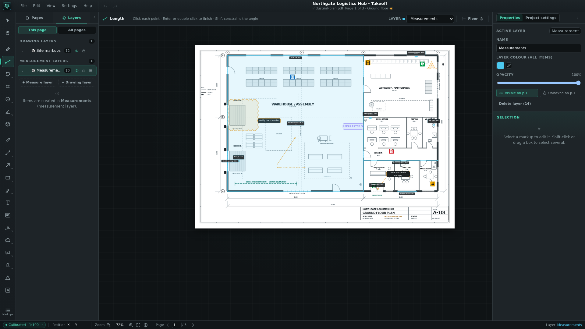
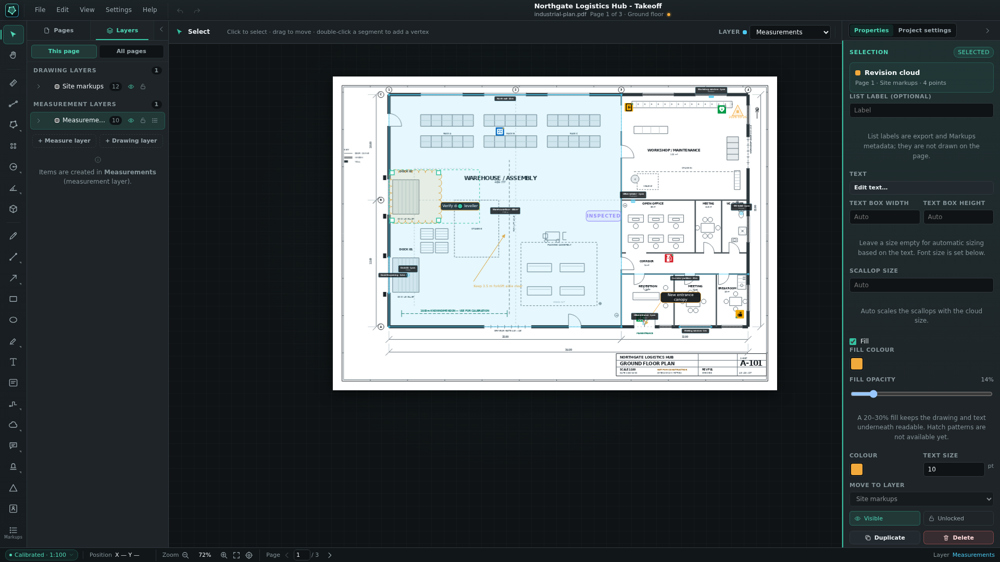
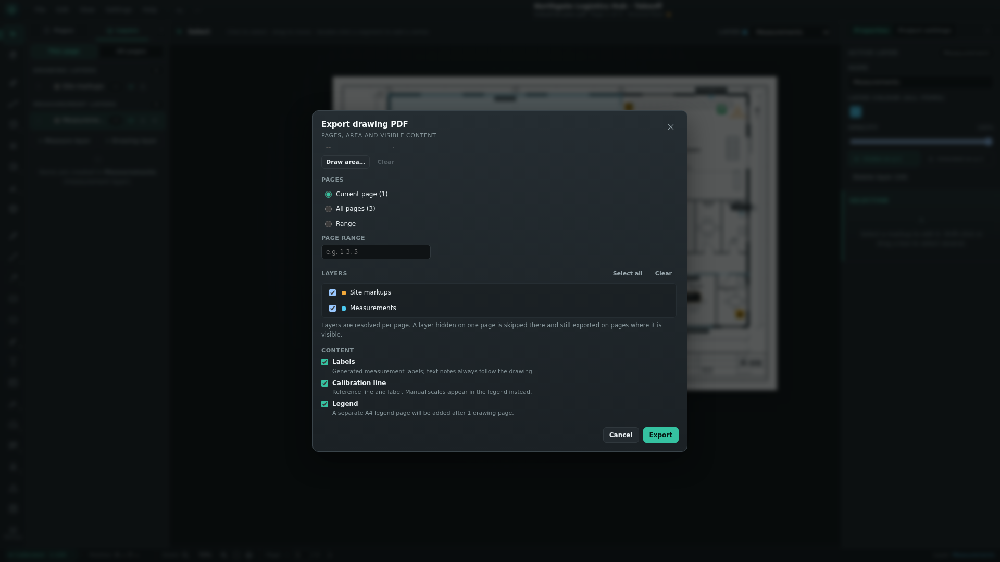
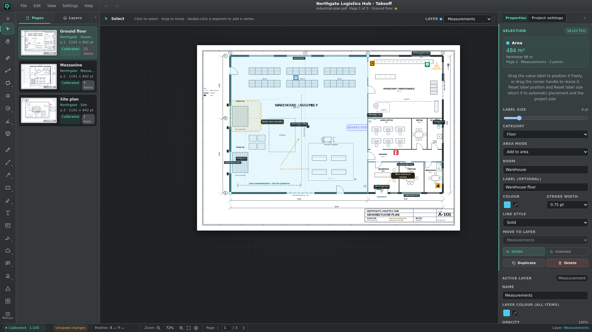
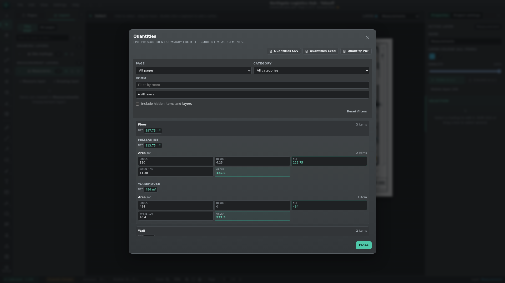
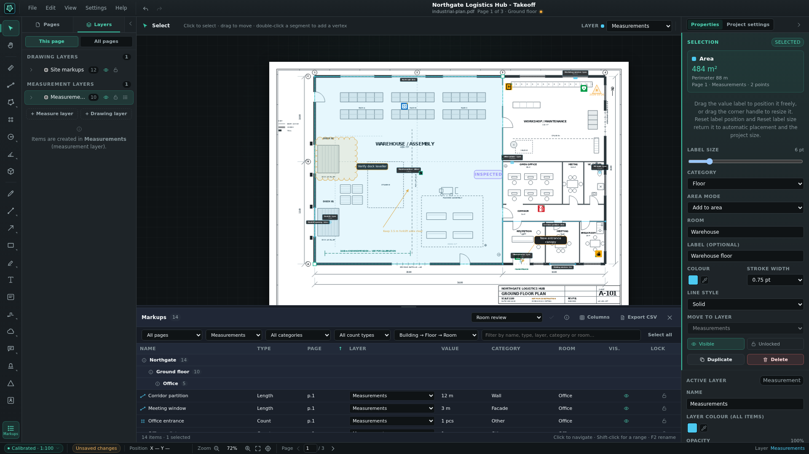

# Workflows

GridScalr is used for two closely related jobs: recording what is on a drawing, and turning those records into quantities. The tools are the same; the order and the output differ.

| Role | Typical output |
| --- | --- |
| Operations technician | A marked-up drawing PDF for a work order, inspection or deviation report |
| Technical property manager | A quantity takeoff with categories, rooms, waste and rounding for procurement |

Both workflows use the same local `.gridscalr` project. A drawing is never uploaded or overwritten.

## Operations technician

Use this workflow when you need to document a site visit, mark a deviation, or give a contractor a drawing with clear annotations.

### 1. Open and calibrate the drawing

1. Open the PDF or scanned TIF with **File → Open drawing…**.
2. Choose the pages you need in the page picker.
3. Calibrate page 1 against a known dimension, or enter the printed `1:N` scale from the page scale chip in the status bar.
4. Lock the scale if the drawing must not be recalibrated by mistake.

A calibrated page shows the scale in the status bar; hover the chip for the reference length and the exact mm per point.

The page cards show a badge when the drawing on disk no longer matches the project, and the filter bar above them narrows the list to **Changed source**, **Superseded**, **OCR missing or stale** or **Scale locked** pages. Check it before a site visit so you do not annotate an outdated sheet.

### 2. Measure what the job needs

Choose **Length** (`L`), **Area** (`A`) or **Count** (`C`). The context bar keeps the active measurement layer and the **New measurement** settings, so repeated measurements stay consistent. Check units and snapping in **Project settings**. On a touch screen, use one finger to draw and two fingers to pan or pinch-zoom; a pen takes priority over palm touches. Long-press an item for its context menu.

- Use Length for pipe runs, cable routes, skirting and other linear work.
- Use a rectangle or polygon area for floor, wall or ceiling areas.
- Use Count for doors, windows, radiators, fixtures and project-specific object types. Save the type, category, room and pieces as a preset when you repeat the same takeoff on several floors.
- Use the **Deduct** switch in the context bar for shafts, openings and other areas that should not be ordered.

Drag a measurement label to place it clear of nearby geometry, or drag its corner handle to resize the paper-space label. Right-click an area label and choose **Lock inside area** to keep it inside a small room; the size adapts to the room. **Reset label position** and **Reset label size** in Properties return it to automatic placement and the project size. Measurements capture the page scale when they are created. They stay usable if the page is recalibrated later, unless you deliberately update existing measurements.

### 3. Mark the deviation

Drawing tools live on drawing layers, separately from measurements. A practical site layer can contain:

- a revision cloud around the affected area;
- a callout with the action or observation;
- a status stamp such as **INSPECTED**, **NOT APPROVED** or a custom status;
- a text note and arrow for access, clearance or a temporary fix.

Right-click or long-press the Cloud, Callout, Stamp and Arrow tools to choose variants, colours and presets. Every object can still be hidden or locked individually without changing the layer.

### 4. Export the work order

1. Choose **File → Export → Drawing PDF…**.
2. Select the current page, all pages or a page range.
3. Choose whole pages or a selected crop area.
4. Include the visible layers, labels, calibration line and, when useful, a legend. For a recipient who reviews in another PDF reader, optionally enable **Optional layers (OCG)** or **Review annotations**. Both are off by default, keep the flattened drawing intact, and annotations are a review artifact rather than an editable project.
5. Save the file under a new name.

The source drawing is never modified. GridScalr also refuses to save an export over any source document in the project.

### Field checklist

- The page scale is correct and locked when appropriate.
- Measurements use the intended category and room.
- Deviations are on a drawing layer, not mixed into the measurement layer.
- Hidden layers and items are intentional; hidden content is excluded from every export.
- The exported PDF has the pages, labels and legend the contractor needs.

## Technical property manager

Use this workflow when the drawing set will become a quantity takeoff, budget or procurement list.

### 1. Build the drawing set

Add every floor or building part to one project. Select several pages in the page picker, or add a second PDF or TIF later with **Pages → Add pages…**.

If you need a page only for notes or sketches, add a blank A3 or A2 page with **Add pages… → Blank page** instead of importing a drawing.

New pages are appended after the existing pages by default. Existing page numbers and measurements do not move unless you reorder or delete a page.

If a drawing arrives later, drop the PDF or TIF on the page cards. The usual page picker and import preflight appear, the insertion line shows where the pages will land, and the whole import is one undo step. Drag a card, or press `Alt` + arrows, to put the sheets in drawing order; **Insert page before…** / **Insert page after…** in the page menu name the target first, and reorder and insert are each one undo step. **Move page to position…** moves the whole page selection to a chosen position. The status filter above the cards narrows the list to **Changed source**, **Superseded**, **OCR missing or stale** or **Scale locked** pages, and every button shows how many pages match. Dragging and dropping are disabled while a filter is active, because the drop position would be ambiguous, so choose **All** first.

Check the badges before a review. A **Source changed** page means the file on disk no longer matches the checksum in the project; resolve it with **Reload source** or **Use current source**, or map a reissued set with **Replace source…**. A **Superseded source** page was not mapped to the new file and still needs review or removal.

### 2. Calibrate and lock the scales

Calibrate a typical page, then use **Apply to all pages** when the whole set shares the same drawing scale. Apply copies the scale but not the lock and skips pages that are already locked.

Use **Lock scale** once the scale is verified. This prevents accidental recalibration during the takeoff.

### 3. Measure by category and room

Check the length and area units in **Project settings → Measurements → Units**. Set the project category and room from the **New measurement** button for each measurement. Room names autocomplete from names already used in the project.

- Measure gross floor area per room.
- Add deductions for shafts, openings and other non-orderable areas with the **Deduct** switch in the context bar.
- Measure wall, facade, roof and ground quantities in their own categories.
- Count doors, windows, radiators and fixtures as pieces, and use **Pieces per object** when one symbol represents several identical objects.
- Group Markups by **Count schedule** and use the count-type filter to review one object type at a time. The quantity report keeps a separate row per count type.

Use **Shift**/`Ctrl`/`Cmd`-click or a marquee to select several measurements, then apply one category, room, area mode, count type or count quantity in a single undoable action. Expand a layer in the Layers tab to check every item it contains; click an item to jump to it on the plan.

Nest layers into groups when a floor or discipline should hide and lock as a unit. Drag a layer onto the middle of another row of the same kind, or press `Alt` + `Right`; `Alt` + `Left` moves it back out. A hidden group hides and a locked group locks everything inside it, the inherited state is written on the row, and grouping never restacks the drawing. Deleting a group removes its whole subtree after a confirmation that names the nested layer and item counts.

### 4. Review quantities and order settings

Open **View → Quantities…** (`Ctrl/Cmd+Alt+Q`). Each row combines one category, room and measurement type and shows gross, deduction, net, waste and order quantity.

Set the project waste percentage and rounding step under **Settings → Project settings → Quantities**. A category can override either value under **Settings → Manage categories…**. Rounding always goes up and order quantity is never lower than net.

Measurements without a page scale are excluded and reported in the dialog. Hidden items and hidden layers are also excluded by default.

### 5. Export the procurement report

Before exporting, open **Settings → Project settings… → Report → Report metadata** and fill in the facility, client, project number, revision, author, date, report title and notes. **Choose logo…** embeds a PNG or JPEG inside the project file; the logo appears on the quantity PDF and in the Excel summary. These fields travel with the `.gridscalr` file and survive project packaging.

Use **Quantities CSV**, **Quantities to Excel…** or **Quantity PDF** in the Quantities dialog, or **File → Export**.

- CSV is intended for spreadsheet imports and simple procurement tools. It is UTF-8 with BOM and CRLF line endings. By default the delimiter and decimal mark follow the app language (Swedish uses semicolon and decimal comma; English uses comma and point). Choose **Interchange (RFC 4180)** in Preferences for commas and points in scripts and other tools.
- The Excel workbook is the usual handoff when the buyer wants to sort, filter or annotate the takeoff. It includes summary, category, room, page, markup and source-notes sheets, all derived from the same item data.
- The PDF report is A4 portrait with category sections, subtotals, totals, repeated headers and page numbers.
- Report headings and number formatting follow the selected interface language.

Reports always cover every page and every category. Dialog filters only affect the live summary, not the exported report.

### 6. Compare the revision before ordering

When the consultant sends a revised drawing, keep the current takeoff open and choose **File → Compare with revision…**. Select the previous `.gridscalr` file. The reference opens as a read-only session next to the current project. You can also press `Ctrl/Cmd+Shift+2` to open **View → Reference view (same page)**, choose **Revision** in the pane toolbar and use **Open…**.

- Use **Side by side** to check the geometry, or **Overlay** and the opacity slider to line up the revisions.
- Keep a detail sheet in the reference pane with its page controls while measuring on another sheet. **Follow primary** returns the reference pane to the current page; zoom and pan stay linked either way.
- Review **Changed**, **Added** and **Removed** in the panel. Click a row to jump to the item; added and removed items open their page in the reference pane.
- Read the warnings for page-count, drawing-name and scale differences before trusting the comparison.
- Choose **Export PDF** for a review file with page visuals, warnings and the difference table.

If only a new PDF drawing arrived, choose **File → Compare with drawing…** instead. A raw PDF reference still supports side-by-side, overlay, opacity and the comparison PDF with page visuals, but it has no markup list or difference table.

The reference is not merged and neither drawing is modified. Close the comparison when the review is done, or save the current project as the new working revision.

### 7. Keep the project reviewable

Use **View → Markups list…**, the **Markups** button at the bottom of the tool rail, or `Ctrl/Cmd+L` to search, select and navigate every item across all pages. Clicking a row zooms to that item with 25 % breathing room while keeping the whole sheet as the outer limit. The docked panel stays open while you jump between sheets and is the quickest way to check that a room or category has not been missed.

Use **Columns** to hide fields that are irrelevant to the current survey. Save the set-up as a **Markups view** so the same columns, filters and grouping return next time. Views are stored in the project file and can be opened by anyone working in it. **Group by → Building → Floor → Room** gives a property hierarchy once each page has a location from **Pages → right-click → Set location…**. Typical views are **Ventilation & Aggregat**, **Brandskydd & Utrymningsvägar**, and a drawing-only review for annotations.

For fire-safety rounds, ventilation surveys or equipment inventories, place built-in **symbols** from the **Symbol** tool. Symbols carry a category-coloured classic sign plate and an inspection status. Filter the Markups list to **Symbols**, show the **Status** column, and group by category to review everything that is missing, not approved or needs action. The status is included in the Markups CSV export.

Save the `.gridscalr` project next to the drawing set. If the project or drawings are moved together, GridScalr follows the stored relative paths. If a source PDF has moved, it asks you to locate it and verifies the checksum before continuing. The status bar shows saved/unsaved state and warns if a source drawing disappears or its checksum changes while the project is open; click the saved/unsaved chip for the last save and automatic backup times, the autosave interval, pending validation warnings, the recovery summary and the conflicted-copy count, with **Backup now**, **Review recovery…**, **Open project doctor…**, **Manage conflicted copies…** and the session pause action. **Project settings → Project → Project size and sources** lists the same source status and the source mode before you export.

### 8. Save safely across computers

GridScalr checks the project file on disk before every desktop save. If the file changed since it was opened, a conflict dialog appears instead of a silent overwrite.

- Choose **Save as conflicted copy** (the default) to keep both versions. The copy is written next to the project and the disk file stays untouched.
- Use **Compare with disk version** to open a read-only difference summary for the local and disk projects, including changed, added and removed markups and quantity fields. It never merges or writes.
- **Reload from disk** discards the in-memory changes and opens the newer file.
- **Overwrite** replaces the newer file with your version. Use it only when you are certain which copy is correct.
- A conflict is not a merge. Open the conflicted copy and import pages from the other project if both versions contain useful work.

When the same project is already open in another GridScalr window or on another computer, the desktop app shows the sidecar lock and offers **Open view-only** by default. Use it to inspect, search and export the current disk file without writing; every editing command is disabled. **Take over to edit** in the banner re-checks the lock and only enables editing when no live window still owns the project. **Take over** at open is for the case where the other session has finished or crashed; it writes a new lock, and the old session becomes view-only or gets a save conflict on its next write. A lock without a heartbeat for five minutes is stale and never blocks; **Clear stale lock** removes it. A **View-only** chip in the status bar and the banner mean a normal Save is refused; use **File → Save a copy…** to keep a copy.

If the project file changes outside the app while it is open, a non-blocking banner offers **Reload from disk**. Reload asks before discarding unsaved changes.

GridScalr also keeps scoped recovery snapshots, one per project and app instance, plus labelled checkpoints before page deletion, duplication, page import and paper changes. Open **Recovery center** on the welcome screen or **Settings → Preferences… → Data → Open recovery center…** to see every record grouped by project and instance, with its save time, size and base-version state. A snapshot labelled **based on an older file version** was taken from a different disk version; it opens only after a second confirmation. Use that path after a crash instead of copying a cloud file over a newer one.

GridScalr keeps between 2 and 10 rolling backups per project in the local app data folder (default 3, set in **Preferences → Data**); the limit applies from the next successful save. **File → Back up now…** writes one immediately. **File → Backup manager…** lists them with time, size and origin path: **Restore as copy** opens a backup as unsaved work, **Replace open project** binds it to the current path after a second confirmation and writes nothing until you save, and **Delete selected** / **Delete all** remove only the app-data copies. Backups are local to this computer and are never added to recent files or packages. Use **File → Save a copy…** or **Share project package…** when the backup must travel.

**File → Conflicted copies…** lists the copies written beside the project by **Save as conflicted copy**. **Open as project** loads one without touching the original, **Compare with open project** shows the read-only revision difference, and **Delete selected** removes one file after confirmation. The same manager is reachable from the project status popover.

Saving with no unsaved changes does not rewrite the file. In the browser fallback, Save downloads a file instead and cannot check the disk version.

### 9. Protect shared and cloud drawings

A drawing on a network share or in a cloud-synced folder can be replaced or moved by someone else. Keep the working geometry stable before you start measuring.

1. When GridScalr recommends **Copy drawing into project** during import, accept it for a shared or cloud source. Save the project first if GridScalr asks; the managed copy lives in `<project>.drawings/` next to the project file.
2. For an existing project, right-click the page and choose **Use managed copy**, or run **File → Consolidate drawings…** to copy every remaining referenced PDF in one checkpointed action.
3. If the original changes while the project is open, the source-changed banner offers **Reload**, **Use current**, **Relink** and **Copy into project**. Nothing is accepted automatically. **Use current** accepts the checksum without changing the working drawing; **Reload** re-reads the file; **Relink** finds a moved file and verifies its checksum.
4. If the page count changed, use **Replace source…** and map the pages. Do not relink and hope the pages still line up.
5. A managed copy protects against the original changing or moving, not against someone editing the copy. The checksum remains authoritative and a changed copy is reported the same way.
6. Use **Detach from source** when the copy is now the master and the original path no longer matters.
7. Share the project when it must travel: **File → Share project package…** writes one `.gridscalr.zip` with managed drawings included once and sender paths cleared. Sharing does not change the live source mode.

### Review checklist

- Every floor and source document is included.
- Scales are calibrated and locked where they should be.
- Rooms and categories match the procurement structure.
- Deductions are inside the correct room and category.
- Waste and rounding are deliberate.
- Report metadata, revision and logo match the recipient.
- Hidden content is intentional.
- The exported CSV, Excel workbook or PDF matches the reviewed quantities.
- When comparing revisions, the diff list and comparison PDF were checked before the new quantities were ordered.

## Recover a project split across two files

Use this when the same drawing set was edited in two `.gridscalr` files by mistake and each file has one correct sheet.

1. Open the project that should keep its page order and settings.
2. Save a copy before changing anything.
3. Choose **File → Import pages from project…** and pick the other file.
4. In the picker, select the corrected sheet. Check its page name and item count, then import it.
5. Review the **Import preflight** counts and the **Source files** list. Relink a missing PDF with **Relink…**; the replacement's page count and SHA-256 checksum are verified. If a file differs, choose **Use anyway** for that file or relink the correct copy — **Import pages** stays disabled until every change is confirmed. The summary beside the button shows the current missing and changed state. Cancel leaves both projects and the source files untouched.
6. If the old, incorrect version is still in the project, delete that page from the Pages tab. The other pages keep their stable IDs and measurements, so the corrected sheet takes the old position and the later displayed numbers move down by one.
7. Remove any empty page-scoped layers left behind by the deleted page from the Layers panel.
8. Check that the quantities, Markups list and drawing PDF still match the intended set before saving.

The import appends pages by default, so it never moves an existing page on its own. An explicit insertion position can place the imported pages at a chosen point. The source project is read-only. Imported pages keep optional provenance with the source project ID, source revision hash/size/mtime, source page ID, import time and app version. The import is one undo step, but deleting a page is a separate structural step and cannot be undone. Confirm the page numbers and quantities before deleting.

## Check a damaged project

A normal save validates the project first. Duplicate IDs, missing page or layer references, dangling categories, count types, line types, assets or logos, invalid page ranges and invalid image geometry are errors: the save stops and the **Project doctor** opens. Warnings such as stale OCR or invalid optional provenance are listed and can be accepted.

Use this when a project fails to open cleanly, a save is blocked, or someone sends a file after manual editing.

1. Read the **Load report** or **Project doctor** issue list. It names each problem by severity and entity and does not hide dropped data.
2. Choose **Open view-only** when you only need to inspect or export the original. Editing is disabled; **Save a copy…** keeps a copy.
3. Choose **Export diagnostics…** when the file must go to support. The text contains issue codes and counts only, never drawing content, labels or paths.
4. Filter the issue list by severity, entity kind or repair availability when the report is long. The filters only narrow the list; **Select all shown repairs** adds the repairs for the filtered issues only. Review the preview — it lists the duplicate renames and dangling references a repair would change, with before and after counts — tick the repair kinds you need and choose **Apply selected repairs**. Nothing is written yet.
5. Choose **Save repaired copy…** and save the copy in a new file. The original is never repaired in place and is never overwritten by a normal save while it is invalid.
6. Open the repaired copy, review the pages, quantities and source links, and use it for the next revision.

The doctor's **Sources** section checks every external drawing and reports it as available, missing or changed, and separates reference drawings from managed copies. **Relink…** reopens the relink flow for one drawing and **Copy into project** stores an available reference as a managed copy. A missing or changed drawing is a warning, never a reason to refuse the save. The same section lists files in the project's drawings folder that no document references, with a size total; select them, choose **Remove unused drawings…**, review the full list and confirm. A copy that is still referenced, or became referenced while the dialog was open, is never removed. The explicit action moves the files to the operating system trash when it is available, otherwise into a timestamped `.removed` folder beside the project, and the doctor reports that path. Source actions are disabled after an in-memory repair until you save the repaired copy.

The doctor cannot prove that a drawing is the right revision, that a quantity is commercially correct, or that every external file still exists. It protects the project's internal references and prevents a silent loss of pages, items or settings; it does not invent missing data.

## Related reference

- [Workspace lists](user-guide.md#workspace-lists)
- [Measure](user-guide.md#measure)
- [Draw and annotate](user-guide.md#draw-and-annotate)
- [Quantities](user-guide.md#quantities)
- [Save and export](user-guide.md#save-and-export)
