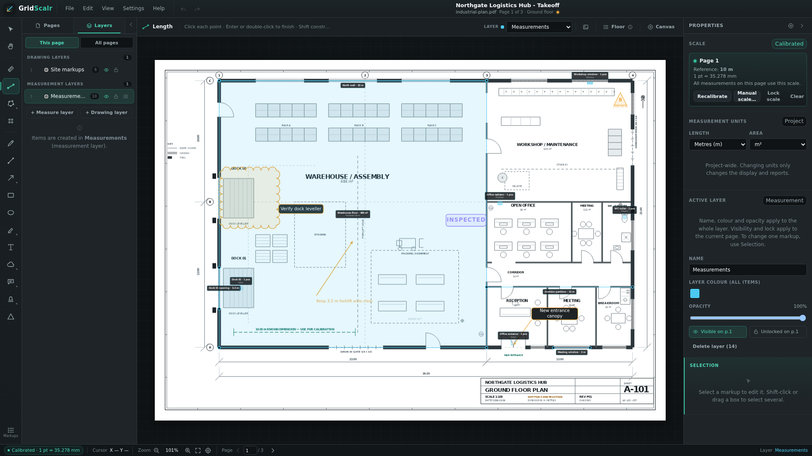
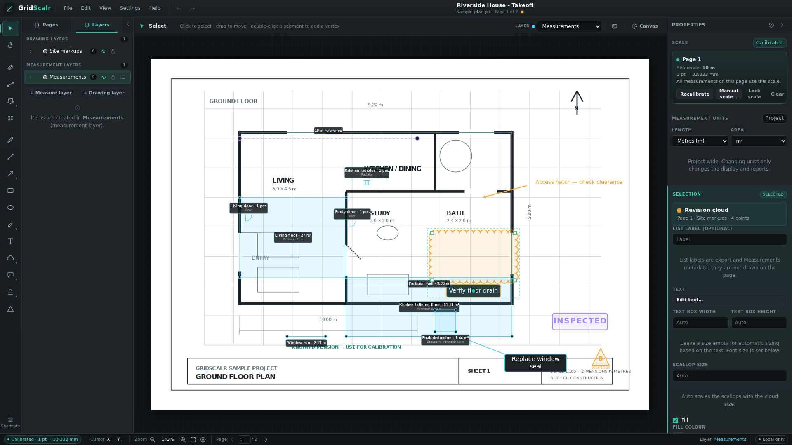
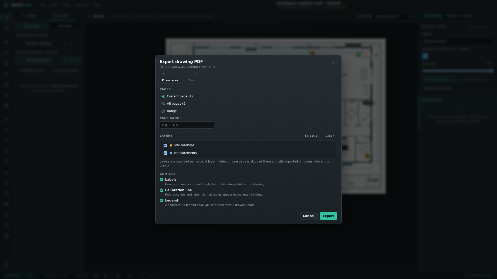
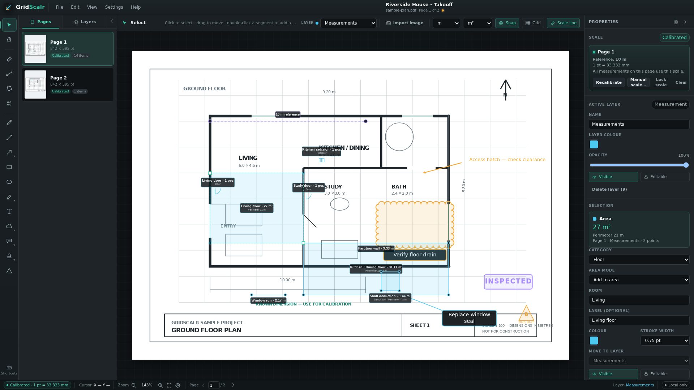
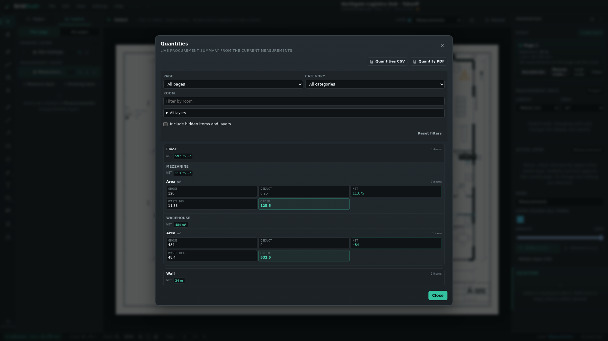
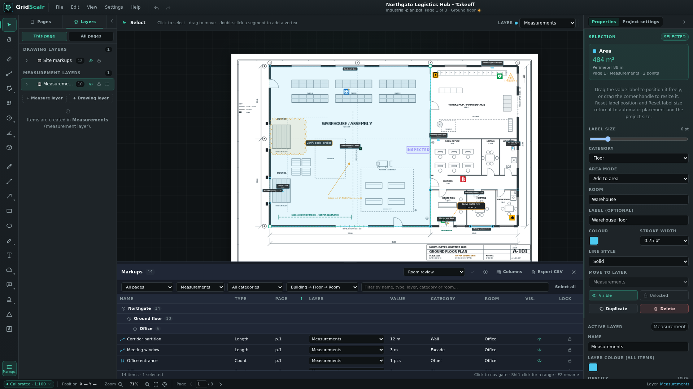

# Workflows

GridScalr is used for two closely related jobs: recording what is on a drawing, and turning those records into quantities. The tools are the same; the order and the output differ.

| Role | Typical output |
| --- | --- |
| Operations technician | A marked-up drawing PDF for a work order, inspection or deviation report |
| Technical property manager | A quantity takeoff with categories, rooms, waste and rounding for procurement |

Both workflows use the same local `.gridscalr` project. A drawing is never uploaded or overwritten.

## Operations technician

Use this workflow when you need to document a site visit, mark a deviation, or give a contractor a drawing with clear annotations.

### 1. Open and calibrate the drawing

1. Open the PDF or scanned TIF with **File → Open drawing…**.
2. Choose the pages you need in the page picker.
3. Calibrate page 1 against a known dimension, or enter the printed `1:N` scale from the page scale chip in the status bar.
4. Lock the scale if the drawing must not be recalibrated by mistake.

A calibrated page shows the scale in the status bar; hover the chip for the reference length and the exact mm per point.

### 2. Measure what the job needs

Choose **Length** (`L`), **Area** (`A`) or **Count** (`C`). The context bar keeps the active measurement layer and the **New measurement** settings, so repeated measurements stay consistent. Check units and snapping in **Project settings**.

- Use Length for pipe runs, cable routes, skirting and other linear work.
- Use a rectangle or polygon area for floor, wall or ceiling areas.
- Use Count for doors, windows, radiators, fixtures and project-specific object types.
- Use the **Deduct** switch in the context bar for shafts, openings and other areas that should not be ordered.

Drag a measurement label to place it clear of nearby geometry, or drag its corner handle to resize the paper-space label. Right-click an area label and choose **Lock inside area** to keep it inside a small room; the size adapts to the room. **Reset label position** and **Reset label size** in Properties return it to automatic placement and the project size. Measurements capture the page scale when they are created. They stay usable if the page is recalibrated later, unless you deliberately update existing measurements.

### 3. Mark the deviation

Drawing tools live on drawing layers, separately from measurements. A practical site layer can contain:

- a revision cloud around the affected area;
- a callout with the action or observation;
- a status stamp such as **INSPECTED**, **NOT APPROVED** or a custom status;
- a text note and arrow for access, clearance or a temporary fix.

Right-click or long-press the Cloud, Callout, Stamp and Arrow tools to choose variants, colours and presets. Every object can still be hidden or locked individually without changing the layer.

### 4. Export the work order

1. Choose **File → Export → Drawing PDF…**.
2. Select the current page, all pages or a page range.
3. Choose whole pages or a selected crop area.
4. Include the visible layers, labels, calibration line and, when useful, a legend.
5. Save the file under a new name.

The source drawing is never modified. GridScalr also refuses to save an export over any source document in the project.

### Field checklist

- The page scale is correct and locked when appropriate.
- Measurements use the intended category and room.
- Deviations are on a drawing layer, not mixed into the measurement layer.
- Hidden layers and items are intentional; hidden content is excluded from every export.
- The exported PDF has the pages, labels and legend the contractor needs.

## Technical property manager

Use this workflow when the drawing set will become a quantity takeoff, budget or procurement list.

### 1. Build the drawing set

Add every floor or building part to one project. Select several pages in the page picker, or add a second PDF or TIF later with **Pages → Add pages…**.

New pages are appended after the existing pages. Existing page numbers and measurements do not move unless you explicitly delete a page.

### 2. Calibrate and lock the scales

Calibrate a typical page, then use **Apply to all pages** when the whole set shares the same drawing scale. Apply copies the scale but not the lock and skips pages that are already locked.

Use **Lock scale** once the scale is verified. This prevents accidental recalibration during the takeoff.

### 3. Measure by category and room

Check the length and area units in **Project settings → Units**. Set the project category and room from the **New measurement** button for each measurement. Room names autocomplete from names already used in the project.

- Measure gross floor area per room.
- Add deductions for shafts, openings and other non-orderable areas with the **Deduct** switch in the context bar.
- Measure wall, facade, roof and ground quantities in their own categories.
- Count doors, windows, radiators and fixtures as pieces, and use **Pieces per object** when one symbol represents several identical objects.

Use **Shift**/`Ctrl`/`Cmd`-click or a marquee to select several measurements, then apply one category, room, area mode, count type or count quantity in a single undoable action. Expand a layer in the Layers tab to check every item it contains; click an item to jump to it on the plan.

### 4. Review quantities and order settings

Open **View → Quantities…** (`Ctrl/Cmd+Alt+Q`). Each row combines one category, room and measurement type and shows gross, deduction, net, waste and order quantity.

Set the project waste percentage and rounding step under **Settings → Project settings → Quantities**. A category can override either value under **Settings → Manage categories…**. Rounding always goes up and order quantity is never lower than net.

Measurements without a page scale are excluded and reported in the dialog. Hidden items and hidden layers are also excluded by default.

### 5. Export the procurement report

Use **Quantities CSV**, **Quantities to Excel…** or **Quantity PDF** in the Quantities dialog, or **File → Export**.

- CSV is intended for spreadsheet imports and simple procurement tools. It uses UTF-8 with BOM, comma separators and point decimals.
- The Excel workbook is the usual handoff when the buyer wants to sort, filter or annotate the takeoff. It includes summary, category, room, page, markup and source-notes sheets, all derived from the same item data.
- The PDF report is A4 portrait with category sections, subtotals, totals, repeated headers and page numbers.

Reports always cover every page and every category. Dialog filters only affect the live summary, not the exported report.

### 6. Compare the revision before ordering

When the consultant sends a revised drawing, keep the current takeoff open and choose **File → Compare with revision…**. Select the previous `.gridscalr` file. The reference opens as a read-only session next to the current project. You can also press `Ctrl/Cmd+Shift+2` to open **View → Reference view (same page)**, choose **Revision** in the pane toolbar and use **Open…**.

- Use **Side by side** to check the geometry, or **Overlay** and the opacity slider to line up the revisions.
- Review **Changed**, **Added** and **Removed** in the panel. Click a row to jump to the item.
- Read the warnings for page-count, drawing-name and scale differences before trusting the comparison.
- Choose **Export PDF** for a review file with page visuals, warnings and the difference table.

If only a new PDF drawing arrived, choose **File → Compare with drawing…** instead. A raw PDF reference still supports side-by-side, overlay, opacity and the comparison PDF with page visuals, but it has no markup list or difference table.

The reference is not merged and neither drawing is modified. Close the comparison when the review is done, or save the current project as the new working revision.

### 7. Keep the project reviewable

Use **View → Markups list…**, the **Markups** button at the bottom of the tool rail, or `Ctrl/Cmd+L` to search, select and navigate every item across all pages. Clicking a row zooms to that item with 25 % breathing room while keeping the whole sheet as the outer limit. The docked panel stays open while you jump between sheets and is the quickest way to check that a room or category has not been missed.

Use **Columns** to hide fields that are irrelevant to the current survey. Save the set-up as a **Markups view** so the same columns, filters and grouping return next time. Views are stored in the project file and can be opened by anyone working in it. **Group by → Building → Floor → Room** gives a property hierarchy once each page has a location from **Pages → right-click → Set location…**. Typical views are **Ventilation & Aggregat**, **Brandskydd & Utrymningsvägar**, and a drawing-only review for annotations.

For fire-safety rounds, ventilation surveys or equipment inventories, place built-in **symbols** from the **Symbol** tool. Symbols carry a category-coloured classic sign plate and an inspection status. Filter the Markups list to **Symbols**, show the **Status** column, and group by category to review everything that is missing, not approved or needs action. The status is included in the Markups CSV export.

Save the `.gridscalr` project next to the drawing set. If the project or drawings are moved together, GridScalr follows the stored relative paths. If a source PDF has moved, it asks you to locate it and verifies the checksum before continuing.

### Review checklist

- Every floor and source document is included.
- Scales are calibrated and locked where they should be.
- Rooms and categories match the procurement structure.
- Deductions are inside the correct room and category.
- Waste and rounding are deliberate.
- Hidden content is intentional.
- The exported CSV, Excel workbook or PDF matches the reviewed quantities.
- When comparing revisions, the diff list and comparison PDF were checked before the new quantities were ordered.

## Related reference

- [Measure](user-guide.md#measure)
- [Draw and annotate](user-guide.md#draw-and-annotate)
- [Quantities](user-guide.md#quantities)
- [Save and export](user-guide.md#save-and-export)
